<div align="center">


<br/>


### 🚆 Indian Railway Live Tracker + RailAI : Backend Service

[🌐 Live App](https://railway-tracking-frontend.vercel.app/) ·
[🎨 Frontend Repo](https://github.com/ashrithBalaji456/Railway_Tracking_Frontend) ·
[💻 Backend Repo](https://github.com/ashrithBalaji456/Railway_Tracking_Backend)

</div>

---

## 📑 Table of Contents

1. [Overview](#-overview)
2. [System Architecture](#-system-architecture)
3. [Tech Stack](#-tech-stack)
4. [Workflow Charts](#-workflow-charts)
5. [Data Charts](#-data-charts)
6. [Project Structure](#-project-structure)
7. [Environment Variables](#-environment-variables)
8. [Getting Started](#-getting-started)
9. [API Documentation](#-api-documentation)
10. [Deployment](#-deployment)
11. [Security Notes](#-security-notes)
12. [Roadmap & TODOs](#-roadmap--todos)

---

## 🌟 Overview

**RailTrack India Backend** (Maven artifact `railtracker`, described in `pom.xml` as *"Indian Railway Live Tracker + RailAI"*) is the REST API behind the RailTrack India web app.

It is responsible for:

| Capability | How it is provided |
|---|---|
| 🚉 Live train data | Calls the **RailRadar** API (`RAILRADAR_BASE_URL`) with an API key |
| 🤖 RailAI assistant | Calls Google's **Gemini** model through `GEMINI_API_URL` |
| 🔐 Authentication | **Spring Security** + **JWT** (jjwt 0.12.5) |
| 💾 Persistence | **PostgreSQL** via Spring Data JPA |
| ⚡ Caching / fast storage | **Redis** (optional, per `.env.example`) |
| 📖 API docs | **springdoc-openapi** Swagger UI |
| ❤️ Health & metrics | **Spring Boot Actuator** |

---

## 🏗 System Architecture

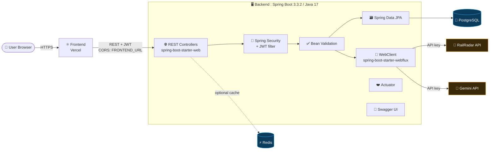

> ℹ️ The boxes inside the backend map to dependencies declared in `pom.xml`. The exact controller/service class names are in `src/` (see [TODOs](#-roadmap--todos)).

---

## 🧰 Tech Stack

| Layer | Technology | Version / Source |
|---|---|---|
| Language | Java | 17 (`pom.xml`) |
| Framework | Spring Boot | 3.3.2 (`pom.xml` parent) |
| Web | `spring-boot-starter-web` | managed by Boot |
| Reactive HTTP client | `spring-boot-starter-webflux` | managed by Boot |
| Security | `spring-boot-starter-security` | managed by Boot |
| Validation | `spring-boot-starter-validation` | managed by Boot |
| ORM | `spring-boot-starter-data-jpa` | managed by Boot |
| Cache / KV | `spring-boot-starter-data-redis` | managed by Boot |
| Monitoring | `spring-boot-starter-actuator` | managed by Boot |
| JWT | `jjwt-api / impl / jackson` | 0.12.5 |
| API docs | `springdoc-openapi-starter-webmvc-ui` | 2.5.0 |
| Database | PostgreSQL driver (runtime) | Docker image `postgres:16-alpine` |
| In-memory DB | H2 | declared in `pom.xml` (no scope set) |
| Testing | `spring-boot-starter-test`, `spring-security-test` | test scope |
| Build | Maven Wrapper (`mvnw`, `mvnw.cmd`) | included |
| Containers | Dockerfile + `docker-compose.yml` | included |

---

## 🔄 Workflow Charts

> 📌 **How to read these:** Diagrams 1, 2 and 6 are taken directly from `docker-compose.yml` / `.env.example`. Diagrams 3, 4 and 5 show the *standard flow implied by the declared dependencies*. Please verify them against your actual controllers and adjust endpoint names.

### 1️⃣ Docker Compose Startup Order

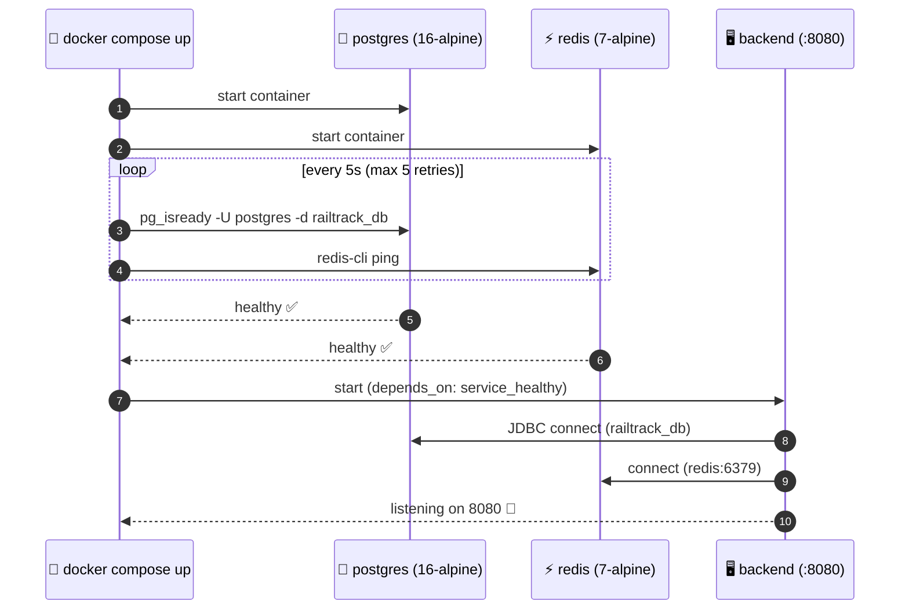

### 2️⃣ Container Network Topology

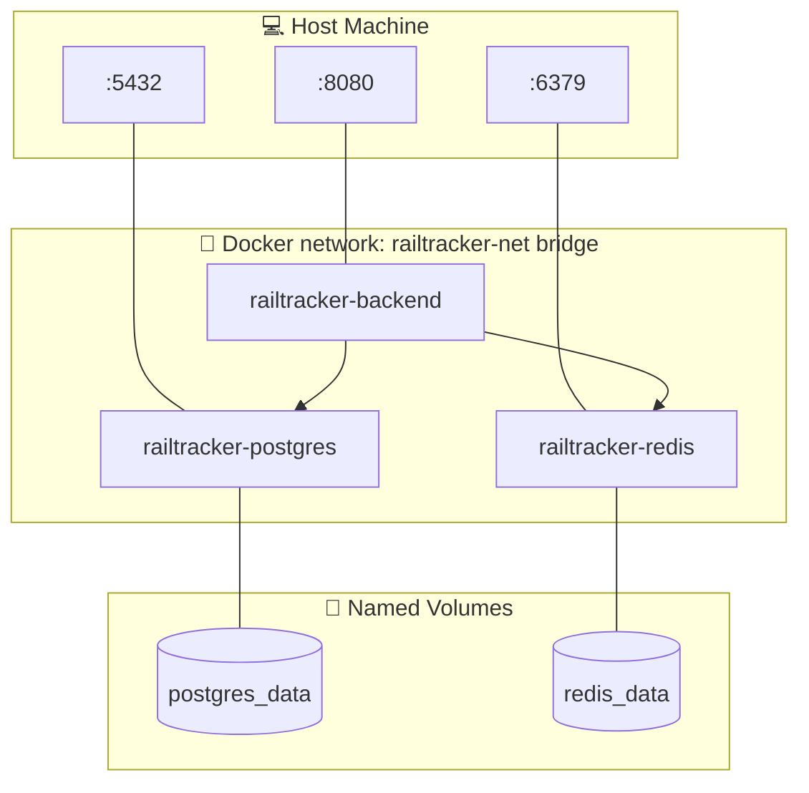

### 3️⃣ JWT Authentication Flow *(conceptual)*

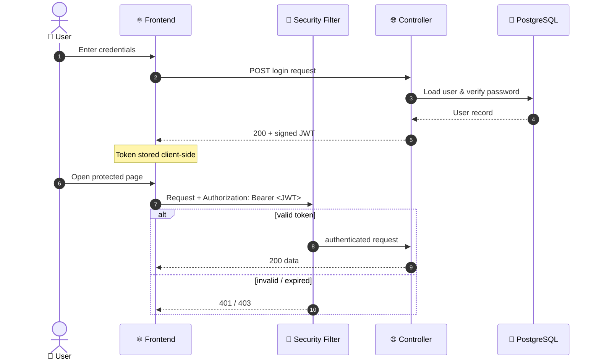

### 4️⃣ Live Train Tracking Flow *(conceptual)*

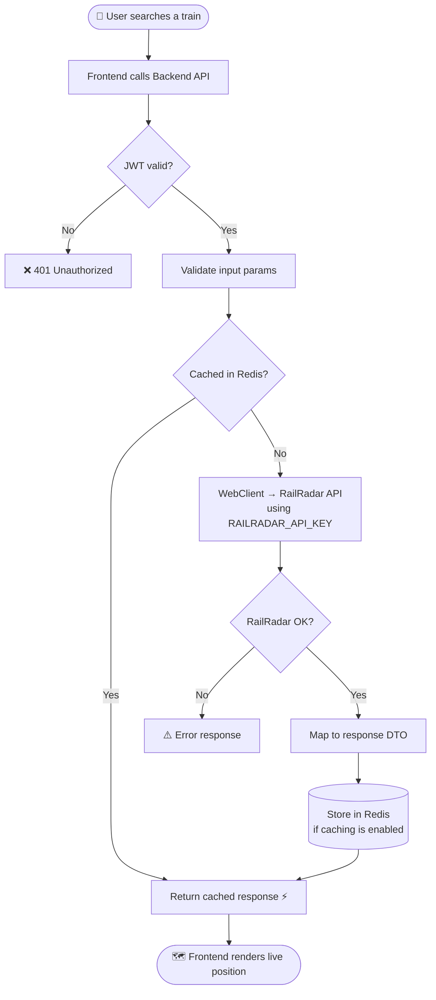

> Redis is marked *optional* in `.env.example`, so the cache branch may not be wired for every endpoint. Confirm in code.

### 5️⃣ RailAI (Gemini) Assistant Flow *(conceptual)*

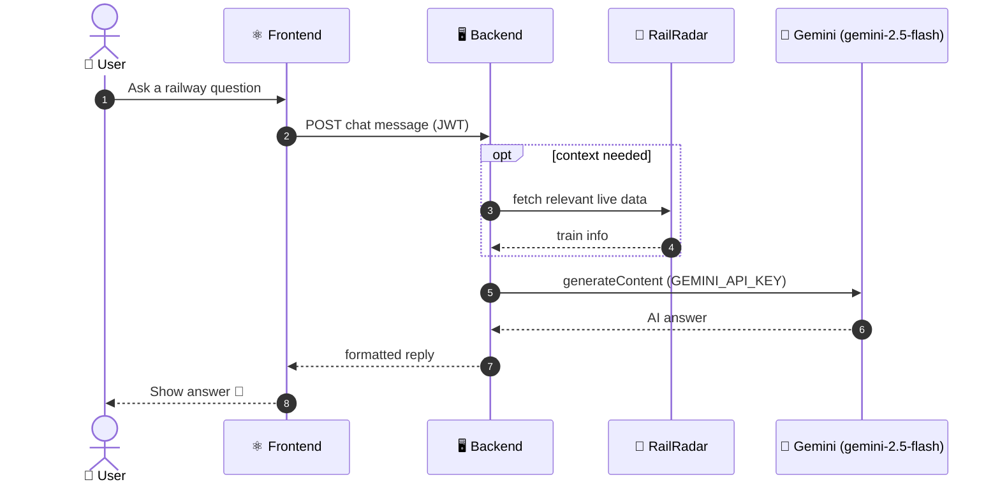

### 6️⃣ Configuration Resolution & Deployment Pipeline

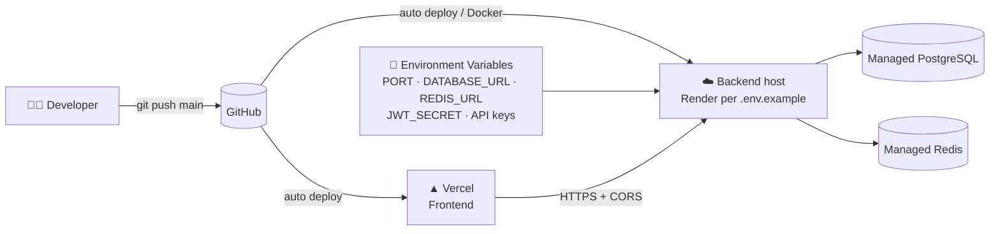

> The `.env.example` comments mention **Render**, so Render is shown as the backend host. If you deploy elsewhere, change this node.

---

## 📊 Data Charts

All numbers below were counted directly from the repository files, not estimated.

### 📦 `pom.xml` dependencies by category (15 total)

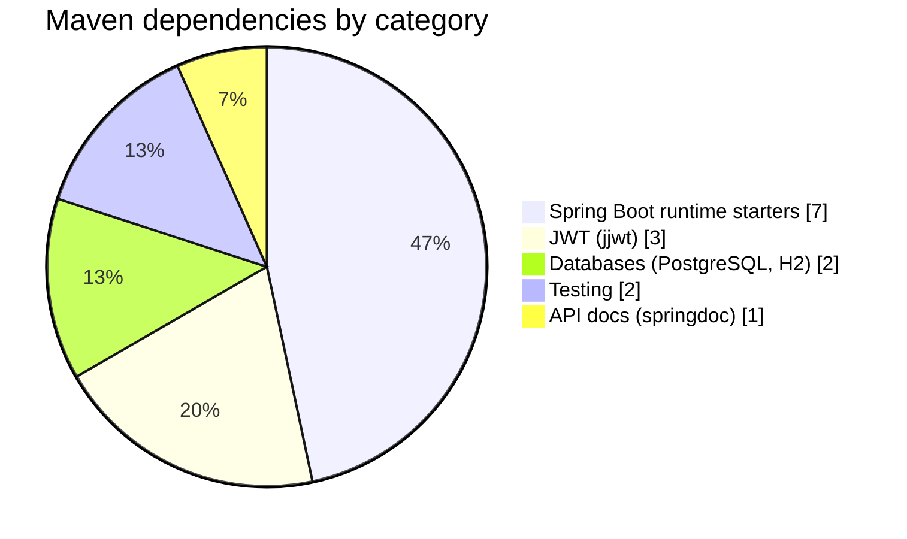

### 🔑 Environment variables by group (14 total)

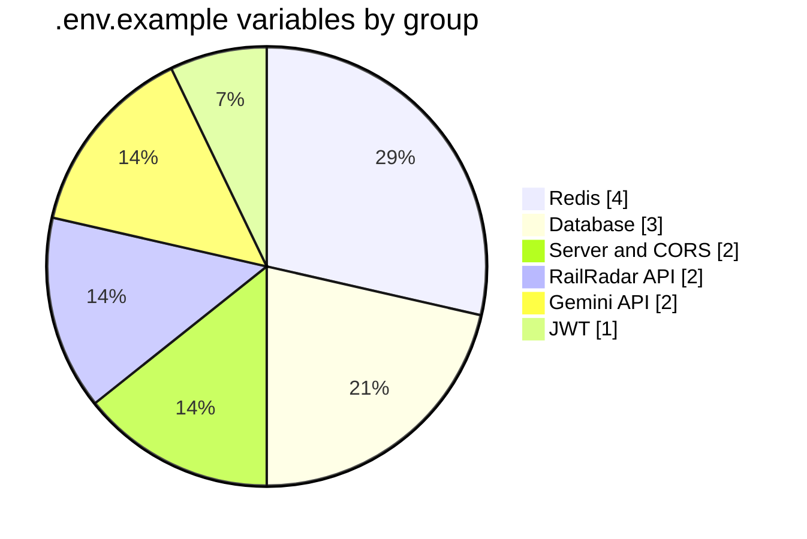

### 📈 Same data as a bar chart

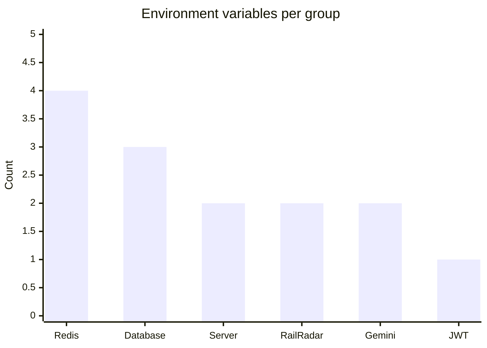

### 🐳 Docker Compose services

| Service | Image | Host Port | Health Check | Volume |
|---|---|---|---|---|
| `backend` | built from `Dockerfile` | `8080` | waits for DB + Redis healthy | none |
| `postgres` | `postgres:16-alpine` | `5432` | `pg_isready` every 5s, 5 retries | `postgres_data` |
| `redis` | `redis:7-alpine` | `6379` | `redis-cli ping` every 5s, 5 retries | `redis_data` |

### 🧩 Feature map

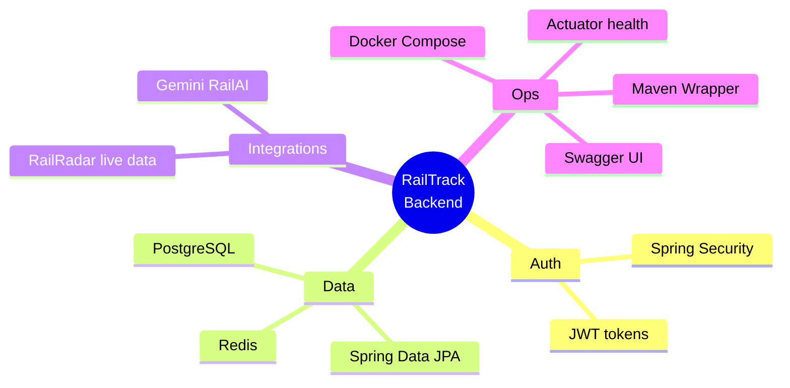

> 📉 **Not included on purpose:** language-percentage charts, commit-activity charts and API latency charts. I could not read that data, and inventing it would be misleading. Section [Roadmap & TODOs](#-roadmap--todos) explains how to add real ones.

---

## 📁 Project Structure

Root files confirmed from the repository:

```text
Railway_Tracking_Backend/
├── .mvn/wrapper/          # Maven wrapper config
├── src/                   # Application source (main + test)
├── .dockerignore
├── .env.example           # Environment variable template
├── .gitignore
├── Dockerfile
├── docker-compose.yml     # backend + postgres + redis
├── mvnw                   # Maven wrapper (Unix)
├── mvnw.cmd               # Maven wrapper (Windows)
├── pom.xml                # Spring Boot 3.3.2, Java 17
└── system.properties      # Platform runtime config
```

<!-- TODO: expand src/ tree (controller, service, repository, model, security, config) from your actual packages -->

---

## 🔑 Environment Variables

Copy `.env.example` and fill in your own values.

| Variable | Purpose | Notes |
|---|---|---|
| `PORT` | Server port | Default `8080` locally |
| `FRONTEND_URL` | Allowed CORS origins | Comma-separated, e.g. production + `http://localhost:5173` |
| `DATABASE_URL` | PostgreSQL connection | Accepts `postgres://…` or `jdbc:postgresql://…` |
| `DATABASE_USERNAME` | DB user | |
| `DATABASE_PASSWORD` | DB password | |
| `REDIS_URL` | Redis connection URL | Optional |
| `REDIS_HOST` | Redis host | Optional, default `localhost` |
| `REDIS_PORT` | Redis port | Optional, default `6379` |
| `REDIS_PASSWORD` | Redis password | Optional |
| `JWT_SECRET` | JWT signing key | Base64, minimum 256 bits |
| `RAILRADAR_API_KEY` | RailRadar auth | Required for live data |
| `RAILRADAR_BASE_URL` | RailRadar endpoint | `https://api.railradar.in/v1` in template |
| `GEMINI_API_KEY` | Gemini auth | Required for RailAI |
| `GEMINI_API_URL` | Gemini endpoint | Template uses `gemini-2.5-flash` |

---

## 🚀 Getting Started

### Prerequisites

- JDK **17**
- Docker + Docker Compose (for the one-command setup)
- A RailRadar API key and a Gemini API key

### Option A: Docker Compose (recommended)

```bash
git clone https://github.com/ashrithBalaji456/Railway_Tracking_Backend.git
cd Railway_Tracking_Backend

# provide your keys (compose reads these from your shell or a .env file)
export RAILRADAR_API_KEY=your_key
export GEMINI_API_KEY=your_key
export JWT_SECRET=$(openssl rand -base64 32)

docker compose up --build
```

The API will be available at `http://localhost:8080`.

### Option B: Run locally with Maven

```bash
cp .env.example .env     # then edit values
# make sure PostgreSQL (and optionally Redis) are running, then:
./mvnw spring-boot:run   # Windows: mvnw.cmd spring-boot:run
```

### Run tests

```bash
./mvnw test
```

---

## 📖 API Documentation

`springdoc-openapi-starter-webmvc-ui` 2.5.0 is installed, so interactive docs should be served at:

| Resource | Typical default path |
|---|---|
| Swagger UI | `http://localhost:8080/swagger-ui.html` |
| OpenAPI JSON | `http://localhost:8080/v3/api-docs` |
| Health | `http://localhost:8080/actuator/health` |

> ⚠️ These are the springdoc / Actuator defaults. Your security config or properties may change them, so please verify against the running app.

### Endpoint reference

| Module | Method | Path | Auth | Description |
|---|---|---|---|---|
| **Auth** | `POST` | `/api/v1/auth/register` | ❌ | User registration with username, email, password |
| **Auth** | `POST` | `/api/v1/auth/login` | ❌ | User login returning JWT Bearer token |
| **Auth** | `GET` | `/api/v1/auth/me` | ✅ | Current authenticated user profile |
| **Trains** | `GET` | `/api/v1/trains` | ❌ | Search trains by name or number |
| **Trains** | `GET` | `/api/v1/trains/{trainNumber}` | ❌ | Full train schedule & metadata |
| **Trains** | `GET` | `/api/v1/trains/{trainNumber}/live` | ❌ | Real-time GPS location, run status & delay |
| **Trains** | `GET` | `/api/v1/trains/{trainNumber}/route` | ❌ | Station-by-station route schedule |
| **Trains** | `GET` | `/api/v1/trains/{trainNumber}/delay` | ❌ | Historical delay analysis & punctuality grade |
| **Trains** | `GET` | `/api/v1/trains/{trainNumber}/fare` | ❌ | Class fare breakdown (1A, 2A, 3A, SL, etc.) |
| **Trains** | `GET` | `/api/v1/trains/between` | ❌ | Direct and alternative trains between station pair |
| **Stations** | `GET` | `/api/v1/stations` | ❌ | Station search & autocomplete |
| **Stations** | `GET` | `/api/v1/stations/{code}` | ❌ | Station metadata, platform & junction details |
| **Stations** | `GET` | `/api/v1/stations/{code}/trains` | ❌ | Station departure board trains |
| **Stations** | `GET` | `/api/v1/stations/{code}/live` | ❌ | Real-time station live board (2-8 hours ahead) |
| **Disruptions** | `GET` | `/api/v1/disruptions/exceptions` | ❌ | Active disruptions (cancelled, diverted, rescheduled) |
| **Disruptions** | `GET` | `/api/v1/disruptions/summary` | ❌ | Network disruption counts & category metrics |
| **Journey** | `GET` | `/api/v1/journey/plan` | ❌ | Direct & connecting multi-leg journey solver |
| **Journey** | `POST` | `/api/v1/journey/overlay` | ❌ | Historical delay overlay for journey legs |
| **RailAI** | `POST` | `/api/v1/ai/chat` | ❌ | Intelligent railway assistant powered by Gemini |
| **Bookmarks** | `GET` | `/api/v1/favorites` | ✅ | User saved favorite trains and stations |
| **Bookmarks** | `POST` | `/api/v1/favorites` | ✅ | Add new bookmark |
| **Bookmarks** | `DELETE` | `/api/v1/favorites/{id}` | ✅ | Remove bookmark |
| **Alerts** | `GET` | `/api/v1/alerts` | ✅ | User tracking alerts |
| **History** | `GET` | `/api/v1/history` | ✅ | Cloud-synced user search history |
| **System** | `GET` | `/actuator/health` | ❌ | Spring Boot Actuator health check |

---

## ☁️ Deployment

| Part | Where | Evidence |
|---|---|---|
| Frontend | Vercel | https://railway-tracking-frontend.vercel.app/ |
| Backend | Render (most likely) | wording in `.env.example` |
| Database | Managed PostgreSQL | `.env.example` |
| Cache | Managed Redis (optional) | `.env.example` |

Set every variable from the table above in your host's dashboard. Make sure `FRONTEND_URL` includes the exact Vercel URL so CORS allows the browser.

---

## 🔒 Security Notes

- ⚠️ `docker-compose.yml` and `.env.example` both contain a **default `JWT_SECRET`** value. Anyone who reads the repo knows it. **Generate a new one for every real deployment** (`openssl rand -base64 32`).
- The compose file uses `postgres` / `postgres` as DB credentials. Fine for local dev, not for production.
- Never commit a real `.env`. `.gitignore` is present, but confirm `.env` is listed.
- Keep `RAILRADAR_API_KEY` and `GEMINI_API_KEY` server-side only.
- `h2` has no `<scope>` in `pom.xml`, so it ships in the runtime classpath. Consider `runtime` or `test` scope if it is only for tests.

---

## 🗺 Roadmap & TODOs

- [ ] Fill the **endpoint table** from Swagger
- [ ] Expand the **`src/` tree** with real package names
- [ ] Add an **ER diagram** once entities are confirmed
- [ ] Add a **CI badge** after setting up GitHub Actions
- [ ] Add real **language / commit charts** with a generator, for example GitHub Insights or a stats-card service (verify availability first)
- [ ] Add a `LICENSE` file and a license badge

---

<div align="center">


Made with ☕ and 🚆 by **[ashrithBalaji456](https://github.com/ashrithBalaji456)**

⭐ Star the repo if it helped you.

</div>
