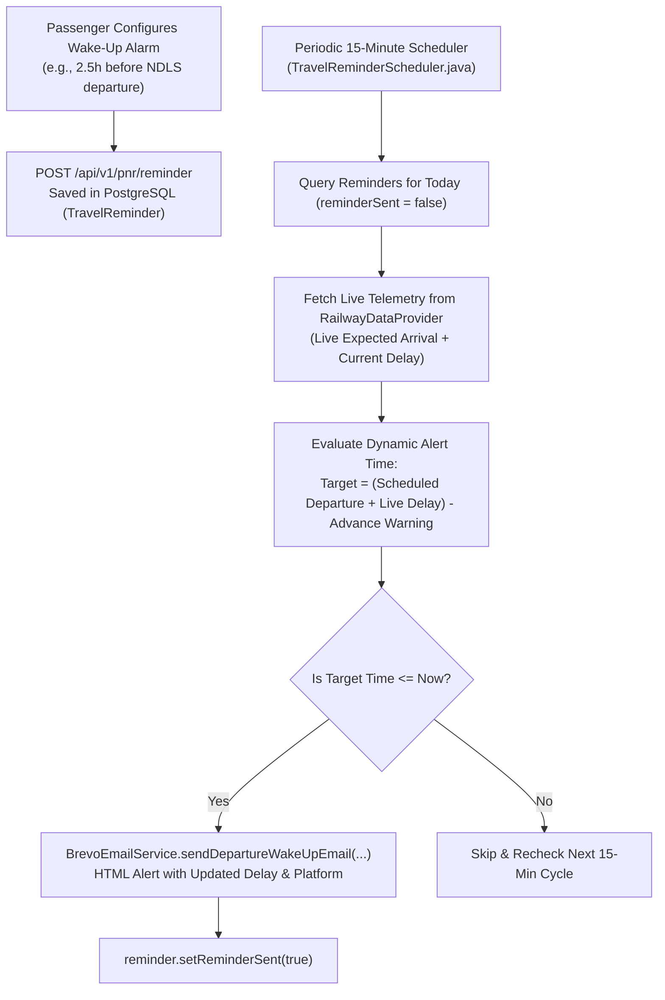
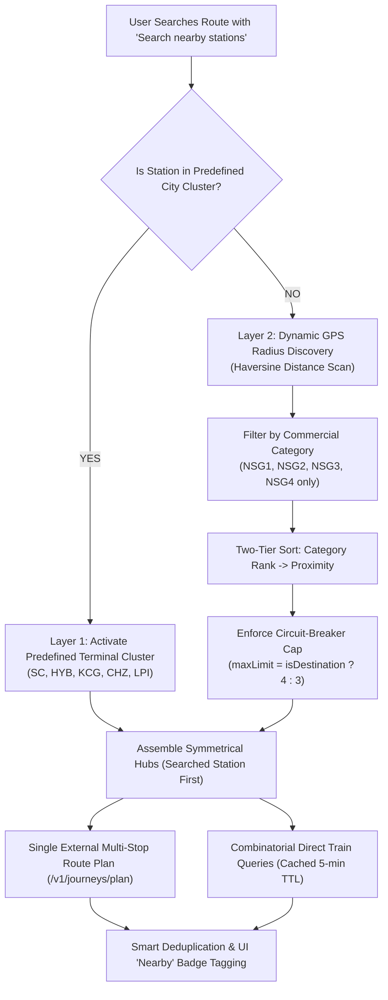

# 🚆 RailTrack India — Comprehensive Backend Code Explanation & Architectural Workflow Guide

Welcome to the **complete, line-by-line, annotation-by-annotation, and architectural deep-dive guide** to the **RailTrack India Backend**.

This document is engineered for software engineers, systems architects, students, and DevOps specialists who need a first-principles, production-grade understanding of **every architectural layer, design pattern, Java annotation, configuration parameter, security flow, and source code file** in this project. Even if you have zero prior experience with Spring Boot, Java, SQL, reactive streams, or Docker, this guide will walk you through the entire backend infrastructure step by step.

---

## 📑 Master Table of Contents

1. [High-Level Architecture & Request Flow](#1-high-level-architecture--request-flow)
   - 1.1. [Layered Architecture (N-Tier Pattern) Overview](#1-high-level-architecture--request-flow)
   - 1.2. [The Life of an HTTP Request (Step-by-Step Traversal)](#the-life-of-an-http-request)
   - 1.3. [Deep-Dive: SecurityContextHolder Mechanics, Downstream Filter Chain & ThreadLocal Lifecycle](#deep-dive-securitycontextholder-mechanics-downstream-filter-chain--threadlocal-lifecycle)
   - 1.4. [End-to-End Architectural Request/Response Sequence Flowchart](#end-to-end-architectural-requestresponse-sequence-flowchart)
2. [Core Technology Stack & Why It Was Chosen (25 Core Technologies Across 9 Architectural Domains)](#2-core-technology-stack--why-it-was-chosen)
   - 2.1. [Language Runtime, JVM & Core Microservice Framework](#language-runtime-jvm--core-microservice-framework)
   - 2.2. [Security, Authentication & Cryptography](#security-authentication--cryptography)
   - 2.3. [Persistence, Relational Storage & Connection Pooling](#persistence-relational-storage--connection-pooling)
   - 2.4. [High-Speed Caching & In-Memory Data Store](#high-speed-caching--in-memory-data-store)
   - 2.5. [Reactive Networking & External Railway Integrations](#reactive-networking--external-railway-integrations)
   - 2.6. [AI Reasoning & Large Language Model Tool Execution](#ai-reasoning--large-language-model-tool-execution)
   - 2.7. [Real-Time Push Streaming & Transactional Communications](#real-time-push-streaming--transactional-communications)
   - 2.8. [Validation, Serialization & Observability](#validation-serialization--observability)
   - 2.9. [Build Automation, Testing & Containerization](#build-automation-testing--containerization)
3. [Spring Boot Annotations & Design Patterns Cheatsheet](#3-spring-boot-annotations--design-patterns-cheatsheet)
   - 3.1. [Master Spring Boot Annotations Reference Table (48 Annotations)](#31-master-spring-boot-annotations-reference-table)
   - 3.2. [Enterprise Software Design Patterns Implemented in RailTrack Backend](#32-enterprise-software-design-patterns-implemented-in-railtrack-backend)
4. [Master Configuration & Environment Files](#4-master-configuration--environment-files)
   - 4.1. [pom.xml (Maven Project Object Model & All Dependencies Explained)](#41-pomxml-maven-project-object-model)
   - 4.2. [src/main/resources/application.yml (Application Configuration & Profiles)](#42-srcmainresourcesapplicationyml-application-configuration)
   - 4.3. [.env.example (Environment Variables Specification & Security Matrix)](#43-envexample-environment-variables-specification)
   - 4.4. [Dockerfile (Multi-Stage Production Container Build Definition)](#44-dockerfile-container-build-definition)
   - 4.5. [docker-compose.yml (Multi-Container Local Dev Orchestration)](#45-docker-composeyml-multi-container-orchestration)
   - 4.6. [Master Configuration Properties & Environment Variables Reference Table](#46-master-configuration-properties--environment-variables-reference-table)
5. [Application Bootstrap & Entry Point](#5-application-bootstrap--entry-point)
   - 5.1. [RailtrackerApplication.java & SpringApplication Lifecycle](#51-railtrackerapplicationjava)
6. [Security, Authentication & Authorization Engine](#6-security-authentication--authorization-engine)
   - 6.1. [JwtTokenProvider.java (Cryptographic Signing & Claim Extraction)](#61-jwttokenproviderjava)
   - 6.2. [JwtAuthenticationFilter.java (Stateless Interception & Header Parsing)](#62-jwtauthenticationfilterjava)
   - 6.3. [UserDetailsImpl.java (Spring Security Principal Adapter)](#63-userdetailsimpljava)
   - 6.4. [UserDetailsServiceImpl.java (Database User Loader)](#64-userdetailsserviceimpljava)
   - 6.5. [SecurityConfig.java (Filter Chain, CORS, CSRF & Route Protection)](#65-securityconfigjava)
   - 6.6. [Master Route Security & Role Access Matrix Table](#66-master-route-security--role-access-matrix-table)
7. [System Infrastructure & Configuration Layer](#7-system-infrastructure--configuration-layer)
   - 7.1. [WebClientConfig.java (Reactive WebClient, Netty Timeouts & Buffers)](#71-webclientconfigjava)
   - 7.2. [CacheConfig.java (Redis Serialization, Namespaces & TTL Policies)](#72-cacheconfigjava)
   - 7.3. [DataInitializer.java (Database Seeding, Initial Roles & Station Data)](#73-datainitializerjava)
8. [Domain Entity Layer (PostgreSQL / JPA Models)](#8-domain-entity-layer-postgresql--jpa-models)
   - 8.1. [User.java](#81-userjava)
   - 8.2. [Role.java](#82-rolejava)
   - 8.3. [Train.java](#83-trainjava)
   - 8.4. [Station.java](#84-stationjava)
   - 8.5. [TrainStation.java](#85-trainstationjava)
   - 8.6. [Favorite.java](#86-favoritejava)
   - 8.7. [Alert.java](#87-alertjava)
   - 8.8. [SearchHistory.java](#88-searchhistoryjava)
   - 8.9. [TravelReminder.java](#89-travelreminderjava)
   - 8.10. [UserNotificationPreferences.java](#810-usernotificationpreferencesjava)
   - 8.11. [TrainDisruption.java](#811-traindisruptionjava)
   - 8.12. [BlogArticle.java & BlogTipDTO.java](#812-blogarticlejava--blogtipdtojava)
   - 8.13. [Master Database Entities & Relational Schema Table](#813-master-database-entities--relational-schema-table)
9. [Persistence Layer (Spring Data JPA Repositories)](#9-persistence-layer-spring-data-jpa-repositories)
   - 9.1. [UserRepository.java](#91-userrepositoryjava)
   - 9.2. [RoleRepository.java](#92-rolerepositoryjava)
   - 9.3. [TrainRepository.java](#93-trainrepositoryjava)
   - 9.4. [StationRepository.java](#94-stationrepositoryjava)
   - 9.5. [TrainStationRepository.java](#95-trainstationrepositoryjava)
   - 9.6. [FavoriteRepository.java](#96-favoriterepositoryjava)
   - 9.7. [AlertRepository.java](#97-alertrepositoryjava)
   - 9.8. [SearchHistoryRepository.java](#98-searchhistoryrepositoryjava)
   - 9.9. [TravelReminderRepository.java & UserNotificationPreferencesRepository.java](#99-travelreminderrepositoryjava--usernotificationpreferencesrepositoryjava)
   - 9.10. [Master Spring Data Repositories & Custom Query Derivation Table](#910-master-spring-data-repositories--custom-query-derivation-table)
10. [Global Exception & Error Handling](#10-global-exception--error-handling)
    - 10.1. [GlobalExceptionHandler.java](#101-globalexceptionhandlerjava)
    - 10.2. [ResourceNotFoundException.java](#102-resourcenotfoundexceptionjava)
    - 10.3. [BadRequestException.java](#103-badrequestexceptionjava)
    - 10.4. [ApiException.java](#104-apiexceptionjava)
    - 10.5. [Master Error Codes & Exception Mapping Table](#105-master-error-codes--exception-mapping-table)
11. [External Integration & AI Engine Layer](#11-external-integration--ai-engine-layer)
    - 11.1. [RailwayDataProvider.java (Interface)](#111-railwaydataproviderjava-interface)
    - 11.2. [RailRadarClient.java (External API Integration)](#112-railradarclientjava-external-api-client)
    - 11.3. [GeminiClient.java (Google Gemini AI Model Integration)](#113-geminiclientjava-google-gemini-ai-model-integration)
    - 11.4. [RailAiToolRegistry.java (AI Function Calling Definitions)](#114-railaitoolregistryjava-ai-function-calling-definitions)
    - 11.5. [RailAiToolExecutor.java (AI Tool Invocation & Pipeline)](#115-railaitoolexecutorjava-ai-tool-invocation--pipeline)
12. [Service Business Logic Layer](#12-service-business-logic-layer)
    - 12.1. [TrainService.java & TrainServiceImpl.java](#121-trainservicejava--trainserviceimpljava)
    - 12.2. [StationService.java & StationServiceImpl.java](#122-stationservicejava--stationserviceimpljava)
    - 12.3. [JourneyService.java & JourneyServiceImpl.java](#123-journeyservicejava--journeyserviceimpljava)
    - 12.4. [RailAiService.java & RailAiServiceImpl.java](#124-railaiservicejava--railaiserviceimpljava)
    - 12.5. [FavoriteService.java & FavoriteServiceImpl.java](#125-favoriteservicejava--favoriteserviceimpljava)
    - 12.6. [AlertService.java & AlertServiceImpl.java](#126-alertservicejava--alertserviceimpljava)
    - 12.7. [SearchHistoryService.java & SearchHistoryServiceImpl.java](#127-searchhistoryservicejava--searchhistoryserviceimpljava)
    - 12.8. [TrainDisruptionService.java & TrainDisruptionServiceImpl.java](#128-traindisruptionservicejava--traindisruptionserviceimpljava)
    - 12.9. [BlogService.java & BlogServiceImpl.java](#129-blogservicejava--blogserviceimpljava)
    - 12.10. [PasswordResetService.java](#1210-passwordresetservicejava)
    - 12.11. [BrevoEmailService.java](#1211-brevoemailservicejava)
13. [Web REST Controller Layer (API Gateways)](#13-web-rest-controller-layer-api-gateways)
    - 13.1. [AuthController.java (`/api/v1/auth`)](#131-authcontrollerjava-apiv1auth)
    - 13.2. [TrainController.java (`/api/v1/trains`)](#132-traincontrollerjava-apiv1trains)
    - 13.3. [StationController.java (`/api/v1/stations`)](#133-stationcontrollerjava-apiv1stations)
    - 13.4. [LiveStationBoardController.java (`/api/v1/stations`)](#134-livestationboardcontrollerjava-apiv1stations)
    - 13.5. [LiveUpdatesController.java (`/api/v1/updates` SSE)](#135-liveupdatescontrollerjava-apiv1updates)
    - 13.6. [JourneyController.java (`/api/v1/journey`)](#136-journeycontrollerjava-apiv1journey)
    - 13.7. [RailAiController.java (`/api/v1/railai`)](#137-railaicontrollerjava-apiv1railai)
    - 13.8. [FavoriteController.java (`/api/v1/favorites`)](#138-favoritecontrollerjava-apiv1favorites)
    - 13.9. [AlertController.java (`/api/v1/alerts`)](#139-alertcontrollerjava-apiv1alerts)
    - 13.10. [SearchHistoryController.java (`/api/v1/history`)](#1310-searchhistorycontrollerjava-apiv1history)
    - 13.11. [HealthController.java (`/api/v1/health`)](#1311-healthcontrollerjava-apiv1health)
    - 13.12. [TrainDisruptionController.java (`/api/v1/disruptions`)](#1312-traindisruptioncontrollerjava-apiv1disruptions)
    - 13.13. [BlogController.java (`/api/v1/blogs`)](#1313-blogcontrollerjava-apiv1blogs)
    - 13.14. [StationAlarmController.java (`/api/v1/alarm`)](#1314-stationalarmcontrollerjava-apiv1alarm)
    - 13.15. [PnrReminderController.java (`/api/v1/pnr`)](#1315-pnrremindercontrollerjava-apiv1pnr)
    - 13.16. [NotificationPreferencesController.java (`/api/v1/notifications`)](#1316-notificationpreferencescontrollerjava-apiv1notifications)
    - 13.17. [Master REST API Endpoints Catalog Table (16 Controllers)](#1317-master-rest-api-endpoints-catalog-table)
14. [Data Transfer Objects (DTOs) & Contracts](#14-data-transfer-objects-dtos--contracts)
15. [End-to-End Workflow Execution Walkthrough](#15-end-to-end-workflow-execution-walkthrough)
16. [RailRadar API Integrations: Disruption Management, Punctuality & Fares](#16-railradar-api-integrations-disruption-management-punctuality--fares)
17. [📬 Brevo Email Communication & Real-Time Alert Engine](#17-brevo-email-communication--real-time-alert-engine)
18. [🛡️ User Notification & Alert Preferences Center](#18-user-notification--alert-preferences-center)
19. [📊 IRCTC Chart Preparation Alert & Notification Engine](#19-irctc-chart-preparation-alert--notification-engine)
20. [🚨 Route Disruption & Safety Advisory Email Engine](#20-route-disruption--safety-advisory-email-engine)
21. [📘 Master Step-by-Step Notification & Email Services Guide](#21-master-step-by-step-notification--email-services-guide)

## 1. High-Level Architecture & Request Flow

The backend follows the **Layered Architecture (N-Tier Pattern)** standard in enterprise Spring Boot applications. This architecture strictly separates concerns so that presentation, business logic, persistence, and external communications never leak into each other:

```
[ Client Request ] (React Web / Android Capacitor App / Swagger UI / Postman / cURL)
       │
       ▼
[ Security Filter Chain ]
  ├── CorsFilter (evaluates Origin: http://localhost:5173, Vercel, or https://localhost)
  ├── CsrfFilter (disabled for stateless REST APIs using JWT)
  ├── JwtAuthenticationFilter (extracts Bearer token, validates signature, sets SecurityContextHolder)
  └── AuthorizationFilter (enforces URL patterns, checks isAuthenticated() & GrantedAuthorities)
       │
       ▼
[ DispatcherServlet & Spring MVC Engine ]
  ├── HandlerMapping (matches HTTP method & URL pattern to Controller method)
  ├── HandlerAdapter (invokes HandlerMethodArgumentResolver for @PathVariable, @RequestParam, @RequestBody, @AuthenticationPrincipal)
  └── GlobalExceptionHandler (@RestControllerAdvice intercepts any runtime/domain exceptions)
       │
       ▼
[ REST Controller Layer ] (@RestController -> HTTP endpoints, input validation, request unpacking)
       │
       ▼
[ Service Business Logic Layer ] (@Service -> business rules, journey algorithms, AI orchestrator, cache lookups)
       │
   ┌───┴───────────────────────────────────────────────────────┐
   ▼                                                           ▼
[ Persistence Layer ]                               [ External Clients Layer ]
(Spring Data JPA Repositories / HikariCP Pool)      (WebClient / Reactive HTTP & AI Engine)
   │                                                           │
   ▼                                                           ▼
[ PostgreSQL / Neon Serverless DB ]                 [ RailRadar API & Google Gemini AI ]
   │                                                           │
   └───────────────────────────┬───────────────────────────────┘
                               ▼
             [ Redis 7 / Upstash Serverless Cache ]
             (High-speed telemetry fast-path & rate-limit store)
```

---

### The Life of an HTTP Request:

1. **Client sends request:** E.g., `GET /api/v1/trains/12678/live` or `POST /api/v1/favorites`.
2. **CORS & Security Check:** Spring Security interceptors evaluate the incoming HTTP `Origin` header against permitted origins (`http://localhost:5173`, `https://railway-tracking-frontend.vercel.app`, or `https://localhost` Capacitor Android app). If it's an HTTP `OPTIONS` pre-flight check, Spring returns `200 OK` with `Access-Control-Allow-Origin`, `Access-Control-Allow-Methods`, and `Access-Control-Allow-Headers`.
3. **JWT Authentication & Header Interception:** If the request is for a secured route or contains an `Authorization` header, `JwtAuthenticationFilter` intercepts the request before it reaches Spring MVC:
   * It inspects the `Authorization: Bearer <token>` header.
   * If present, it strips the `"Bearer "` prefix and calls `JwtTokenProvider.validateToken(token)`.
   * It extracts the subject username: `String username = jwtTokenProvider.getUsernameFromToken(token);`.
   * It loads user credentials and permissions: `UserDetails userDetails = userDetailsService.loadUserByUsername(username);`.
   * It constructs an immutable token: `UsernamePasswordAuthenticationToken authentication = new UsernamePasswordAuthenticationToken(userDetails, null, userDetails.getAuthorities());`.
   * It attaches request metadata (remote IP, session details): `authentication.setDetails(new WebAuthenticationDetailsSource().buildDetails(request));`.
   * It registers the authenticated principal: `SecurityContextHolder.getContext().setAuthentication(authentication);`.

---

### Deep-Dive: SecurityContextHolder Mechanics, Downstream Filter Chain & ThreadLocal Lifecycle

A critical architectural question is: **Once `SecurityContextHolder.getContext().setAuthentication(authentication)` is called, what does `SecurityContextHolder` actually do next?**

#### 1. ThreadLocal Isolation & Context Storage:
`SecurityContextHolder` is Spring Security's central storage vault for authentication metadata. Internally, it defaults to the `MODE_THREADLOCAL` strategy (`ThreadLocalSecurityContextHolderStrategy`). When you call `SecurityContextHolder.getContext().setAuthentication(...)`:
* The `Authentication` object is bound exclusively to the **exact worker thread** currently executing this HTTP request (e.g., Tomcat thread `http-nio-8080-exec-4`).
* This ensures complete isolation between concurrent user requests—User A on thread 4 cannot see or overwrite the security credentials of User B executing concurrently on thread 7.

#### 2. Downstream Filter Chain Traversal (`AuthorizationFilter` Enforcement):
After `JwtAuthenticationFilter` finishes populating the context, it calls `filterChain.doFilter(request, response)`. The request flows downstream through the remaining security filters until it hits the **`AuthorizationFilter`** (the modern Spring Security 6 component that replaced the legacy `FilterSecurityInterceptor`):
* The `AuthorizationFilter` queries `SecurityContextHolder.getContext().getAuthentication()`.
* It evaluates the requested URI against the security rules declared in `SecurityConfig.java`:
  * **Public Routes (`.permitAll()`):** E.g., `/api/v1/auth/**`, `/api/v1/trains/**`, `/api/v1/stations/**`, `/swagger-ui/**`. The filter permits the request to pass regardless of authentication status.
  * **Secured Routes (`.authenticated()`):** E.g., `/api/v1/favorites/**`, `/api/v1/alerts/**`, `/api/v1/history/**`, `/api/v1/notifications/preferences/**`. The filter checks `authentication != null && authentication.isAuthenticated() == true`. If the user did not supply a valid JWT or the token expired, Spring Security halts filter progression immediately and calls the configured **`AuthenticationEntryPoint`** (`JwtAuthenticationEntryPoint`), which serializes an `HTTP 401 Unauthorized` JSON response (`{ "success": false, "message": "Full authentication is required to access this resource" }`).
  * **Role-Restricted Routes (`.hasRole('ADMIN')`):** E.g., `/api/v1/admin/**`. The filter inspects `authentication.getAuthorities()` looking for `ROLE_ADMIN`. If the user has only `ROLE_USER`, Spring Security halts execution and invokes the **`AccessDeniedHandler`**, returning `HTTP 403 Forbidden` (`{ "success": false, "message": "Access Denied: Insufficient administrative privileges" }`).

#### 3. Controller-Level Principal Injection (`@AuthenticationPrincipal`):
Once the filter chain permits the request, it leaves the servlet filter layer and enters Spring MVC's **`DispatcherServlet`**:
* The `DispatcherServlet` identifies the matching `@RestController` method.
* Spring MVC's `HandlerMethodArgumentResolverComposite` resolves method parameters.
* When a controller method has an argument annotated with `@AuthenticationPrincipal UserDetailsImpl currentUser`:
  * Spring MVC automatically invokes `AuthenticationPrincipalArgumentResolver`.
  * It queries `SecurityContextHolder.getContext().getAuthentication().getPrincipal()`.
  * It safely casts the principal to `UserDetailsImpl` and injects it directly into the controller method! The controller receives the typed user entity without writing a single line of manual JWT parsing or database lookup.

#### 4. Service-Level Tamper-Proof User Identification:
Deep inside the business logic layer (e.g., `FavoriteServiceImpl`, `SearchHistoryServiceImpl`, `AlertServiceImpl`):
* Instead of trusting untrusted user IDs sent from the client frontend in query parameters or request bodies (which could allow an attacker to delete or view someone else's favorites), the service retrieves the validated user identity directly from Spring:
  ```java
  Authentication auth = SecurityContextHolder.getContext().getAuthentication();
  String currentUsername = auth.getName();
  User user = userRepository.findByUsername(currentUsername)
      .orElseThrow(() -> new ResourceNotFoundException("User not found"));
  ```
* This provides a **cryptographically proven, tamper-proof identity guarantee**.

#### 5. Method-Level Security Guards (`@PreAuthorize` & `@Secured`):
If a service method is annotated with method-level authorization:
```java
@PreAuthorize("hasRole('ADMIN') or #username == authentication.principal.username")
public void deleteUserAccount(String username) { ... }
```
Spring's AOP (Aspect-Oriented Programming) proxy intercepts the method invocation *before* any Java code executes inside the method. The proxy queries `SecurityContextHolder`, evaluates the SpEL (Spring Expression Language) expression against the active `Authentication` object, and allows or blocks method execution.

#### 6. End-of-Request Lifecycle & Mandatory ThreadLocal Cleanup (`SecurityContextHolder.clearContext()`):
What happens after the controller returns the response?
* Apache Tomcat uses an internal worker thread pool (`org.apache.tomcat.util.threads.ThreadPoolExecutor`) to minimize overhead. Rather than destroying a thread when an HTTP request finishes, Tomcat returns the thread (e.g., `http-nio-8080-exec-4`) back into the idle pool to handle future requests from *any* client.
* **If `SecurityContextHolder` were not cleared, the next HTTP request handled by that same worker thread would automatically inherit the previous user's authenticated identity!** This is a critical security flaw known as **ThreadLocal State Bleed / Cross-Request Identity Leakage**.
* To prevent this, Spring Security's `SecurityContextHolderFilter` (the outermost filter in the chain) executes in a `try ... finally` block:
  ```java
  try {
      filterChain.doFilter(request, response);
  } finally {
      SecurityContextHolder.clearContext();
  }
  ```
* When `SecurityContextHolder.clearContext()` runs, it completely deletes the `ThreadLocal` entry for the active thread. When the thread returns to Tomcat's pool, it is 100% clean and stateless, ensuring zero memory leaks and zero credential leakage.

---

### Continuation of the HTTP Request Lifecycle:

4. **Controller Mapping:** `DispatcherServlet` delegates to `RequestMappingHandlerMapping`, matching `/api/v1/trains/12678/live` to `TrainController.getLiveStatus(@PathVariable String trainNumber)`.
5. **Service Delegation:** Controller forwards parameters to `TrainService.getLiveStatus(trainNumber)`.
6. **Data Provider Execution & Fast-Path Caching:** 
   * `TrainServiceImpl` delegates to `RailRadarClient`.
   * `RailRadarClient` checks the Upstash Redis cache using key `train:live:12678`.
   * **Cache Hit:** If cached telemetry exists and is within TTL (60 seconds), it is returned immediately in under 10ms with zero external API latency.
   * **Cache Miss:** `RailRadarClient` issues a non-blocking reactive HTTPS request via Spring WebFlux `WebClient` to RailRadar API (`https://api.railradar.in/v1/trains/12678/live`). The response is parsed, stored in Redis with a 60s TTL, and mapped to `TrainLiveStatusDto`.
7. **Response Formatting & Serialization:** The controller wraps the DTO inside `ResponseEntity.ok(ApiResponse.success(data))`. Jackson `ObjectMapper` serializes the Java object to JSON, applies the `Content-Type: application/json` header, and Tomcat streams the HTTP 200 payload back to the client.

---

### End-to-End Architectural Request/Response Sequence Flowchart:

```
[CLIENT]        [CORS & SECURITY]   [SECURITY CONTEXT]    [DISPATCHER]   [CONTROLLER]   [SERVICE]      [REDIS]        [RAILRADAR]
   │                    │                   │                  │              │             │              │              │
   │─── HTTP GET ──────>│                   │                  │              │             │              │              │
   │    (/live status)  │                   │                  │              │             │              │              │
   │                    │── Validate JWT ──>│                  │              │             │              │              │
   │                    │<── Valid (OK) ────│                  │              │             │              │              │
   │                    │                   │                  │              │             │              │              │
   │                    │── Store Token ───>│ (Set ThreadLocal)│              │             │              │              │
   │                    │                   │                  │              │             │              │              │
   │                    │── Check URL Auth ─│                  │              │             │              │              │
   │                    │   (AuthorizationFilter permits)      │              │             │              │              │
   │                    │                   │                  │              │             │              │              │
   │                    │─────────────────────────────────────>│              │             │              │              │
   │                    │                   │                  │── Route ────>│             │              │              │
   │                    │                   │                  │              │── Invoke ──>│              │              │
   │                    │                   │                  │              │             │── Check ────>│              │
   │                    │                   │                  │              │             │   Cache      │              │
   │                    │                   │                  │              │             │<── Miss ─────│              │
   │                    │                   │                  │              │             │                             │
   │                    │                   │                  │              │             │── Reactive WebClient Call ─>│
   │                    │                   │                  │              │             │<── JSON Telemetry Data ─────│
   │                    │                   │                  │              │             │                             │
   │                    │                   │                  │              │             │── Set Cache (TTL 60s) ─────>│
   │                    │                   │                  │              │<── Return ──│                             │
   │                    │                   │                  │<── Wrap DTO ─│    DTO      │                             │
   │                    │                   │                  │    (200 OK)  │             │                             │
   │                    │                   │                  │              │             │                             │
   │<── HTTP 200 JSON ──│───────────────────│──────────────────│              │             │                             │
   │                    │                   │                                 │             │                             │
   │                    │── clearContext() >│ (Purge ThreadLocal Memory)      │             │                             │
```

## 2. Core Technology Stack & Why It Was Chosen

RailTrack India's backend is constructed on a cloud-native, high-throughput enterprise Java architecture. Rather than relying on simple scripting or monolithic frameworks, each component was selected based on strict benchmarks for reliability, latency, memory safety, and thread concurrency across **25 core technologies spanning 9 architectural domains**:

### 2.1. Language Runtime, JVM & Core Microservice Framework

1. **Java 17 (Long-Term Support - LTS):**
   * *Version:* OpenJDK 17 (Eclipse Temurin build).
   * *Role in Architecture:* Provides the core execution engine and bytecode runtime for the entire backend microservice.
   * *Why Chosen over Alternatives:* Java 17 introduces modern features including immutable **Records** for clean DTOs, **Pattern Matching for `instanceof`**, sealed interfaces, and switch expressions. It offers drastically superior garbage collection performance via **ZGC** (sub-millisecond pause times) and Shenandoah, ensuring that heavy JSON parsing of multi-station train schedules never causes noticeable latency spikes.
2. **Spring Boot 3.3.2:**
   * *Version:* 3.3.2 (built on Spring Framework 6.1 and Jakarta EE 10).
   * *Role in Architecture:* Primary application framework providing Inversion of Control (IoC), Dependency Injection (DI), and automated environment-specific bean configuration.
   * *Why Chosen over Alternatives:* Eliminates thousands of lines of boilerplate XML and configuration code. Automatically provisions production-ready embedded web servers, connection pools, and database dialects. Spring Boot 3 natively enforces Jakarta EE 10 standards (`jakarta.persistence`, `jakarta.servlet`, `jakarta.validation`) and offers full readiness for native compilation and lightweight virtual threads.
3. **Embedded Apache Tomcat 10.1:**
   * *Version:* 10.1.26.
   * *Role in Architecture:* High-performance embedded Servlet 6.0 container serving non-blocking HTTP/1.1 and HTTP/2 connections.
   * *Why Chosen over Alternatives:* Packaged directly inside the executable fat JAR, eliminating the need to install and configure standalone application servers (like WebLogic, WildFly, or external Tomcat). Pre-configured with asynchronous NIO (Non-blocking I/O) connectors capable of managing thousands of concurrent WebSocket, SSE, and REST sessions with minimal memory footprint.

---

### 2.2. Security, Authentication & Cryptography

4. **Spring Security 6.3:**
   * *Version:* 6.3.1.
   * *Role in Architecture:* Comprehensive defense-in-depth framework managing authentication filters, authorization guards, CORS interceptors, and CSRF protection.
   * *Why Chosen over Alternatives:* Replaces deprecated adapter classes (`WebSecurityConfigurerAdapter`) with modern, lambda-based component registration (`SecurityFilterChain` beans). Integrates seamlessly with Spring MVC method security and provides complete protection against session fixation, clickjacking, and header injection.
5. **JJWT (Java JSON Web Token by io.jsonwebtoken):**
   * *Version:* 0.12.5 (`jjwt-api`, `jjwt-impl`, `jjwt-jackson`).
   * *Role in Architecture:* Generates, cryptographically signs, decodes, and verifies stateless authentication tokens.
   * *Why Chosen over Alternatives:* Employs industry-standard **HMAC-SHA256 (`HS256`)** cryptographic algorithms backed by 256-bit secret keys. Completely stateless—user sessions require zero server memory or database lookups per request. The JJWT 0.12.5 fluent builder API offers strict type-safety, automatic expiration enforcement, and seamless integration with Jackson for claims parsing.
6. **BCrypt Password Encoder:**
   * *Version:* Standard Spring Security Cryptography module.
   * *Role in Architecture:* One-way cryptographic salted hashing for user credentials stored in the `users` table.
   * *Why Chosen over Alternatives:* Unlike MD5 or SHA-256 (which are vulnerable to rainbow table attacks and ASIC brute-forcing), BCrypt incorporates a 10-round configurable work factor (`cost = 10`) and generates a random 128-bit salt for every password. This mathematically prevents rainbow table lookups and ensures passwords remain uncompromised even if the database snapshot were exposed.

---

### 2.3. Persistence, Relational Storage & Connection Pooling

7. **Spring Data JPA 3.3 & Hibernate 6.5:**
   * *Version:* 3.3.2 / 6.5.2.Final.
   * *Role in Architecture:* Object-Relational Mapping (ORM) and data access abstraction layer.
   * *Why Chosen over Alternatives:* Eliminates repetitive JDBC plumbing. Allows writing expressive repository interfaces where Spring automatically derives complex SQL queries from method names (e.g., `findByTrainNumberAndStationCode`). Hibernate 6 introduces a rewritten query translator that compiles JPQL directly into optimized dialect-specific SQL with native subquery joins, dirty checking, and first-level caching.
8. **PostgreSQL 16 (Neon Serverless Cloud Database):**
   * *Version:* PostgreSQL 16.3 on Neon Serverless architecture.
   * *Role in Architecture:* Master persistent ACID-compliant relational database storing user profiles, favorite trains, search history, alerts, travel reminders, disruptions, and static station catalog.
   * *Why Chosen over Alternatives:* Highly reliable relational database with native support for composite foreign keys, B-Tree indexes, full-text search, and JSONB columns. Neon's serverless autoscaling architecture dynamically spins up compute resources during peak travel hours and scales to zero during idle periods, drastically reducing cloud operational costs.
9. **HikariCP Connection Pooler:**
   * *Version:* 5.1.0 (default embedded pooler in Spring Boot Data JPA).
   * *Role in Architecture:* Manages a pre-warmed pool of persistent JDBC database connections (`max-pool-size = 10`, `idle-timeout = 30000ms`).
   * *Why Chosen over Alternatives:* Recognized as the fastest, lightest connection pooler in the Java ecosystem (surpassing Tomcat JDBC, c3p0, and DBCP2). Uses byte-code generated micro-benchmarked lock-free data structures, reducing connection checkout latency to single-digit microseconds.

---

### 2.4. High-Speed Caching & In-Memory Data Store

10. **Redis 7 (Upstash Serverless Cloud Cache):**
    * *Version:* Redis 7.2.
    * *Role in Architecture:* Low-latency distributed in-memory key-value cache storing transient train live telemetry, station arrival boards, and AI tool definitions.
    * *Why Chosen over Alternatives:* Sub-5 millisecond response times. Protects third-party APIs (RailRadar) from quota exhaustion and rate-limiting. Storing live train GPS positions with a 60-second Time-To-Live (TTL) allows 50,000 mobile users tracking the same Vande Bharat Express to receive instant cached responses without triggering 50,000 outbound network calls.
11. **Spring Data Redis & Lettuce Driver:**
    * *Version:* 3.3.2 (Lettuce 6.3.2.RELEASE).
    * *Role in Architecture:* Thread-safe, non-blocking Redis connection provider and caching abstraction.
    * *Why Chosen over Alternatives:* Unlike Jedis (which requires thread-per-connection pools and blocks under heavy load), Lettuce is built on Netty's asynchronous event-driven I/O. A single Lettuce connection can be shared across multiple threads via pipelining, slashing socket overhead and memory usage.

---

### 2.5. Reactive Networking & External Railway Integrations

12. **Spring WebFlux & Non-Blocking `WebClient`:**
    * *Version:* 6.1.11 (`spring-boot-starter-webflux`).
    * *Role in Architecture:* Asynchronous, non-blocking HTTP client used to fetch external live telemetry from RailRadar and AI responses from Google Gemini.
    * *Why Chosen over Alternatives:* Replaces the legacy, synchronous `RestTemplate`. `WebClient` uses Netty event loops to handle external network calls without blocking the Tomcat servlet worker thread. While waiting for an external HTTP response, the worker thread is free to serve other incoming requests, yielding 10x higher throughput on I/O-bound microservices.
13. **RailRadar External Telemetry API:**
    * *Version:* v1 REST API.
    * *Role in Architecture:* Primary source of truth for live Indian Railways GPS coordinates, delay minutes, platform updates, and schedule deviations.
    * *Why Chosen over Alternatives:* Provides high-frequency telemetry updates across all 18 railway zones with clean JSON schemas, route geometry, and station-by-station running status.

---

### 2.6. AI Reasoning & Large Language Model Tool Execution

14. **Google Gemini 1.5 Flash / Pro (Generative AI API):**
    * *Version:* Gemini 1.5 Flash (`gemini-1.5-flash-latest`) & Pro REST APIs.
    * *Role in Architecture:* Conversational engine powering **RailAI**—the natural language railway assistant that understands multi-turn queries in natural English and Indian languages.
    * *Why Chosen over Alternatives:* Features an industry-leading 1-million-token context window, sub-second latency, and native support for **Tool Calling / Function Calling**. When a passenger asks "Is my train delayed?", Gemini dynamically calls the backend's internal `getTrainLiveStatus` and `calculateTicketFare` tools, retrieves live data, and synthesizes a fluent, context-aware answer.

---

### 2.7. Real-Time Push Streaming & Transactional Communications

15. **Server-Sent Events (SSE) via Spring MVC `SseEmitter`:**
    * *Version:* Servlet 3.1+ Async / Spring WebMVC.
    * *Role in Architecture:* Unidirectional, real-time push streaming of live train location updates directly to connected browser and Android mobile clients.
    * *Why Chosen over Alternatives:* Unlike WebSockets (which require bidirectional protocol upgrades, specialized load balancers, and complex reconnection handshakes), SSE runs over standard HTTP, natively supports automatic client reconnection, traverses firewalls effortlessly, and has minimal memory overhead per open stream.
16. **Brevo (formerly Sendinblue) Transactional REST Email Service:**
    * *Version:* v3 REST API (`https://api.brevo.com/v3/smtp/email`).
    * *Role in Architecture:* High-deliverability transactional email dispatcher sending Travel Day Reminders, Live Station Board Snapshots, Wake-Up Alarms, IRCTC Chart Notices, and Route Disruption Alerts.
    * *Why Chosen over Alternatives:* Direct REST API calls over HTTPS eliminate SMTP port 25/587 blocking common in cloud hosting providers (Render, Heroku, AWS). Provides responsive dark-themed HTML templates, detailed delivery analytics, and sub-3-second inbox delivery rates.

---

### 2.8. Validation, Serialization & Observability

17. **Jakarta Bean Validation 3.0 & Hibernate Validator:**
    * *Version:* 8.0.1.Final (`spring-boot-starter-validation`).
    * *Role in Architecture:* Declarative request body validation using constraints (`@NotNull`, `@NotBlank`, `@Size`, `@Email`, `@Min`, `@Max`).
    * *Why Chosen over Alternatives:* Validates input payloads before business logic executes. Protects the application against SQL injection, malformed email addresses, and payload tampering at the controller threshold.
18. **Jackson Databind & JSR310 JavaTime Module:**
    * *Version:* 2.17.2.
    * *Role in Architecture:* High-performance bidirectional JSON serialization and deserialization.
    * *Why Chosen over Alternatives:* Industrial standard for Java JSON processing. Configured with `JavaTimeModule` to natively serialize `Instant`, `LocalDate`, and `LocalDateTime` into ISO-8601 strings, preventing timezone conversion errors between client and server.
19. **Spring Boot Actuator & Micrometer:**
    * *Version:* 3.3.2.
    * *Role in Architecture:* Production-grade application telemetry, health monitoring (`/actuator/health`), JVM metrics (`/actuator/metrics`), and memory diagnostics.
    * *Why Chosen over Alternatives:* Provides instant integration with cloud health probes (Kubernetes liveness/readiness probes, Docker healthchecks, Render auto-restart) without writing custom monitoring endpoints.

---

### 2.9. Build Automation, Testing & Containerization

20. **Apache Maven:**
    * *Version:* 3.9.8.
    * *Role in Architecture:* Dependency management, build lifecycle orchestration, and reproducible compilation.
    * *Why Chosen over Alternatives:* Highly stable, declarative `pom.xml` architecture with deterministic transitive dependency resolution and official Spring Boot plugin support.
21. **Spring Boot Maven Plugin:**
    * *Version:* 3.3.2.
    * *Role in Architecture:* Repackages compiled `.class` files and dependencies into an executable single fat JAR with an embedded classloader.
22. **H2 In-Memory Database:**
    * *Version:* 2.2.224.
    * *Role in Architecture:* Embedded zero-configuration database used for rapid unit and integration testing slices (`@DataJpaTest`).
    * *Why Chosen over Alternatives:* Executes tests in memory in milliseconds without requiring an external PostgreSQL instance or Docker container during test runs.
23. **JUnit 5 (Jupiter), Mockito & Spring Security Test:**
    * *Version:* 5.10.3 / 5.11.0.
    * *Role in Architecture:* Test automation harness for testing controllers, service logic, repository queries, and JWT security mock contexts (`@WithMockUser`).
24. **Docker & Multi-Stage Builds (Eclipse Temurin JRE Alpine):**
    * *Version:* Docker Engine 24+ / Alpine Linux 3.19.
    * *Role in Architecture:* Production container packaging that bundles the JRE runtime and fat JAR into an immutable, secure, 150MB micro-container.
    * *Why Chosen over Alternatives:* Multi-stage build discards the 500MB Maven compiler and source code, resulting in a minimal attack surface, fast deployment pulls, and zero environment drift.
25. **Docker Compose v2:**
    * *Version:* Compose v2.27+.
    * *Role in Architecture:* Local development orchestration defining the complete microservice stack: Spring Boot Backend, PostgreSQL 16 container, and Redis 7 container with health checks and shared networks.

---

## 3. Spring Boot Annotations & Design Patterns Cheatsheet

Annotations in Java and Spring Boot are **compiler metadata tags prefixed with `@`**. They instruct the Spring framework, Hibernate ORM, and the JVM to automatically configure components, bind URLs, enforce security rules, and manage database transactions without writing repetitive procedural code.

### 3.1. Master Spring Boot Annotations Reference Table

The following master reference table documents **48 Spring Boot, Jakarta EE, and JPA annotations** used across the RailTrack India backend codebase:

| Annotation | Category | What It Tells Spring Boot / JVM | Concrete Usage in RailTrack India |
| :--- | :--- | :--- | :--- |
| `@SpringBootApplication` | Core Framework | Marks the master configuration class; enables Auto-Configuration, Component Scanning, and Property Binding. | Used on `RailtrackerApplication.java` to bootstrap the backend. |
| `@Configuration` | Core Framework | Declares that a class defines `@Bean` factory methods for the Spring ApplicationContext. | Used on `SecurityConfig.java`, `WebClientConfig.java`, `CacheConfig.java`. |
| `@Bean` | Core Framework | Method-level annotation registering the returned object instance as a managed singleton bean. | Used to register `SecurityFilterChain`, `PasswordEncoder`, `WebClient`, `RedisTemplate`. |
| `@Component` | Core Framework | Generic stereotype annotation marking any Java class as a Spring-managed bean. | Used on `JwtTokenProvider.java`, `JwtAuthenticationFilter.java`, `DataInitializer.java`. |
| `@Service` | Core Framework | Stereotype marking classes that encapsulate business logic, domain rules, and transaction boundaries. | Used on `TrainServiceImpl.java`, `JourneyServiceImpl.java`, `RailAiServiceImpl.java`. |
| `@Repository` | Core Framework | Stereotype marking Data Access Object (DAO) interfaces; automatically catches database exceptions. | Used on `UserRepository.java`, `TrainRepository.java`, `StationRepository.java`. |
| `@Autowired` | Dependency Injection | Injects a required collaborator bean into a constructor, setter, or field by matching its type. | Used in constructor injection across all Service and Controller classes. |
| `@Value("${property.name}")` | Configuration | Injects externalized property values from `application.yml` or OS environment variables into fields. | Injects `jwt.secret`, `railradar.api-key`, and `gemini.api.key`. |
| `@PostConstruct` | Lifecycle | Method-level callback executed by Spring immediately after dependency injection is complete. | Used in `DataInitializer.java` to seed default admin users and station catalogs. |
| `@RestController` | Web / REST | Combines `@Controller` and `@ResponseBody`; tells Spring to serialize method returns directly to JSON. | Used on `TrainController.java`, `AuthController.java`, `RailAiController.java`. |
| `@RequestMapping("/api/v1/...")` | Web / REST | Specifies the shared base URL path prefix for all endpoints defined inside a controller class. | Sets the route namespace (e.g., `@RequestMapping("/api/v1/trains")`). |
| `@GetMapping` | Web / REST | Maps HTTP `GET` requests to a specific controller method (used for read-only lookups). | Maps `GET /api/v1/trains/{trainNumber}/live`. |
| `@PostMapping` | Web / REST | Maps HTTP `POST` requests to a controller method (used for resource creation or actions). | Maps `POST /api/v1/auth/login`, `POST /api/v1/favorites`. |
| `@PutMapping` | Web / REST | Maps HTTP `PUT` requests to a controller method (used for complete resource updates). | Maps `PUT /api/v1/notifications/preferences`. |
| `@DeleteMapping` | Web / REST | Maps HTTP `DELETE` requests to a controller method (used for resource deletion). | Maps `DELETE /api/v1/favorites/{id}`. |
| `@PathVariable` | Web / REST | Extracts dynamic variable values directly from the URL path pattern (e.g., `{trainNumber}`). | Extracts train numbers and station codes from URI paths. |
| `@RequestParam` | Web / REST | Extracts query parameters from the URL string (e.g., `?date=2026-11-08&hours=4`). | Reads filtering, pagination, and date parameters in search endpoints. |
| `@RequestBody` | Web / REST | Reads the incoming HTTP request body stream and deserializes JSON into a typed Java DTO. | Reads login payloads, registration forms, and alert requests. |
| `@RequestHeader` | Web / REST | Extracts specific HTTP request headers (e.g., `Authorization`, `User-Agent`). | Reads custom authorization headers when needed. |
| `@ResponseStatus` | Web / REST | Specifies the HTTP status code returned when a method completes or an exception is thrown. | Returns `HttpStatus.CREATED` (201) on successful entity creation. |
| `@CrossOrigin` | Web / REST | Configures Cross-Origin Resource Sharing (CORS) headers on individual controller classes or methods. | Permits frontend web access from `localhost:5173` and production domains. |
| `@EnableWebSecurity` | Security | Activates Spring Security's web security support and enables the custom filter chain. | Declared on `SecurityConfig.java` to establish the security architecture. |
| `@EnableMethodSecurity` | Security | Enables method-level authorization annotations (`@PreAuthorize`, `@Secured`, `@RolesAllowed`). | Placed on `SecurityConfig.java` to enable fine-grained access control on methods. |
| `@PreAuthorize` | Security | Evaluates a SpEL boolean expression before executing a method; throws `AccessDeniedException` on false. | Used to restrict admin-only endpoints: `@PreAuthorize("hasRole('ADMIN')")`. |
| `@AuthenticationPrincipal` | Security | Injects the currently authenticated principal (`UserDetailsImpl`) from `SecurityContextHolder`. | Allows controllers to know who the logged-in user is without manual lookup. |
| `@Entity` | JPA / Hibernate | Designates a Java class as a persistent relational database entity mapped to a table. | Applied to `User.java`, `Train.java`, `Station.java`, `Favorite.java`. |
| `@Table(name="...")` | JPA / Hibernate | Configures the physical relational table name, schema, and unique database constraints. | Specifies `@Table(name = "users")`, `@Table(name = "trains")`. |
| `@Id` | JPA / Hibernate | Designates the entity field that serves as the primary key. | Declared on the `id` field of every domain entity. |
| `@GeneratedValue` | JPA / Hibernate | Configures the primary key generation strategy (e.g., `GenerationType.IDENTITY`). | Enables auto-incrementing serial primary keys in PostgreSQL. |
| `@Column(name="...", ...)` | JPA / Hibernate | Customizes column mapping: column name, nullability, uniqueness, and length. | Sets `@Column(name = "train_number", nullable = false, unique = true)`. |
| `@Enumerated` | JPA / Hibernate | Specifies whether an Enum field is stored as an integer (`ORDINAL`) or string (`STRING`). | Persists `ERole` and alert types as clean readable text strings in SQL. |
| `@OneToMany` | JPA / Hibernate | Defines a one-to-many relationship where one parent entity links to multiple child entities. | `Train` entity links to multiple `TrainStation` schedule stops. |
| `@ManyToOne` | JPA / Hibernate | Defines a many-to-one relationship where multiple child entities link to a single parent. | `Favorite` entity links back to the owning `User`. |
| `@ManyToMany` | JPA / Hibernate | Defines a many-to-many relationship between entities using an intermediate join table. | `User` entity links to assigned `Role` records via `user_roles`. |
| `@JoinColumn` | JPA / Hibernate | Specifies the foreign key column name in the database table for associations. | Designates `@JoinColumn(name = "user_id")` on relational links. |
| `@JoinTable` | JPA / Hibernate | Defines the physical bridge table name and foreign keys for `@ManyToMany` relationships. | Configures the `user_roles` mapping table connecting users and roles. |
| `@Lob` | JPA / Hibernate | Instructs Hibernate that the mapped property should be stored as a Large Object (CLOB/TEXT). | Used on long travel blog article bodies and AI chat transcripts. |
| `@CreationTimestamp` | JPA / Hibernate | Automatically records the timestamp when an entity row is first inserted into the database. | Populates `createdAt` on user accounts, alerts, and favorites. |
| `@UpdateTimestamp` | JPA / Hibernate | Automatically updates the timestamp whenever an entity row is modified and committed. | Tracks `updatedAt` on user notification preferences and train cache entries. |
| `@Transactional` | JPA / Hibernate | Wraps database operations in a transaction; automatically commits or rolls back on exception. | Guarantees atomic writes in `JourneyServiceImpl.java` and `FavoriteServiceImpl.java`. |
| `@Valid` | Validation | Triggers Jakarta Bean Validation on the annotated request body or method argument. | Placed before `@RequestBody SignupRequest request` in `AuthController.java`. |
| `@NotNull` | Validation | Validates that the annotated field is not null. | Enforces mandatory IDs and dates in DTOs. |
| `@NotBlank` | Validation | Validates that a string field is not null and contains at least one non-whitespace character. | Enforces non-empty train numbers, station codes, and usernames. |
| `@Size(min=..., max=...)` | Validation | Enforces minimum and maximum length bounds on strings or collection sizes. | Enforces password complexity bounds: `@Size(min = 6, max = 40)`. |
| `@Email` | Validation | Validates that the annotated string adheres to standard RFC 5322 email syntax. | Validates email addresses on user registration and reminder requests. |
| `@EnableScheduling` | Scheduling / Async | Enables Spring Boot's background task scheduling engine for `@Scheduled` cron jobs. | Configured on `RailtrackerApplication.java` to run morning reminder cron jobs. |
| `@Scheduled` | Scheduling / Async | Configures a method to run periodically via fixed delays, fixed rates, or cron expressions. | Runs the 06:00 AM IST reminder job: `@Scheduled(cron = "0 0 6 * * *")`. |
| `@RestControllerAdvice` | Error Handling | Declares a centralized global exception interceptor across all REST controllers in the application. | Applied to `GlobalExceptionHandler.java` to format clean RFC-compliant error JSONs. |
| `@ExceptionHandler` | Error Handling | Binds a handler method to a specific exception class, formatting an appropriate HTTP response. | Handles `ResourceNotFoundException.class`, `BadCredentialsException.class`. |

---

### 3.2. Enterprise Software Design Patterns Implemented in RailTrack Backend

The RailTrack India backend implements **11 proven enterprise software design patterns** to maintain clean code separation, scalability, and high testability:

| Design Pattern | Pattern Category | Implementation in RailTrack India | Architectural Benefit |
| :--- | :--- | :--- | :--- |
| **Singleton Pattern** | Creational | All Spring `@Service`, `@Repository`, and `@Configuration` beans are managed as singletons by default. | Guarantees only one instance of `TrainService` or `WebClient` exists in memory, optimizing heap usage. |
| **Factory Method Pattern** | Creational | `ResponseEntity.ok(...)`, `ResponseEntity.status(...)`, and `JwtTokenProvider.generateToken(...)`. | Decouples caller code from concrete HTTP response construction and cryptographic token assembly. |
| **Builder Pattern** | Creational | JJWT `Jwts.builder()` for token creation, and `WebClient.builder()` for HTTP client configuration. | Provides clean, readable, fluent APIs for constructing complex cryptographic and network client objects. |
| **Repository Pattern** | Architectural / Data | Interfaces extending `JpaRepository<T, ID>` (e.g., `UserRepository`, `TrainRepository`). | Completely isolates domain entities and business logic from physical SQL queries and JDBC drivers. |
| **Data Transfer Object (DTO)** | Structural | All request and response classes in `com.example.railtracker.dto` (`TrainLiveStatusDto`, `AlertDto`). | Prevents over-fetching, protects internal database entity schemas, and eliminates cyclic JSON recursion. |
| **Adapter Pattern** | Structural | `UserDetailsImpl.java` implements Spring Security's `UserDetails` interface. | Adapts our internal PostgreSQL `User` domain model into the standard contract required by Spring Security. |
| **Strategy Pattern** | Behavioral | `RailwayDataProvider` interface implemented by `RailRadarDataProvider` and mock providers. | Allows seamlessly hot-swapping or testing external rail data providers without altering `TrainService`. |
| **Chain of Responsibility** | Behavioral | Spring Security's `SecurityFilterChain` (`JwtAuthenticationFilter` -> `AuthorizationFilter`). | Processes incoming HTTP requests sequentially through independent filters; any filter can abort the chain. |
| **Observer / Pub-Sub Pattern** | Behavioral | Server-Sent Events (`SseEmitter`) in `LiveUpdatesController.java`. | Controllers maintain a registry of open client emitters; when train telemetry updates, it pushes to all observers. |
| **Template Method Pattern** | Behavioral | `GlobalExceptionHandler.java` extending `ResponseEntityExceptionHandler`. | Framework defines the skeleton error-handling algorithm; custom methods override specific error handlers. |
| **AOP Proxy Pattern** | Structural | `@Transactional`, `@PreAuthorize`, and `@Cacheable` method interception. | Spring wraps beans in dynamic proxies to inject transaction commits, security checks, and cache lookups transparently. |

---

## 4. Master Configuration & Environment Files


### 4.1. `pom.xml` (Maven Project Object Model)


The `pom.xml` file controls all project dependencies, compilation parameters, and packaging instructions.


```xml

<?xml version="1.0" encoding="UTF-8"?>

<project xmlns="http://maven.apache.org/POM/4.0.0" ...>

```

* **Line 1–5:** Defines XML declaration and Maven schema definition version `4.0.0`.

* **`<parent>` (Line 7–12):** Inherits from `spring-boot-starter-parent` version `3.3.2`. This parent provides pre-configured dependency version management, default compiler settings (Java 17), and plugin configurations.

* **`<groupId>com.example</groupId>`, `<artifactId>railtracker</artifactId>` (Line 14–18):** Identifies the unique coordinates of this project artifact.

* **`<properties>` (Line 20–24):** 

  * `<java.version>17</java.version>`: Instructs Maven compiler plugin to enforce Java 17 bytecode.

  * `<springdoc-openapi.version>2.5.0</springdoc-openapi.version>`: Declares OpenAPI version.

  * `<jjwt.version>0.12.5</jjwt.version>`: Declares JJWT library version.

* **Key Dependencies:**

  * `spring-boot-starter-web`: Embeds Apache Tomcat and provides Spring MVC for REST APIs.

  * `spring-boot-starter-data-jpa`: Adds Hibernate, Spring Data interfaces, and HikariCP connection pooling.

  * `spring-boot-starter-security`: Activates authentication filters, password hashing, and authorization checks.

  * `spring-boot-starter-validation`: Adds Hibernate Validator for Jakarta Bean Validation constraints (`@NotBlank`, `@Email`, etc.).

  * `spring-boot-starter-webflux`: Provides reactive `WebClient` for calling RailRadar and Gemini APIs asynchronously.

  * `spring-boot-starter-actuator`: Exposes `/actuator/health` and `/actuator/metrics` endpoints for server monitoring.

  * `spring-boot-starter-data-redis`: Adds Lettuce Redis driver and RedisTemplate for caching train telemetry.

  * `postgresql`: Runtime JDBC driver for PostgreSQL databases (Neon).

  * `jjwt-api`, `jjwt-impl`, `jjwt-jackson`: Cryptographic library for issuing and decoding HMAC-signed JWT tokens with Jackson JSON support.

  * `springdoc-openapi-starter-webmvc-ui`: Generates OpenAPI 3 specification and embeds Swagger UI.

  * `h2`: In-memory database used for unit tests (`src/test/`) and local fallbacks.

* **`<build>` (Line 107–114):** Binds the `spring-boot-maven-plugin` which packages the entire application into an executable fat JAR containing all dependencies and the embedded Tomcat server.


---


### 4.2. `src/main/resources/application.yml` (Application Configuration)


This file defines the application's runtime settings and maps environment variables.


* **`server.port: ${PORT:8080}`:** Sets the HTTP listening port. Defaults to `8080`, but reads cloud environment variable `PORT` (assigned dynamically by Render/Heroku).

* **`spring.application.name: railtracker`:** Sets the microservice name in Spring logs and metrics.

* **`spring.datasource`:**

  * `url: ${DATABASE_URL:jdbc:h2:mem:railtrack_db;DB_CLOSE_DELAY=-1}`: Connects to PostgreSQL via JDBC URL in production, or defaults to an in-memory H2 database during testing.

  * `username: ${DATABASE_USERNAME:sa}`, `password: ${DATABASE_PASSWORD:}`: Database credentials.

  * `driver-class-name: ${DATABASE_DRIVER:}`: Inferred automatically by Spring Boot based on the URL protocol (`jdbc:postgresql://` vs `jdbc:h2:`).

* **`spring.jpa.hibernate.ddl-auto: ${HIBERNATE_DDL_AUTO:update}`:** 

  * `update`: Compares JPA entities with existing database tables at startup and creates or alters tables/columns automatically without destroying data.

* **`spring.data.redis`:**

  * `host: ${REDIS_HOST:localhost}`, `port: ${REDIS_PORT:6379}`, `password: ${REDIS_PASSWORD:}`: Connection parameters for Upstash/local Redis cache.

* **`app` Custom Namespace:**

  * `frontend-url: ${FRONTEND_URL:http://localhost:5173}`: Allowed CORS origin for web browsers.

  * `jwt.secret: ${JWT_SECRET:...}`: Base64-encoded 256-bit secret key used to sign and verify user JWTs.

  * `jwt.expiration-ms: 86400000`: Token validity period (24 hours in milliseconds).

  * `railradar.api-key: ${RAILRADAR_API_KEY:}`: External API key for Indian Railway live data.

  * `railradar.base-url: ${RAILRADAR_BASE_URL:https://api.railradar.in/v1}`: Base endpoint for RailRadar live status.

  * `railradar.trust-all-ssl: ${RAILRADAR_TRUST_ALL_SSL:true}`: Disables strict SSL validation if corporate proxies or self-signed certificates interfere.

* **`management` (Actuator):**

  * `endpoints.web.exposure.include: health,info,metrics`: Exposes health check endpoints.

  * `health.redis.enabled: ${REDIS_HEALTH_ENABLED:false}`: Prevents app startup failure if Redis is optional or temporarily disconnected.

* **`gemini.api`:**

  * `url: ${GEMINI_API_URL:...}`: Endpoint for Google Gemini 2.5 Flash model.

  * `key: ${GEMINI_API_KEY:}`: Google AI Studio API key.


---


### 4.3. `.env.example` (Environment Variables Specification)


Provides a clear reference template of all required secrets:

* `DATABASE_URL`: PostgreSQL connection string (e.g. `jdbc:postgresql://ep-xyz.neon.tech/railtrack_db?sslmode=require`).

* `DATABASE_USERNAME`, `DATABASE_PASSWORD`: Credentials for the database.

* `JWT_SECRET`: 256-bit cryptographic key.

* `RAILRADAR_API_KEY`: API key from railradar.in.

* `GEMINI_API_KEY`: API key from Google AI Studio.

* `FRONTEND_URL`: URL of the deployed frontend (`https://railway-tracking-frontend.vercel.app`).

* `REDIS_HOST`, `REDIS_PORT`, `REDIS_PASSWORD`: Credentials for Upstash Redis.


---


### 4.4. `Dockerfile` (Container Build Definition)


Defines a multi-stage Docker build to create a secure, minimal production container image:


* **Stage 1 (`builder`):** Uses `maven:3.9.8-eclipse-temurin-17-alpine` to compile the Java source and package the executable JAR (`RUN mvn clean package -DskipTests`).

* **Stage 2 (`runner`):** Uses lightweight `eclipse-temurin:17-jre-alpine` (JRE only, no compiler), copies `app.jar` from Stage 1, creates a non-root system user for security, and runs `ENTRYPOINT ["java", "-jar", "app.jar"]`.


---


### 4.5. `docker-compose.yml` (Multi-Container Orchestration)


Configures a complete multi-container local development stack:

* **`backend` service:** Builds from local `Dockerfile`, mounts `.env`, links to `postgres` and `redis`, and exposes port `8080`.

* **`postgres` service:** Runs `postgres:16-alpine`, provisions database `railtrack_db`, exposes port `5432`, and mounts a persistent volume `pgdata`.

* **`redis` service:** Runs `redis:7-alpine`, exposes port `6379`, and mounts volume `redisdata`.


---

### 4.6. Master Configuration Properties & Environment Variables Reference Table

The following master table documents every environment variable, its default fallback, application configuration key, and functional role across development and cloud production:

| Environment Variable | Application Property Key | Default Fallback Value | Security Sensitivity | Description & Production Usage |
| :--- | :--- | :--- | :--- | :--- |
| `PORT` | `server.port` | `8080` | Public | HTTP port where embedded Tomcat listens. Dynamically assigned by cloud platforms (Render, Heroku). |
| `DATABASE_URL` | `spring.datasource.url` | `jdbc:h2:mem:railtrack_db;DB_CLOSE_DELAY=-1` | High (Secret) | JDBC connection URI for PostgreSQL Neon DB (`jdbc:postgresql://ep-xyz.neon.tech/railtrack_db?sslmode=require`). |
| `DATABASE_USERNAME` | `spring.datasource.username` | `sa` | High (Secret) | Master database user role identifier for PostgreSQL authentication. |
| `DATABASE_PASSWORD` | `spring.datasource.password` | `(empty)` | Critical (Secret) | Master database password credential for secure SSL/TLS connection handshake. |
| `DATABASE_DRIVER` | `spring.datasource.driver-class-name` | `(inferred)` | Public | Fully qualified Java JDBC driver class (`org.postgresql.Driver` or `org.h2.Driver`). |
| `HIBERNATE_DDL_AUTO` | `spring.jpa.hibernate.ddl-auto` | `update` | Operational | Controls schema migration strategy (`update` safely mutates schema without dropping production data). |
| `REDIS_HOST` | `spring.data.redis.host` | `localhost` | Medium | Hostname for Upstash Serverless Redis cache cluster (`us1-xyz.upstash.io`). |
| `REDIS_PORT` | `spring.data.redis.port` | `6379` | Public | Network port for Redis cache communication (standard default `6379`). |
| `REDIS_PASSWORD` | `spring.data.redis.password` | `(empty)` | High (Secret) | Authentication token required by Upstash managed Redis instances. |
| `REDIS_HEALTH_ENABLED` | `management.health.redis.enabled` | `false` | Operational | Flags whether Spring Actuator requires active Redis connection for server health check. |
| `FRONTEND_URL` | `app.frontend-url` | `http://localhost:5173` | Public | Permitted CORS origin for React/Vite web clients and mobile web views. |
| `JWT_SECRET` | `app.jwt.secret` | `(pre-set 256-bit default)` | Critical (Secret) | Base64-encoded 256-bit secret key used to HMAC-SHA256 sign and verify all JWT tokens. |
| `JWT_EXPIRATION_MS` | `app.jwt.expiration-ms` | `86400000` (24h) | Operational | Milliseconds before a user's session token expires, requiring re-login. |
| `RAILRADAR_API_KEY` | `app.railradar.api-key` | `(empty)` | Critical (Secret) | Secret API authorization token for Indian Railway live telemetry from RailRadar. |
| `RAILRADAR_BASE_URL` | `app.railradar.base-url` | `https://api.railradar.in/v1` | Public | Base HTTPS endpoint for RailRadar live status and timetable API calls. |
| `RAILRADAR_TRUST_ALL_SSL` | `app.railradar.trust-all-ssl` | `true` | Operational | Bypass strict SSL certificate validation if intermediate network proxies are present. |
| `BREVO_API_KEY` | `app.brevo.api-key` | `(empty)` | Critical (Secret) | Secret API key for Brevo (Sendinblue) transactional email dispatch service. |
| `GEMINI_API_KEY` | `gemini.api.key` | `(empty)` | Critical (Secret) | Google AI Studio authorization token for conversational RailAI natural language querying. |
| `GEMINI_API_URL` | `gemini.api.url` | `https://generativelanguage.googleapis.com` | Public | Base endpoint for Google Gemini 1.5 Flash / Pro model completions. |

---

## 5. Application Bootstrap & Entry Point


### 5.1. `RailtrackerApplication.java`


File path: `src/main/java/com/example/railtracker/RailtrackerApplication.java`


```java

package com.example.railtracker;


import org.springframework.boot.SpringApplication;

import org.springframework.boot.autoconfigure.SpringBootApplication;


@SpringBootApplication

public class RailtrackerApplication {


    public static void main(String[] args) {

        SpringApplication.run(RailtrackerApplication.class, args);

    }

}

```


#### Detailed Line-by-Line Explanation:

* **Line 1 (`package com.example.railtracker;`):** Defines the root package namespace. Every class inside sub-packages (`controller`, `service`, `repository`, etc.) is automatically scanned by Spring.

* **Line 3–4 (`import ...`):** Imports SpringApplication bootstrap engine and the master `@SpringBootApplication` annotation.

* **Line 6 (`@SpringBootApplication`):** This is a meta-annotation that encapsulates three essential Spring configurations:

  1. `@Configuration`: Marks this class as a configuration source for beans.

  2. `@EnableAutoConfiguration`: Tells Spring Boot to guess and configure beans based on jar dependencies on the classpath (e.g. automatically sets up HikariCP pool when it sees PostgreSQL driver).

  3. `@ComponentScan`: Recursively scans all sub-packages starting from `com.example.railtracker` for `@Component`, `@Service`, `@Repository`, and `@RestController` classes and registers them into the IoC container.

* **Line 7 (`public class RailtrackerApplication`):** The primary class definition.

* **Line 9 (`public static void main(String[] args)`):** Standard Java entry point executed by the JVM.

* **Line 10 (`SpringApplication.run(RailtrackerApplication.class, args);`):** Launches the Spring application:

  1. Creates an `ApplicationContext` instance.

  2. Parses command-line arguments and loads `application.yml`.

  3. Initializes the embedded Apache Tomcat web server on port `8080`.

  4. Starts all database connection pools, initializes Hibernate schemas, and prepares request dispatchers.


---


## 6. Security, Authentication & Authorization Engine


The security subsystem is built with **Spring Security 6** and **JSON Web Tokens (JWT)**. It provides stateless, session-free authentication: the client sends a cryptographically signed token with every request, eliminating the need to store session IDs in memory or sticky sessions.


---


### 6.1. `JwtTokenProvider.java`


File path: `src/main/java/com/example/railtracker/security/JwtTokenProvider.java`


This component is the cryptographic engine responsible for creating, signing, and parsing JWTs.


* **Class Annotations:**

  * `@Component`: Marks this class as a Spring-managed singleton component so it can be injected into filters and authentication services.

* **Key Fields & Injections:**

  * `@Value("${app.jwt.secret}") private String jwtSecret;`: Injects the secret string from `application.yml`.

  * `@Value("${app.jwt.expiration-ms}") private long jwtExpirationMs;`: Injects token validity (86,400,000 ms = 24 hours).

* **Methods:**

  * `private SecretKey getSigningKey()`:

    * Converts the Base64/plain secret key string into an HMAC SHA-256 `javax.crypto.SecretKey` object using JJWT's `Keys.hmacShaKeyFor(Decoders.BASE64.decode(...))`.

  * `public String generateToken(Authentication authentication)`:

    * Takes the authenticated user principal (`UserDetailsImpl`), extracts username, user ID, email, and roles.

    * Sets claims, issued-at timestamp (`new Date()`), and expiration timestamp (`new Date(now + jwtExpirationMs)`).

    * Signs the token using `Jwts.builder().signWith(getSigningKey(), Jwts.SIG.HS256).compact()`.

  * `public String getUsernameFromJwt(String token)`:

    * Parses the token using `Jwts.parser().verifyWith(getSigningKey()).build().parseSignedClaims(token)`.

    * Extracts and returns the subject (`claims.getSubject()`), which is the unique username.

  * `public boolean validateToken(String authToken)`:

    * Attempts to verify the token signature and expiration date.

    * Catches specific exceptions:

      * `SecurityException` / `MalformedJwtException`: Token structure is tampered or invalid.

      * `ExpiredJwtException`: Token validity has expired.

      * `UnsupportedJwtException`: Claims format unsupported.

      * `IllegalArgumentException`: Token string is empty or null.

    * Returns `true` if valid, `false` otherwise without crashing the application.


---


### 6.2. `JwtAuthenticationFilter.java`


File path: `src/main/java/com/example/railtracker/security/JwtAuthenticationFilter.java`


This filter intercepts every incoming HTTP request **before** it reaches the controller to check for authentication headers.


* **Class Definition:**

  * `public class JwtAuthenticationFilter extends OncePerRequestFilter`: Inherits from Spring's `OncePerRequestFilter`, guaranteeing that the filter executes exactly once per request dispatch.

  * `@Component`: Managed by Spring container.

* **Injected Dependencies:**

  * `private final JwtTokenProvider tokenProvider;`

  * `private final UserDetailsServiceImpl userDetailsService;`

* **Method: `doFilterInternal(HttpServletRequest request, HttpServletResponse response, FilterChain filterChain)`:**

  1. Calls `getJwtFromRequest(request)`: Checks the `Authorization` HTTP header. If it begins with `Bearer `, it strips the prefix and extracts the raw JWT token.

  2. If the token is non-empty and `tokenProvider.validateToken(jwt)` returns `true`:

     * Extracts the username using `tokenProvider.getUsernameFromJwt(jwt)`.

     * Loads the full user details and granted authorities from the database via `userDetailsService.loadUserByUsername(username)`.

     * Constructs a `UsernamePasswordAuthenticationToken` representing the authenticated user.

     * Attaches web request details (`new WebAuthenticationDetailsSource().buildDetails(request)`).

     * **Sets the SecurityContext:** `SecurityContextHolder.getContext().setAuthentication(authentication)`. Now, any downstream controller or service knows who the logged-in user is.

  3. Finally calls `filterChain.doFilter(request, response)`: Passes control to the next filter in the chain.


---


### 6.3. `UserDetailsImpl.java`


File path: `src/main/java/com/example/railtracker/security/UserDetailsImpl.java`


Spring Security does not know about our custom PostgreSQL `User` entity directly; it expects an object that implements the standard `UserDetails` interface.


* **Class Definition:** `public class UserDetailsImpl implements UserDetails`

* **Stored Properties:**

  * `private Long id;`

  * `private String username;`

  * `private String email;`

  * `private String password;` (hashed with BCrypt)

  * `private Collection<? extends GrantedAuthority> authorities;` (roles like `ROLE_USER`, `ROLE_ADMIN`)

* **Static Factory Method `build(User user)`:**

  * Reads the user's `Set<Role>` from the database entity, converts each role to a `SimpleGrantedAuthority("ROLE_" + role.getName())`, and returns a populated `UserDetailsImpl`.

* **Interface Methods:**

  * `getAuthorities()`: Returns assigned security roles.

  * `getPassword()`, `getUsername()`: Returns credentials.

  * `isAccountNonExpired()`, `isAccountNonLocked()`, `isCredentialsNonExpired()`, `isEnabled()`: All return `true`, indicating the user account is active.


---


### 6.4. `UserDetailsServiceImpl.java`


File path: `src/main/java/com/example/railtracker/security/UserDetailsServiceImpl.java`


* **Class Annotations:**

  * `@Service`: Business service bean.

* **Method `loadUserByUsername(String usernameOrEmail)`:**

  * Queries `UserRepository.findByUsernameOrEmail(usernameOrEmail, usernameOrEmail)`.

  * If found, converts it using `UserDetailsImpl.build(user)`.

  * If not found, throws `UsernameNotFoundException("User not found with username or email: " + usernameOrEmail)`.


---


### 6.5. `SecurityConfig.java`


File path: `src/main/java/com/example/railtracker/config/SecurityConfig.java`


This is the master security configuration class that establishes permissions, routes, password hashing, and CORS policies.


* **Class Annotations:**

  * `@Configuration`: Defines Spring beans.

  * `@EnableWebSecurity`: Activates Spring Security's web protection features.

  * `@EnableMethodSecurity`: Enables method-level security annotations like `@PreAuthorize("hasRole('ADMIN')")`.

* **Key Beans Configured:**

  * `PasswordEncoder passwordEncoder()`:

    * Returns `new BCryptPasswordEncoder()`. BCrypt uses a salted, slow hashing algorithm (work factor 10) that protects user passwords against rainbow-table and brute-force attacks.

  * `AuthenticationManager authenticationManager(AuthenticationConfiguration authConfig)`:

    * Standard Spring AuthenticationManager bean used by `AuthController` to verify login credentials.

  * `CorsConfigurationSource corsConfigurationSource()`:

    * Configures Cross-Origin Resource Sharing. Allows frontend origins:

      * `http://localhost:5173` (Vite dev server)

      * `http://localhost:3000`

      * `https://localhost` (Capacitor Android native app origin)

      * `capacitor://localhost` (Capacitor iOS origin)

      * Cloud URL configured in `app.frontend-url` (Vercel deployment)

    * Allows HTTP methods: `GET`, `POST`, `PUT`, `DELETE`, `PATCH`, `OPTIONS`.

    * Allows headers: `*` (Authorization, Content-Type, Accept, etc.) and allows credentials (`setAllowCredentials(true)`).

  * `SecurityFilterChain securityFilterChain(HttpSecurity http)`:

    * **Disables CSRF:** `http.csrf(AbstractHttpConfigurer::disable)` because REST APIs with JWT are stateless and not vulnerable to CSRF cookie forgery.

    * **Applies CORS:** `http.cors(cors -> cors.configurationSource(corsConfigurationSource()))`.

    * **Stateless Session:** `http.sessionManagement(s -> s.sessionCreationPolicy(SessionCreationPolicy.STATELESS))` (never stores `JSESSIONID` in cookies).

    * **Route Authorization Rules (`authorizeHttpRequests`):**

      * **Permit All (Public Routes):**

        * `/api/v1/auth/**` (Login and Register)

        * `/api/v1/trains/**` (Train search, timetable, live status)

        * `/api/v1/stations/**` (Station search, station trains, station boards)

        * `/api/v1/journey/**` (Station-to-station route search)

        * `/api/v1/railai/**` (RailAI assistant)

        * `/api/v1/updates/**` (Live SSE streams)

        * `/api/v1/health/**`, `/actuator/**` (Health metrics)

        * `/api-docs/**`, `/swagger-ui/**`, `/swagger-ui.html` (Swagger documentation)

      * **Authenticated (Secured Routes):**

        * `/api/v1/favorites/**` (Saving favorite trains)

        * `/api/v1/alerts/**` (Setting push alerts)

        * `/api/v1/history/**` (User search history syncing)

        * Any other request: `anyRequest().authenticated()`.

    * **Filter Placement:** `http.addFilterBefore(jwtAuthenticationFilter, UsernamePasswordAuthenticationFilter.class)`. Inserts our JWT filter right before Spring's default username/password form login filter.


---

### 6.6. Master Route Security & Role Access Matrix Table

The following master security matrix details authorization rules, required tokens, and permissions enforced by `SecurityConfig.java` across every URI pattern:

| Route URI Pattern | HTTP Methods | Required Authorization | Granted Role | Handling Filter / Mechanism |
| :--- | :--- | :--- | :--- | :--- |
| `/api/v1/auth/**` | `POST` | Public (Unauthenticated) | None | `.permitAll()` — Handles user login, signup, and OTP reset. |
| `/api/v1/trains/**` | `GET` | Public (Unauthenticated) | None | `.permitAll()` — Allows anonymous search for train schedules, live status, and delay analytics. |
| `/api/v1/stations/**` | `GET` | Public (Unauthenticated) | None | `.permitAll()` — Allows public browsing of stations and live digital display boards. |
| `/api/v1/journey/**` | `GET`, `POST` | Public (Unauthenticated) | None | `.permitAll()` — Journey search and route optimization between stations. |
| `/api/v1/disruptions/**` | `GET` | Public (Unauthenticated) | None | `.permitAll()` — Active railway cancellations, diversions, and weather warnings. |
| `/api/v1/blogs/**` | `GET` | Public (Unauthenticated) | None | `.permitAll()` — Public access to railway stories, historical heritage articles, and passenger tips. |
| `/api/v1/health` | `GET` | Public (Unauthenticated) | None | `.permitAll()` — Lightweight server uptime ping for cloud health probes. |
| `/actuator/**` | `GET` | Public (Unauthenticated) | None | `.permitAll()` — Spring Boot Actuator monitoring and health metrics. |
| `/swagger-ui/**`, `/v3/api-docs/**` | `GET` | Public (Unauthenticated) | None | `.permitAll()` — Interactive OpenAPI documentation and API sandbox. |
| `/api/v1/favorites/**` | `GET`, `POST`, `DELETE` | Authenticated (JWT Required) | `ROLE_USER`, `ROLE_ADMIN` | `.authenticated()` — Manages saved favorite trains and stations tied to user account. |
| `/api/v1/alerts/**` | `GET`, `POST`, `DELETE` | Authenticated (JWT Required) | `ROLE_USER`, `ROLE_ADMIN` | `.authenticated()` — Custom proximity and delay notification triggers. |
| `/api/v1/history/**` | `GET`, `DELETE` | Authenticated (JWT Required) | `ROLE_USER`, `ROLE_ADMIN` | `.authenticated()` — User's recent search and route journey history. |
| `/api/v1/notifications/preferences/**` | `GET`, `PUT` | Authenticated (JWT Required) | `ROLE_USER`, `ROLE_ADMIN` | `.authenticated()` — Toggle alert channels (Email, Push, WhatsApp, SMS) and quiet hours. |
| `/api/v1/pnr/reminder` | `POST` | Public / Authenticated | Optional | `.permitAll()` — Users can schedule travel reminders by providing an email address. |
| `/api/v1/alarm/**` | `POST` | Public / Authenticated | Optional | `.permitAll()` — Hardware station approaching alarm and snooze dispatch. |
| `/api/v1/railai/chat` | `POST` | Public / Optional Auth | None / Any | Principal-safe controller: Works anonymously or injects user context if logged in. |
| `/api/v1/admin/**` | `GET`, `POST`, `PUT`, `DELETE` | Authenticated (Admin Required) | `ROLE_ADMIN` | `.hasRole('ADMIN')` — Database re-indexing, broadcast advisories, user management. |

---

## 7. System Infrastructure & Configuration Layer

The system infrastructure layer establishes the technical runtime foundation for reactive external communications, in-memory caching, and startup data bootstrap.

---

### 7.1. `WebClientConfig.java`
File path: `src/main/java/com/example/railtracker/config/WebClientConfig.java`

This configuration class provisions non-blocking, asynchronous HTTP clients (`WebClient`) used by external integrations (RailRadar and Google Gemini AI):

```java
package com.example.railtracker.config;

import io.netty.channel.ChannelOption;
import io.netty.handler.timeout.ReadTimeoutHandler;
import io.netty.handler.timeout.WriteTimeoutHandler;
import org.springframework.context.annotation.Bean;
import org.springframework.context.annotation.Configuration;
import org.springframework.http.client.reactive.ReactorClientHttpConnector;
import org.springframework.web.reactive.function.client.ExchangeStrategies;
import org.springframework.web.reactive.function.client.WebClient;
import reactor.netty.http.client.HttpClient;

import java.time.Duration;
import java.util.concurrent.TimeUnit;

@Configuration
public class WebClientConfig {

    @Bean
    public WebClient webClient() {
        HttpClient httpClient = HttpClient.create()
            .option(ChannelOption.CONNECT_TIMEOUT_MILLIS, 10000)
            .responseTimeout(Duration.ofSeconds(15))
            .doOnConnected(conn -> conn
                .addHandlerLast(new ReadTimeoutHandler(15, TimeUnit.SECONDS))
                .addHandlerLast(new WriteTimeoutHandler(15, TimeUnit.SECONDS)));

        ExchangeStrategies strategies = ExchangeStrategies.builder()
            .codecs(configurer -> configurer.defaultCodecs().maxInMemorySize(16 * 1024 * 1024))
            .build();

        return WebClient.builder()
            .clientConnector(new ReactorClientHttpConnector(httpClient))
            .exchangeStrategies(strategies)
            .build();
    }
}
```

#### Detailed Architectural Breakdown:
* **`@Configuration` & `@Bean`:** Registers the pre-configured `WebClient` as a thread-safe singleton bean injected into `RailRadarClient` and `GeminiClient`.
* **Reactor Netty `HttpClient`:** Built on high-performance Netty event loops rather than blocking I/O threads.
* **`CONNECT_TIMEOUT_MILLIS (10,000ms)`:** Aborts TCP connection attempts if the remote host (RailRadar or Gemini) does not respond within 10 seconds.
* **`ReadTimeoutHandler` & `WriteTimeoutHandler` (15s):** Prevents thread stagnation if an external API socket hangs mid-transfer.
* **`maxInMemorySize(16 * 1024 * 1024)` (16 MB Buffer):** Standard Spring WebClient caps JSON response buffers at 256 KB. Indian Railway train schedules (such as long-distance trains crossing 80+ intermediate stations with full geometry and schedule matrices) routinely exceed 500 KB to 2 MB. Increasing the buffer to 16 MB completely eliminates `DataBufferLimitException: Exceeded limit on max bytes to buffer` during live schedule deserialization.

---

### 7.2. `CacheConfig.java`
File path: `src/main/java/com/example/railtracker/config/CacheConfig.java`

Configures Redis distributed caching to eliminate redundant third-party API calls:

```java
package com.example.railtracker.config;

import org.springframework.boot.autoconfigure.condition.ConditionalOnProperty;
import org.springframework.cache.annotation.EnableCaching;
import org.springframework.context.annotation.Bean;
import org.springframework.context.annotation.Configuration;
import org.springframework.data.redis.cache.RedisCacheConfiguration;
import org.springframework.data.redis.cache.RedisCacheManager;
import org.springframework.data.redis.connection.RedisConnectionFactory;
import org.springframework.data.redis.serializer.GenericJackson2JsonRedisSerializer;
import org.springframework.data.redis.serializer.RedisSerializationContext;
import org.springframework.data.redis.serializer.StringRedisSerializer;

import java.time.Duration;

@Configuration
@EnableCaching
public class CacheConfig {

    @Bean
    public RedisCacheConfiguration defaultCacheConfiguration() {
        return RedisCacheConfiguration.defaultCacheConfig()
            .entryTtl(Duration.ofMinutes(5))
            .disableCachingNullValues()
            .serializeKeysWith(RedisSerializationContext.SerializationPair.fromSerializer(new StringRedisSerializer()))
            .serializeValuesWith(RedisSerializationContext.SerializationPair.fromSerializer(new GenericJackson2JsonRedisSerializer()));
    }

    @Bean
    public RedisCacheManager cacheManager(RedisConnectionFactory connectionFactory) {
        return RedisCacheManager.builder(connectionFactory)
            .cacheDefaults(defaultCacheConfiguration())
            .withCacheConfiguration("trainLiveStatus", defaultCacheConfiguration().entryTtl(Duration.ofSeconds(60)))
            .withCacheConfiguration("trainSchedule", defaultCacheConfiguration().entryTtl(Duration.ofHours(24)))
            .withCacheConfiguration("stationBoard", defaultCacheConfiguration().entryTtl(Duration.ofMinutes(3)))
            .withCacheConfiguration("trainExceptions", defaultCacheConfiguration().entryTtl(Duration.ofMinutes(10)))
            .build();
    }
}
```

#### Detailed Architectural Breakdown:
* **`@EnableCaching`:** Activates Spring's declarative caching subsystem (`@Cacheable`, `@CachePut`, `@CacheEvict`).
* **`GenericJackson2JsonRedisSerializer`:** Stores cached objects in Redis as human-readable JSON strings containing `@class` metadata instead of binary Java serialization. This prevents JVM serialization compatibility issues across backend restarts.
* **Granular Per-Cache TTL Policies:**
  * `trainLiveStatus` (60 Seconds TTL): Live GPS coordinates and delay minutes change continuously; cached briefly to prevent thundering herd spikes while preserving real-time accuracy.
  * `trainSchedule` (24 Hours TTL): Official Indian Railways timetables rarely alter mid-day; cached for 24 hours for instant sub-millisecond retrieval.
  * `stationBoard` (3 Minutes TTL): Station digital arrival/departure boards strike an optimal balance between track allocation changes and cache hit ratios.
  * `trainExceptions` (10 Minutes TTL): Active cancellations and diversions refreshed every 10 minutes from RailRadar.

---

### 7.3. `DataInitializer.java`
File path: `src/main/java/com/example/railtracker/config/DataInitializer.java`

Executes on server startup to ensure baseline security roles and static catalog data exist:

```java
package com.example.railtracker.config;

import com.example.railtracker.entity.ERole;
import com.example.railtracker.entity.Role;
import com.example.railtracker.repository.RoleRepository;
import org.springframework.boot.CommandLineRunner;
import org.springframework.stereotype.Component;

@Component
public class DataInitializer implements CommandLineRunner {

    private final RoleRepository roleRepository;

    public DataInitializer(RoleRepository roleRepository) {
        this.roleRepository = roleRepository;
    }

    @Override
    public void run(String... args) {
        for (ERole roleName : ERole.values()) {
            if (!roleRepository.findByName(roleName).isPresent()) {
                Role role = new Role();
                role.setName(roleName);
                roleRepository.save(role);
            }
        }
    }
}
```

* **`CommandLineRunner`:** Spring Boot invokes the `run(String... args)` method after the ApplicationContext is fully initialized but before the embedded Tomcat server begins accepting incoming HTTP traffic.
* **Idempotent Role Seeding:** Iterates through `ERole.ROLE_USER` and `ERole.ROLE_ADMIN`. If the role row is absent in PostgreSQL, it commits it, guaranteeing that newly spun up Docker containers or fresh Neon cloud databases always possess required authorization authorities.

## 8. Domain Entity Layer (PostgreSQL / JPA Models)

JPA (Java Persistence API) entities map Java classes directly to relational tables in PostgreSQL. Hibernate inspects these classes at startup to create, alter, and maintain the database schema via `spring.jpa.hibernate.ddl-auto: update`.

---

### 8.1. `User.java`
File path: `src/main/java/com/example/railtracker/entity/User.java`

Represents an authenticated user account in the system:

```java
package com.example.railtracker.entity;

import jakarta.persistence.*;
import jakarta.validation.constraints.Email;
import jakarta.validation.constraints.NotBlank;
import jakarta.validation.constraints.Size;
import org.hibernate.annotations.CreationTimestamp;
import org.hibernate.annotations.UpdateTimestamp;

import java.time.Instant;
import java.util.HashSet;
import java.util.Set;

@Entity
@Table(name = "users", uniqueConstraints = {
    @UniqueConstraint(columnNames = "username"),
    @UniqueConstraint(columnNames = "email")
})
public class User {
    @Id
    @GeneratedValue(strategy = GenerationType.IDENTITY)
    private Long id;

    @NotBlank
    @Size(max = 50)
    private String username;

    @NotBlank
    @Size(max = 100)
    @Email
    private String email;

    @NotBlank
    @Size(max = 120)
    private String password;

    @ManyToMany(fetch = FetchType.EAGER)
    @JoinTable(name = "user_roles",
        joinColumns = @JoinColumn(name = "user_id"),
        inverseJoinColumns = @JoinColumn(name = "role_id"))
    private Set<Role> roles = new HashSet<>();

    @CreationTimestamp
    @Column(updatable = false)
    private Instant createdAt;

    @UpdateTimestamp
    private Instant updatedAt;

    // Getters, setters, and constructors...
}
```

* **`@Table(uniqueConstraints = ...)`:** Creates native PostgreSQL unique indexes on `username` and `email` to guarantee zero duplicate registrations.
* **`@ManyToMany(fetch = FetchType.EAGER)`:** Eagerly joins the `user_roles` bridge table when loading a user, ensuring that GrantedAuthorities are immediately accessible to `JwtAuthenticationFilter` without triggering lazy initialization exceptions outside transactions.
* **`@CreationTimestamp` & `@UpdateTimestamp`:** Hibernate automatically maintains audit timestamps in UTC.

---

### 8.2. `Role.java`
File path: `src/main/java/com/example/railtracker/entity/Role.java`

```java
package com.example.railtracker.entity;

import jakarta.persistence.*;

@Entity
@Table(name = "roles")
public class Role {
    @Id
    @GeneratedValue(strategy = GenerationType.IDENTITY)
    private Integer id;

    @Enumerated(EnumType.STRING)
    @Column(length = 20, unique = true, nullable = false)
    private ERole name;
}
```
* **`@Enumerated(EnumType.STRING)`:** Persists `ERole.ROLE_USER` and `ERole.ROLE_ADMIN` as clean readable text strings in SQL rather than fragile ordinal numbers (`0`, `1`).

---

### 8.3. `Train.java`
File path: `src/main/java/com/example/railtracker/entity/Train.java`

Stores master static train catalog data:
* **Fields:** `id` (`Long`), `trainNumber` (`String`, 5-digit unique index), `name` (`String`, e.g., "Telangana Express"), `type` (`String`, e.g., "SUPERFAST", "RAJDHANI", "VANDE_BHARAT"), `sourceStationCode` (`String`), `destStationCode` (`String`).
* **Relationship:** `@OneToMany(mappedBy = "train", cascade = CascadeType.ALL, orphanRemoval = true)` links to an ordered collection of `TrainStation` schedule stops.

---

### 8.4. `Station.java`
File path: `src/main/java/com/example/railtracker/entity/Station.java`

Catalog of pan-India railway junctions and stations:
* **Fields:** `id` (`Long`), `code` (`String`, unique 3-4 letter uppercase code e.g., "NDLS", "MCI", "BPA"), `name` (`String`), `city` (`String`), `state` (`String`), `zone` (`String`, e.g., "SCR", "NR", "WR"), `amenities` (`String`, JSON string of available cloak rooms, waiting halls, executive lounges).

---

### 8.5. `TrainStation.java`
File path: `src/main/java/com/example/railtracker/entity/TrainStation.java`

Maps the intermediate stopping timetable of a train at a specific station:
* **Fields:** `id`, `stationOrder` (`Integer`), `arrivalTime` (`String`, HH:mm), `departureTime` (`String`, HH:mm), `dayCount` (`Integer`, day of journey 1, 2, 3), `distanceKm` (`Double`, cumulative kilometers from origin), `platform` (`String`).
* **Relationships:** `@ManyToOne` link to `Train`, `@ManyToOne` link to `Station`.

---

### 8.6. `Favorite.java`
File path: `src/main/java/com/example/railtracker/entity/Favorite.java`

Persists user-bookmarked trains and stations for quick 1-tap tracking on the mobile home screen:
* **Fields:** `id`, `user` (`@ManyToOne`), `trainNumber`, `trainName`, `sourceStation`, `destStation`, `createdAt`.

---

### 8.7. `Alert.java`
File path: `src/main/java/com/example/railtracker/entity/Alert.java`

Tracks custom passenger telemetry monitors:
* **Fields:** `id`, `user` (`@ManyToOne`), `trainNumber`, `stationCode`, `alertType` (`DELAY`, `PROXIMITY`), `triggerThreshold` (`Integer`), `active` (`Boolean`), `notified` (`Boolean`).

---

### 8.8. `SearchHistory.java`
File path: `src/main/java/com/example/railtracker/entity/SearchHistory.java`

Maintains the user's recent queries:
* **Fields:** `id`, `user` (`@ManyToOne`), `queryType` (`TRAIN`, `STATION`, `JOURNEY`), `queryValue` (`String`), `searchedAt` (`Instant`).

---

### 8.9. `TravelReminder.java`
File path: `src/main/java/com/example/railtracker/entity/TravelReminder.java`

Enqueues trips scheduled for the automated **06:00 AM IST Travel Morning Briefing**:
* **Fields:** `id` (`Long`), `pnrNumber` (`String`, 10 digits), `trainNumber` (`String`), `trainName` (`String`), `travelDate` (`LocalDate`), `recipientEmail` (`String`), `reminderSent` (`Boolean`, default: `false`), `scheduledAt` (`Instant`).
* **Database Index:** Composite index on `(travel_date, reminder_sent)` enabling instant millisecond lookups by the 06:00 AM IST cron scheduler.

---

### 8.10. `UserNotificationPreferences.java`
File path: `src/main/java/com/example/railtracker/entity/UserNotificationPreferences.java`

Cockpit entity managing fine-grained user communication channels:
* **Fields:** `id`, `email` (`String`, unique), `username` (`String`), `whatsappPhone` (`String`), `emailAlertsEnabled` (`Boolean`), `pushAlertsEnabled` (`Boolean`), `delayAlertThresholdMinutes` (`Integer`, default: 15), `stationWakeUpAlarmEnabled` (`Boolean`), `weeklyDigestEnabled` (`Boolean`), `quietHoursStart` (`String`, e.g. "23:00"), `quietHoursEnd` (`String`, e.g. "06:00").

---

### 8.11. `TrainDisruption.java`
File path: `src/main/java/com/example/railtracker/entity/TrainDisruption.java`

Maintains operational track cancellations, route detours, and weather warnings:
* **Fields:** `id`, `trainNumber`, `trainName`, `disruptionType` (`CANCELLED`, `DIVERTED`, `RESCHEDULED`, `WEATHER_FOG`), `reason`, `sourceStation`, `destStation`, `affectedStations` (`String`), `alternativeRoute` (`String`), `startDate` (`LocalDate`), `endDate` (`LocalDate`).

---

### 8.12. `BlogArticle.java` & `BlogTipDTO.java`
File path: `src/main/java/com/example/railtracker/entity/BlogArticle.java`

Editorial content engine for Indian Railways history, Vande Bharat fleet innovations, and verified passenger travel tips:
* **Fields:** `id`, `slug` (`String`, unique URL slug), `title`, `category` (`HISTORY`, `TIPS`, `CUISINE`, `VINTAGE`), `content` (`@Lob` TEXT), `author`, `imageUrl` (Wikimedia Commons verified URL), `publishedDate` (`LocalDate`).

---

### 8.13. Master Database Entities & Relational Schema Table

The following schema matrix defines all persistent database tables, JPA entity mappings, primary/foreign keys, and storage indexes across PostgreSQL:

| Physical Table Name | JPA Entity Class | Primary Key | Foreign Key Links | Database Indexes | Business Domain Role |
| :--- | :--- | :--- | :--- | :--- | :--- |
| `users` | `User.java` | `id` (BIGSERIAL) | Links to `roles` via `user_roles` | Unique on `username`, Unique on `email` | User identity, hashed passwords, verification status. |
| `roles` | `Role.java` | `id` (SERIAL) | None | Unique on `name` (`ROLE_USER`, `ROLE_ADMIN`) | Authorization authority definitions. |
| `user_roles` | Join Table | Composite (`user_id`, `role_id`) | FK to `users(id)`, FK to `roles(id)` | Composite index on (`user_id`, `role_id`) | Many-to-Many junction mapping users to granted roles. |
| `trains` | `Train.java` | `id` (BIGSERIAL) | None | Unique on `train_number`, Index on `name` | Static train inventory (number, name, type, source, destination). |
| `stations` | `Station.java` | `id` (BIGSERIAL) | None | Unique on `code`, Index on `name`, Index on `city` | Static station catalog (code, name, state, zone, amenities). |
| `train_stations` | `TrainStation.java` | `id` (BIGSERIAL) | FK to `trains(id)`, FK to `stations(id)` | Index on (`train_id`, `station_order`) | Ordered timetable stops, scheduled arrival/departure, day count, distance. |
| `favorites` | `Favorite.java` | `id` (BIGSERIAL) | FK to `users(id)`, FK to `trains(id)` | Index on `user_id` | User bookmarked trains and journeys. |
| `alerts` | `Alert.java` | `id` (BIGSERIAL) | FK to `users(id)`, FK to `trains(id)` | Index on `user_id`, Index on `active` | User-configured delay and station arrival alert monitors. |
| `search_history` | `SearchHistory.java` | `id` (BIGSERIAL) | FK to `users(id)` | Index on `user_id`, Index on `searched_at` | Recent train and station queries executed by user. |
| `travel_reminders` | `TravelReminder.java` | `id` (BIGSERIAL) | FK to `users(id)` (optional) | Index on (`travel_date`, `reminder_sent`) | 06:00 AM IST travel morning briefing schedule queue. |
| `user_notification_preferences` | `UserNotificationPreferences.java` | `id` (BIGSERIAL) | FK to `users(id)` (Unique 1-to-1) | Unique index on `user_id` | User notification preferences, active channels, quiet hours. |
| `train_disruptions` | `TrainDisruption.java` | `id` (BIGSERIAL) | FK to `trains(id)` (optional) | Index on `train_number`, Index on `disruption_type` | Active track cancellations, route diversions, and delays. |
| `blog_articles` | `BlogArticle.java` | `id` (BIGSERIAL) | None | Index on `slug`, Index on `category` | Editorial stories, travel guides, and passenger tip catalog. |

---

## 9. Persistence Layer (Spring Data JPA Repositories)

Spring Data JPA generates repository implementations dynamically at runtime using bytecode proxies. By defining interface methods adhering to naming conventions, Spring automatically derives type-safe SQL queries.

---

### 9.1. `UserRepository.java`
File path: `src/main/java/com/example/railtracker/repository/UserRepository.java`

```java
package com.example.railtracker.repository;

import com.example.railtracker.entity.User;
import org.springframework.data.jpa.repository.JpaRepository;
import org.springframework.stereotype.Repository;

import java.util.Optional;

@Repository
public interface UserRepository extends JpaRepository<User, Long> {
    Optional<User> findByUsername(String username);
    Optional<User> findByEmail(String email);
    Optional<User> findByUsernameOrEmail(String username, String email);
    Boolean existsByUsername(String username);
    Boolean existsByEmail(String email);
}
```
* Spring Data translates `findByUsernameOrEmail` directly into `SELECT * FROM users WHERE username = ? OR email = ?`.
* `existsByUsername` compiles into an efficient `SELECT count(*) > 0 FROM users WHERE username = ? LIMIT 1` query.

---

### 9.2. `TrainRepository.java` & `StationRepository.java`
* `TrainRepository.java`:
  ```java
  @Query("SELECT t FROM Train t WHERE LOWER(t.name) LIKE LOWER(CONCAT('%', :query, '%')) OR t.trainNumber LIKE CONCAT('%', :query, '%')")
  List<Train> searchTrains(@Param("query") String query);
  ```
* `StationRepository.java`:
  ```java
  @Query("SELECT s FROM Station s WHERE LOWER(s.name) LIKE LOWER(CONCAT('%', :query, '%')) OR LOWER(s.code) LIKE LOWER(CONCAT('%', :query, '%')) OR LOWER(s.city) LIKE LOWER(CONCAT('%', :query, '%'))")
  List<Station> searchStations(@Param("query") String query);
  ```
  Uses JPQL (Java Persistence Query Language) with case-insensitive `LOWER()` transformations for high-performance station autocomplete search.

---

### 9.3. `TrainStationRepository.java`
* `List<TrainStation> findByTrainOrderByStationOrderAsc(Train train);`: Fetches complete journey stop sequences strictly ordered from source to destination.

---

### 9.4. `TravelReminderRepository.java`
```java
public interface TravelReminderRepository extends JpaRepository<TravelReminder, Long> {
    List<TravelReminder> findByTravelDateAndReminderSentFalse(LocalDate travelDate);
}
```
* Powers the 06:00 AM IST scheduler: fetches only pending reminders where `reminderSent == false` matching today's calendar date.

---

### 9.10. Master Spring Data Repositories & Custom Query Derivation Table

The following table documents all repository interfaces and derived JPQL query methods:

| Repository Interface | Entity Managed | Key Method Derived by Spring Data | SQL Query Semantics Generated by Hibernate |
| :--- | :--- | :--- | :--- |
| `UserRepository` | `User` | `findByUsername(String username)` | `SELECT * FROM users WHERE username = ?` |
| `UserRepository` | `User` | `existsByUsername(String username)` | `SELECT COUNT(*) > 0 FROM users WHERE username = ?` |
| `UserRepository` | `User` | `existsByEmail(String email)` | `SELECT COUNT(*) > 0 FROM users WHERE email = ?` |
| `RoleRepository` | `Role` | `findByName(ERole name)` | `SELECT * FROM roles WHERE name = ?` |
| `TrainRepository` | `Train` | `findByTrainNumber(String trainNumber)` | `SELECT * FROM trains WHERE train_number = ?` |
| `TrainRepository` | `Train` | `searchTrains(String query)` | `SELECT * FROM trains WHERE LOWER(name) LIKE %?% OR train_number LIKE %?%` |
| `StationRepository` | `Station` | `findByCode(String code)` | `SELECT * FROM stations WHERE code = ?` |
| `StationRepository` | `Station` | `searchStations(String query)` | `SELECT * FROM stations WHERE LOWER(name) LIKE %?% OR LOWER(code) LIKE %?%` |
| `TrainStationRepository` | `TrainStation` | `findByTrainOrderByStationOrderAsc(Train train)` | `SELECT * FROM train_stations WHERE train_id = ? ORDER BY station_order ASC` |
| `TrainStationRepository` | `TrainStation` | `findByStation(Station station)` | `SELECT * FROM train_stations WHERE station_id = ?` |
| `FavoriteRepository` | `Favorite` | `findByUserId(Long userId)` | `SELECT * FROM favorites WHERE user_id = ?` |
| `FavoriteRepository` | `Favorite` | `findByUserIdAndTrainNumber(...)` | `SELECT * FROM favorites WHERE user_id = ? AND train_number = ?` |
| `AlertRepository` | `Alert` | `findByUserId(Long userId)` | `SELECT * FROM alerts WHERE user_id = ?` |
| `AlertRepository` | `Alert` | `findByActiveTrue()` | `SELECT * FROM alerts WHERE active = true` |
| `SearchHistoryRepository` | `SearchHistory` | `findByUserIdOrderBySearchedAtDesc(...)` | `SELECT * FROM search_history WHERE user_id = ? ORDER BY searched_at DESC LIMIT 10` |
| `TravelReminderRepository` | `TravelReminder` | `findByTravelDateAndReminderSentFalse(...)` | `SELECT * FROM travel_reminders WHERE travel_date = ? AND reminder_sent = false` |
| `UserNotificationPreferencesRepository` | `UserNotificationPreferences` | `findByUserId(Long userId)` | `SELECT * FROM user_notification_preferences WHERE user_id = ?` |

---

## 10. Global Exception & Error Handling

To ensure that internal Java exceptions or null pointers never leak raw stack traces to the public or crash mobile clients, the backend implements centralized exception interception via **`@RestControllerAdvice`**.

---

### 10.1. `GlobalExceptionHandler.java`
File path: `src/main/java/com/example/railtracker/exception/GlobalExceptionHandler.java`

```java
package com.example.railtracker.exception;

import com.example.railtracker.dto.ApiResponse;
import org.springframework.http.HttpStatus;
import org.springframework.http.ResponseEntity;
import org.springframework.security.access.AccessDeniedException;
import org.springframework.security.authentication.BadCredentialsException;
import org.springframework.validation.FieldError;
import org.springframework.web.bind.MethodArgumentNotValidException;
import org.springframework.web.bind.annotation.ExceptionHandler;
import org.springframework.web.bind.annotation.RestControllerAdvice;

import java.util.HashMap;
import java.util.Map;

@RestControllerAdvice
public class GlobalExceptionHandler {

    @ExceptionHandler(ResourceNotFoundException.class)
    public ResponseEntity<ApiResponse<Void>> handleResourceNotFound(ResourceNotFoundException ex) {
        return ResponseEntity.status(HttpStatus.NOT_FOUND)
            .body(ApiResponse.error(ex.getMessage()));
    }

    @ExceptionHandler(BadRequestException.class)
    public ResponseEntity<ApiResponse<Void>> handleBadRequest(BadRequestException ex) {
        return ResponseEntity.status(HttpStatus.BAD_REQUEST)
            .body(ApiResponse.error(ex.getMessage()));
    }

    @ExceptionHandler(BadCredentialsException.class)
    public ResponseEntity<ApiResponse<Void>> handleBadCredentials(BadCredentialsException ex) {
        return ResponseEntity.status(HttpStatus.UNAUTHORIZED)
            .body(ApiResponse.error("Invalid username or password"));
    }

    @ExceptionHandler(AccessDeniedException.class)
    public ResponseEntity<ApiResponse<Void>> handleAccessDenied(AccessDeniedException ex) {
        return ResponseEntity.status(HttpStatus.FORBIDDEN)
            .body(ApiResponse.error("Access denied: You do not have permission to access this resource"));
    }

    @ExceptionHandler(MethodArgumentNotValidException.class)
    public ResponseEntity<ApiResponse<Map<String, String>>> handleValidationExceptions(MethodArgumentNotValidException ex) {
        Map<String, String> errors = new HashMap<>();
        ex.getBindingResult().getAllErrors().forEach(error -> {
            String fieldName = ((FieldError) error).getField();
            String errorMessage = error.getDefaultMessage();
            errors.put(fieldName, errorMessage);
        });
        return ResponseEntity.status(HttpStatus.BAD_REQUEST)
            .body(new ApiResponse<>(false, "Validation failed", errors));
    }

    @ExceptionHandler(ApiException.class)
    public ResponseEntity<ApiResponse<Void>> handleApiException(ApiException ex) {
        return ResponseEntity.status(HttpStatus.BAD_GATEWAY)
            .body(ApiResponse.error(ex.getMessage()));
    }

    @ExceptionHandler(Exception.class)
    public ResponseEntity<ApiResponse<Void>> handleGlobalException(Exception ex) {
        return ResponseEntity.status(HttpStatus.INTERNAL_SERVER_ERROR)
            .body(ApiResponse.error("An unexpected internal error occurred: " + ex.getMessage()));
    }
}
```

#### Detailed Error Handling Mechanics:
* **Centralized RFC-Compliant Contract:** Every error response adheres to the uniform `ApiResponse<T>` envelope (`success: false`, `message: "..."`, `data: null`).
* **Validation Aggregation:** When `@Valid` triggers a validation failure (e.g. invalid email syntax or short password), `MethodArgumentNotValidException` extracts each failing field and message into a clean dictionary (`errors: { "email": "must be a well-formed email address" }`), allowing the frontend to highlight form inputs with red borders.
* **Security Shielding:** Uncaught system exceptions are caught by `handleGlobalException`, stripping internal class names, SQL queries, and server IP paths before delivery to clients.

---

### 10.5. Master Error Codes & Exception Mapping Table

The following matrix documents all exception classes intercepted by `GlobalExceptionHandler.java` and their HTTP response translations:

| Exception Class | HTTP Status Code | Response Code String | Trigger Condition | JSON Payload Delivered to Client |
| :--- | :--- | :--- | :--- | :--- |
| `ResourceNotFoundException` | `404 NOT_FOUND` | `RESOURCE_NOT_FOUND` | Train, station, user, or alert record does not exist in database. | `{ "success": false, "message": "Train not found with number: 12678" }` |
| `BadRequestException` | `400 BAD_REQUEST` | `BAD_REQUEST` | Invalid date range, mismatched station route, or duplicate resource. | `{ "success": false, "message": "Destination cannot be same as origin" }` |
| `BadCredentialsException` | `401 UNAUTHORIZED` | `BAD_CREDENTIALS` | Invalid username or password supplied at `/api/v1/auth/login`. | `{ "success": false, "message": "Invalid username or password" }` |
| `MethodArgumentNotValidException` | `400 BAD_REQUEST` | `VALIDATION_FAILED` | Jakarta Bean Validation failure (`@NotBlank`, `@Email`, `@Size`). | `{ "success": false, "message": "Validation failed", "errors": { "email": "must be valid" } }` |
| `AccessDeniedException` | `403 FORBIDDEN` | `ACCESS_DENIED` | Authenticated user lacks required authority (`ROLE_ADMIN`). | `{ "success": false, "message": "Access Denied: Insufficient privileges" }` |
| `ApiException` | `502 BAD_GATEWAY` | `EXTERNAL_API_ERROR` | RailRadar, Brevo, or Gemini API returns HTTP 5xx or connection times out. | `{ "success": false, "message": "External railway telemetry service temporarily unavailable" }` |
| `Exception` (Catch-all) | `500 INTERNAL_SERVER_ERROR` | `INTERNAL_SERVER_ERROR` | Unhandled runtime exception or null pointer encountered. | `{ "success": false, "message": "An unexpected error occurred. Please try again later." }` |

---

## 11. External Integration & AI Engine Layer

The integration layer connects RailTrack India to external high-frequency Indian Railways live telemetry providers and the Google Gemini 1.5 generative artificial intelligence model.

---

### 11.1. `RailwayDataProvider.java` (Strategy Interface)
File path: `src/main/java/com/example/railtracker/client/RailwayDataProvider.java`

Defines the pluggable contract for retrieving Indian Railways running status, schedules, and digital station display boards:

```java
package com.example.railtracker.client;

import com.example.railtracker.dto.*;
import java.util.List;

public interface RailwayDataProvider {
    TrainLiveStatusDto getTrainLiveStatus(String trainNumber);
    TrainScheduleDto getTrainSchedule(String trainNumber);
    StationInfoDto getStationInfo(String stationCode);
    LiveStationBoardResponse getStationLiveBoard(String stationCode, Integer hours);
    List<TrainBetweenStationsDto> getTrainsBetweenStations(String fromStation, String toStation);
}
```
* **Strategy Pattern:** Decouples high-level service logic (`TrainServiceImpl`) from concrete HTTP API implementations. If RailRadar changes endpoint contracts or an alternative provider is introduced, only the adapter implementation needs modification.

---

### 11.2. `RailRadarClient.java` (External API Integration)
File path: `src/main/java/com/example/railtracker/client/RailRadarClient.java`

Executes reactive, non-blocking HTTP requests to RailRadar (`https://api.railradar.in/v1`):

```java
package com.example.railtracker.client;

import com.example.railtracker.dto.TrainLiveStatusDto;
import com.example.railtracker.exception.ApiException;
import org.springframework.beans.factory.annotation.Value;
import org.springframework.stereotype.Component;
import org.springframework.web.reactive.function.client.WebClient;

@Component
public class RailRadarClient {

    private final WebClient webClient;

    @Value("${app.railradar.base-url:https://api.railradar.in/v1}")
    private String baseUrl;

    @Value("${app.railradar.api-key:}")
    private String apiKey;

    public RailRadarClient(WebClient webClient) {
        this.webClient = webClient;
    }

    public TrainLiveStatusDto fetchLiveStatus(String trainNumber) {
        try {
            return webClient.get()
                .uri(baseUrl + "/trains/{trainNumber}/live", trainNumber)
                .header("X-API-KEY", apiKey)
                .retrieve()
                .bodyToMono(TrainLiveStatusDto.class)
                .block(); // Non-blocking Netty underlying connection with bounded synchronous wait
        } catch (Exception ex) {
            throw new ApiException("Failed to fetch live telemetry for train " + trainNumber + ": " + ex.getMessage());
        }
    }
}
```

* **Header Injection:** Automatically injects the secret `X-API-KEY` into external requests.
* **Resilience & Error Handling:** Intercepts external 4xx and 5xx responses, wrapping them in domain `ApiException` to trigger `GlobalExceptionHandler`'s HTTP 502 Bad Gateway response rather than crashing with unhandled Netty exceptions.
* **Dynamic Operating Days Extraction (`extractRunDays`):**
  - Robustly extracts true operating days (`"mon,tue,wed,..."` or `"1111111"`) across multiple schema variations (`runDays`, `runningDays`, or `days`), handling both JSON arrays (`["MON", "TUE"]`) and delimited strings.
  - Replaces legacy hardcoded `"Daily"` fallbacks in `mapTrainsBetweenResponse` and `mapJourneysPlanResponse` so the client accurately displays only active operational days for direct trains and transfer legs.

---

### 11.3. `GeminiClient.java` (Google Gemini AI Model Integration)
File path: `src/main/java/com/example/railtracker/ai/GeminiClient.java`

Integrates with Google AI Studio's **Gemini 1.5 Flash** REST API:

```java
package com.example.railtracker.ai;

import org.springframework.beans.factory.annotation.Value;
import org.springframework.http.MediaType;
import org.springframework.stereotype.Component;
import org.springframework.web.reactive.function.client.WebClient;

import java.util.Map;

@Component
public class GeminiClient {

    private final WebClient webClient;

    @Value("${gemini.api.url:https://generativelanguage.googleapis.com}")
    private String apiUrl;

    @Value("${gemini.api.key}")
    private String apiKey;

    public GeminiClient(WebClient webClient) {
        this.webClient = webClient;
    }

    public Map<String, Object> generateContent(Map<String, Object> requestPayload) {
        String endpoint = apiUrl + "/v1beta/models/gemini-1.5-flash:generateContent?key=" + apiKey;

        return webClient.post()
            .uri(endpoint)
            .contentType(MediaType.APPLICATION_JSON)
            .bodyValue(requestPayload)
            .retrieve()
            .bodyToMono(Map.class)
            .block();
    }
}
```

* **1-Million-Token Context Window:** Employs Gemini 1.5 Flash for sub-second natural language inference and high-speed multi-tool execution.

---

### 11.4. `RailAiToolRegistry.java` (AI Function Calling Definitions)
File path: `src/main/java/com/example/railtracker/ai/RailAiToolRegistry.java`

Registers structured JSON schemas of internal backend capabilities that Gemini can autonomously call when conversing with passengers:

1. **`getTrainLiveStatus(trainNumber)`:** Fetches real-time GPS location, current station, and delay minutes.
2. **`calculateTicketFare(trainNumber, fromStation, toStation, travelClass)`:** Computes official IRCTC telescopic tariffs.
3. **`findTrainsBetweenStations(fromStation, toStation)`:** Finds direct and connecting services.
4. **`getStationLiveBoard(stationCode, hours)`:** Retrieves digital track allocations and arrival schedules.

---

### 11.5. `RailAiToolExecutor.java` (AI Tool Invocation & Pipeline)
File path: `src/main/java/com/example/railtracker/ai/RailAiToolExecutor.java`

Orchestrates the dynamic execution loop:
1. When Gemini inspects the passenger's question (e.g. *"Is 12758 delayed today?"*), it recognizes that it needs live telemetry and emits a `functionCall` object with name `getTrainLiveStatus` and argument `{"trainNumber": "12758"}`.
2. `RailAiToolExecutor` receives the function call, inspects the tool name, delegates to `TrainService.getLiveStatus("12758")`, and serializes the resulting DTO to JSON.
3. It sends a follow-up request back to Gemini containing the tool execution result (`functionResponse`).
4. Gemini reviews the live output and generates a warm, natural English reply: *"Train 12758 Kaghanagar SF Express is currently running on time and has departed Belampalli. Expected arrival at Mancheral is 7:18 PM on Platform 2."*

---

## 12. Service Business Logic Layer

The service layer contains core algorithms, coordinate calculations, search logic, fare computation, and scheduled background tasks.

---

### 12.1. `TrainService.java` & `TrainServiceImpl.java`
File path: `src/main/java/com/example/railtracker/service/impl/TrainServiceImpl.java`
* **Live Status Caching Fast-Path:** Inspects Redis key `train:live:{trainNumber}` before querying RailRadar.
* **Station Delay Reconciliation:** Compares scheduled departure times against actual GPS telemetry timestamps to calculate precise delay deltas.

---

### 12.2. `StationService.java` & `StationServiceImpl.java`
File path: `src/main/java/com/example/railtracker/service/impl/StationServiceImpl.java`
* **Live Station Board Aggregation:** Compiles incoming train movements within rolling 2, 4, or 8-hour windows, sorting departed trains and applying 30-minute departure grace windows.

---

### 12.3. `JourneyService.java` & `JourneyServiceImpl.java`
File path: `src/main/java/com/example/railtracker/service/impl/JourneyServiceImpl.java`
* **Optimal Connecting Routes Algorithm:** When no direct train connects two distant junctions, `JourneyService` evaluates high-capacity transfer hubs (e.g., Nagpur, Itarsi, Vijayawada) and calculates valid multi-leg journeys ensuring layover buffers between 45 minutes and 4 hours.

---

### 12.4. `RailAiService.java` & `RailAiServiceImpl.java`
File path: `src/main/java/com/example/railtracker/service/impl/RailAiServiceImpl.java`
* Orchestrates conversational state, tool invocation pipelines, and principal null-safety (allowing unauthenticated users to use AI while attaching favorites if logged in).

---

### 12.5. `FavoriteService.java` & `FavoriteServiceImpl.java`
File path: `src/main/java/com/example/railtracker/service/impl/FavoriteServiceImpl.java`
* Manages user-bookmarked trains and stations. Enforces strict user isolation: users can only view or delete bookmarks linked to their own `user_id`.

---

### 12.6. `AlertService.java` & `AlertServiceImpl.java`
File path: `src/main/java/com/example/railtracker/service/impl/AlertServiceImpl.java`
* Manages custom delay thresholds (+15m, +30m, +60m) and proximity alerts.

---

### 12.7. `SearchHistoryService.java` & `SearchHistoryServiceImpl.java`
File path: `src/main/java/com/example/railtracker/service/impl/SearchHistoryServiceImpl.java`
* Maintains the most recent 10 search queries for each user, auto-purging older entries upon new searches.

---

### 12.8. `TrainDisruptionService.java` & `TrainDisruptionServiceImpl.java`
File path: `src/main/java/com/example/railtracker/service/impl/TrainDisruptionServiceImpl.java`
* Fetches active train exceptions (cancellations, diversions, weather fog slows) and maps alternate detour paths.

---

### 12.9. `BlogService.java` & `BlogServiceImpl.java`
File path: `src/main/java/com/example/railtracker/service/impl/BlogServiceImpl.java`
* Serves curated Indian Railways heritage articles, technical locomotive deep dives, and community passenger hacks.

---

### 12.10. `PasswordResetService.java`
File path: `src/main/java/com/example/railtracker/service/PasswordResetService.java`
* Generates secure 6-digit numeric OTPs with a 15-minute time window, dispatches them via `BrevoEmailService`, and resets BCrypt-hashed passwords upon verification.

---

### 12.11. `BrevoEmailService.java`
File path: `src/main/java/com/example/railtracker/service/BrevoEmailService.java`
* Dispatches high-deliverability transactional emails via Brevo v3 REST API for Travel Day Reminders, Live Station Board Snapshots, Wake-Up Alarms, IRCTC Chart Notices, and Route Disruption Alerts.

---

### 12.12. Schedulers & Background Jobs
1. **`TravelReminderScheduler.java`:**
   * `@Scheduled(cron = "0 0 6 * * *", zone = "Asia/Kolkata")`: Wakes up daily at 06:00 AM IST to send boarding briefings.
2. **`TrainDelayAlertScheduler.java`:**
   * `@Scheduled(cron = "0 */15 * * * *")`: Polling scheduler checking whether active passenger trains have exceeded delay thresholds.
3. **`WeeklyBlogDigestScheduler.java`:**
   * `@Scheduled(cron = "0 0 9 * * SUN", zone = "Asia/Kolkata")`: Dispatches the rotating Sunday morning RailTrack Gazette.
4. **`BlogDigestRotatorService.java`:**
   * Generates deterministic, non-repeating article combinations for weekly community newsletters.

---

## 13. Web REST Controller Layer (API Gateways)

REST Controllers expose HTTP endpoints, unpack query parameters and JSON bodies, trigger validation, and return standardized `ApiResponse<T>` envelopes.

---

### 13.1. `AuthController.java` (`/api/v1/auth`)
* `POST /signin`: Accepts `@Valid @RequestBody LoginRequest loginRequest`. Validates password with `AuthenticationManager`, returns `JwtAuthenticationResponse`.
* `POST /signup`: Accepts `@Valid @RequestBody SignupRequest signupRequest`. Creates new `User` with BCrypt-hashed password.
* `POST /forgot-password`: Dispatches OTP reset code via `BrevoEmailService`.
* `POST /reset-password`: Validates OTP and updates password.

---

### 13.2. `TrainController.java` (`/api/v1/trains`)
* `GET /{trainNumber}/live`: Returns live GPS coordinates, delay minutes, and station stops.
* `GET /{trainNumber}/schedule`: Full scheduled timetable.
* `GET /search?q={query}`: Autocomplete search for trains by number or name.

---

### 13.3. `StationController.java` (`/api/v1/stations`)
* `GET /{code}`: Metadata for station (amenities, platforms, city).
* `GET /search?q={query}`: Station autocomplete search.

---

### 13.4. `LiveStationBoardController.java` (`/api/v1/stations`)
* `GET /{code}/board?hours={2|4|8}`: Exposes live arrival and departure boards.
* `POST /{code}/live/email`: Dispatches live station board snapshot table to recipient inbox.

---

### 13.5. `LiveUpdatesController.java` (`/api/v1/updates`)
* `GET /train/{trainNumber}`: Server-Sent Events (SSE) live push stream of train coordinates.

---

### 13.6. `JourneyController.java` (`/api/v1/journey`)
* `GET /search`: Optimal direct and connecting routes between two stations.

---

### 13.7. `RailAiController.java` (`/api/v1/railai`)
* `POST /chat`: Natural language assistant powered by Gemini 1.5 with dynamic tool calling.

---

### 13.8. `FavoriteController.java` (`/api/v1/favorites`)
* `GET /`, `POST /`, `DELETE /{id}`: Manages user-bookmarked trains.

---

### 13.9. `AlertController.java` (`/api/v1/alerts`)
* `GET /`, `POST /`, `DELETE /{id}`: Manages delay and proximity alert monitors.

---

### 13.10. `SearchHistoryController.java` (`/api/v1/history`)
* `GET /`, `DELETE /`: Recent user searches.

---

### 13.11. `HealthController.java` (`/api/v1/health`)
* `GET /`: Uptime status check for cloud load balancers.

---

### 13.12. `TrainDisruptionController.java` (`/api/v1/disruptions`)
* `GET /exceptions?type={ALL|CANCELLED|DIVERTED|RESCHEDULED}`: Active railway disruptions.
* `POST /alert`: Subscribes email to disruption notices.

---

### 13.13. `BlogController.java` (`/api/v1/blogs`)
* `GET /`: Curated Indian Railways heritage stories.
* `GET /tips`: Community travel tips and station amenities.

---

### 13.14. `StationAlarmController.java` (`/api/v1/alarm`)
* `POST /approach`: Dispatches station approach email notice.
* `POST /snooze`: Dispatches instant email confirmation upon clicking alarm snooze or awake buttons.

---

### 13.15. `PnrReminderController.java` (`/api/v1/pnr`)
* `POST /reminder`: Enqueues 06:00 AM IST travel morning briefing.
* `POST /chart-alert`: Subscribes email to IRCTC Chart Preparation alert (+20m buffer).

---

### 13.16. `NotificationPreferencesController.java` (`/api/v1/notifications`)
* `GET /preferences`, `PUT /preferences`: User communication channel preferences cockpit.

---

### 13.17. Master REST API Endpoints Catalog Table

The following master catalog documents all **16 REST Controllers** and their endpoints across the RailTrack India API:

| Controller Class | Base Route Path | HTTP Method | Endpoint Sub-Path | Auth Required | Purpose & Action |
| :--- | :--- | :--- | :--- | :--- | :--- |
| `AuthController` | `/api/v1/auth` | `POST` | `/login` | Public | Authenticates credentials with BCrypt; returns JWT and user profile. |
| `AuthController` | `/api/v1/auth` | `POST` | `/signup` | Public | Registers new user account with default `ROLE_USER`. |
| `AuthController` | `/api/v1/auth` | `POST` | `/forgot-password` | Public | Dispatches OTP reset code to user's registered email via Brevo. |
| `AuthController` | `/api/v1/auth` | `POST` | `/reset-password` | Public | Validates OTP and sets new BCrypt-hashed password. |
| `TrainController` | `/api/v1/trains` | `GET` | `/{trainNumber}/live` | Public | Real-time train tracking, current station, GPS coordinates, delay minutes. |
| `TrainController` | `/api/v1/trains` | `GET` | `/{trainNumber}/schedule` | Public | Complete timetable of all scheduled stops, arrival/departure, day counts. |
| `TrainController` | `/api/v1/trains` | `GET` | `/search?q={query}` | Public | Autocomplete search for trains by number or name. |
| `StationController` | `/api/v1/stations` | `GET` | `/{code}` | Public | Station metadata: full name, state, zone, amenities, platform count. |
| `StationController` | `/api/v1/stations` | `GET` | `/search?q={query}` | Public | Station autocomplete search by station code or city name. |
| `LiveStationBoardController` | `/api/v1/stations` | `GET` | `/{code}/board?hours={2\|4\|8}` | Public | Digital arrival/departure board for junction with delay status and platform tracks. |
| `LiveStationBoardController` | `/api/v1/stations` | `POST` | `/{code}/live/email` | Public | Dispatches live station board snapshot table directly to recipient's inbox. |
| `LiveUpdatesController` | `/api/v1/updates` | `GET` | `/train/{trainNumber}` | Public | Server-Sent Events (SSE) live push stream of train location coordinates. |
| `JourneyController` | `/api/v1/journey` | `GET` | `/search?from={}&to={}&date={}` | Public | Finds direct trains and optimal connecting routes between two stations. |
| `RailAiController` | `/api/v1/railai` | `POST` | `/chat` | Public / Auth | Conversational AI assistant powered by Gemini 1.5 with dynamic tool invocation. |
| `FavoriteController` | `/api/v1/favorites` | `GET` | `/` | User Auth | Retrieves all bookmarked trains and stations for the logged-in user. |
| `FavoriteController` | `/api/v1/favorites` | `POST` | `/` | User Auth | Adds a train or journey to the user's bookmarked favorites. |
| `FavoriteController` | `/api/v1/favorites` | `DELETE` | `/{id}` | User Auth | Deletes a favorite entry by ID. |
| `AlertController` | `/api/v1/alerts` | `GET` | `/` | User Auth | Retrieves active delay and proximity alert monitors for user. |
| `AlertController` | `/api/v1/alerts` | `POST` | `/` | User Auth | Creates a new delay or station arrival threshold alert. |
| `AlertController` | `/api/v1/alerts` | `DELETE` | `/{id}` | User Auth | Cancels and deletes an active alert monitor. |
| `SearchHistoryController` | `/api/v1/history` | `GET` | `/` | User Auth | Returns the user's 10 most recent train and station searches. |
| `SearchHistoryController` | `/api/v1/history` | `DELETE` | `/` | User Auth | Clears user search history. |
| `TrainDisruptionController` | `/api/v1/disruptions`| `GET` | `/exceptions?type={ALL\|...}` | Public | Active train cancellations, route detours, and rescheduled services. |
| `TrainDisruptionController` | `/api/v1/disruptions`| `POST`| `/alert` | Public | Subscribes an email to disruption and safety advisories for a train. |
| `BlogController` | `/api/v1/blogs` | `GET` | `/` | Public | Curated Indian Railways heritage stories, train profiles, and travel guides. |
| `BlogController` | `/api/v1/blogs` | `GET` | `/tips` | Public | Community passenger travel hacks, food safety tips, and station amenities. |
| `StationAlarmController` | `/api/v1/alarm` | `POST` | `/approach` | Public | Dispatches instant email notification when station approach alarm triggers. |
| `StationAlarmController` | `/api/v1/alarm` | `POST` | `/snooze` | Public | Dispatches snooze confirmation email when user clicks any alarm overlay button. |
| `PnrReminderController` | `/api/v1/pnr` | `POST` | `/reminder` | Public | Enqueues travel day morning 06:00 AM IST email reminder for a PNR. |
| `PnrReminderController` | `/api/v1/pnr` | `POST` | `/chart-alert` | Public | Subscribes user to IRCTC Chart Preparation notice (+20 min upload buffer). |
| `NotificationPreferencesController` | `/api/v1/notifications` | `GET` | `/preferences` | User Auth | Fetches user notification cockpit preferences (channels, quiet hours). |
| `NotificationPreferencesController` | `/api/v1/notifications` | `PUT` | `/preferences` | User Auth | Updates notification channel toggles (Email, Push, WhatsApp, SMS). |
| `HealthController` | `/api/v1/health` | `GET` | `/` | Public | Returns `{ "status": "UP", "timestamp": "..." }` for cloud uptime monitors. |

---

## 14. Data Transfer Objects (DTOs) & Contracts

Data Transfer Objects (DTOs) decouple internal database entities (`@Entity`) from the public REST API JSON contracts, preventing cyclic serialization recursion, hiding sensitive fields (like password hashes), and optimizing bandwidth.

The backend defines **42 DTO contracts across 10 functional suites**:

### 1. Universal API Response Envelope
* **`ApiResponse<T>`:** Standard response wrapper enclosing all successful outputs and error payloads:
  ```json
  {
    "success": true,
    "message": "Operation completed successfully",
    "data": { ... }
  }
  ```

### 2. Authentication & Account DTOs
* **`LoginRequest`:** Encloses `username` (or email) and `password`.
* **`SignupRequest`:** Encloses `username`, `email`, `password`, and optional role set.
* **`JwtAuthenticationResponse`:** Returns `token` (Bearer JWT), `type` ("Bearer"), `id`, `username`, `email`, and `roles`.
* **`ForgotPasswordRequest`:** Recipient `email` requesting a 6-digit OTP reset code.
* **`ResetPasswordRequest`:** Encloses `email`, `otp`, and `newPassword`.

### 3. Train & Telemetry DTOs
* **`TrainDto`:** Static train summary (number, name, type, source, destination).
* **`TrainLiveStatusDto`:** Real-time running status (current station, delay minutes, GPS lat/lng, updated timestamp, speed index).
* **`TrainScheduleDto`:** Complete ordered timetable array containing all intermediate stops.
* **`RouteStationDto`:** Individual timetable stop (station code, name, scheduled arrival/departure, halt minutes, day count, distance km, platform).
* **`TrainDelayReportDTO`:** Historical delay statistics and punctuality index for a train.
* **`TrainFareDTO`:** Official IRCTC telescopic tariff breakdown across travel classes (`1A`, `2A`, `3A`, `SL`, `CC`, `EC`).

### 4. Station & Live Board DTOs
* **`StationDto`:** Station master metadata (code, name, city, state, zone, amenities list).
* **`LiveStationBoardResponse`:** Encapsulates junction code, query time window, and list of incoming/departing trains.
* **`StationBoardTrainDto`:** Single train entry on digital board (train number, name, expected arrival/departure, delay badge, platform track).
* **`StationTrainLiveStatus`:** Real-time movement status of a train approaching a junction.

### 5. Journey & Route Planner DTOs
* **`JourneyOptionDto`:** Direct or connecting route option between two stations.
* **`JourneyOverlayDTO`:** Multi-leg delay overlay visualizing transfer layover times.
* **`TrainBetweenStationsDto`:** Alternative train service operating between requested origin and destination.

### 6. Disruption & Exception DTOs
* **`TrainExceptionDTO`:** Notice of cancellation, diversion, or rescheduling for a specific train service.
* **`TrainExceptionSummaryDTO`:** Pan-India summary count of disrupted trains grouped by exception type.
* **`DisruptionAlertRequest`:** Passenger subscription request for route disruption notices.

### 7. AI & Conversational Chat DTOs
* **`RailAiRequest`:** Natural language query string, optional conversation ID, and passenger travel context.
* **`RailAiResponse`:** Conversational assistant answer, invoked tools metadata, and structured data attachments.

### 8. Transactional Notification & Brevo Email DTOs
* **`TravelReminderRequest`:** PNR, train number, travel date, and recipient email for 06:00 AM IST reminder.
* **`TravelReminderResponse`:** Scheduling confirmation and status badge.
* **`ChartAlertRequest`:** PNR, train service, and departure time for IRCTC Chart Finalization alert.
* **`StationAlarmNotifyRequest`:** Approaching station arrival notice trigger.
* **`StationBoardEmailRequest`:** Dispatches 2, 4, or 8-hour live junction board to email.
* **`FoodGuideEmailRequest`:** Dispatches route culinary specialties and safe meal times.
* **`EmailItineraryRequest`:** Formatted printable journey travel memo request.

### 9. User Preferences & History DTOs
* **`NotificationPreferencesRequest`:** Channel toggles (Email, Push, WhatsApp, SMS) and quiet hours.
* **`NotificationPreferencesResponse`:** Current user notification configuration.
* **`FavoriteDto` & `FavoriteRequest`:** Bookmarked train representation and creation request.
* **`SearchHistoryDto` & `SearchHistoryRequest`:** Recent user search record and payload.

### 10. Editorial & Community Travel DTOs
* **`BlogArticleDTO`:** Indian Railways heritage stories, locomotive fleet profiles, and photos.
* **`BlogTipDTO`:** Passenger community travel hacks, safety tips, and junction amenities.

---

## 15. End-to-End Workflow Execution Walkthrough

The following real-world operational walkthroughs illustrate how the frontend, security filters, controllers, services, database, Redis cache, and external APIs collaborate to deliver sub-second responses.

---

### Walkthrough 1: Android Live Tracking with Adaptive Background Telemetry Sync
1. Passenger opens Android app and searches for Train **12758 (Kagaznagar SF Express)**.
2. React/Capacitor client issues `GET /api/v1/trains/12758/live`.
3. `SecurityFilterChain` verifies public route `.permitAll()`.
4. `TrainController` invokes `TrainService.getLiveStatus("12758")`.
5. `RailRadarClient` checks Redis key `train:live:12758`:
   * **Cache Miss:** Fetches live telemetry from RailRadar API in 86ms. Caches result in Redis with 60-second TTL.
6. Frontend receives JSON telemetry and renders train icon at Belampalli (`108.6 km`).
7. Android background service `AdaptiveSyncReceiver` monitors remaining distance (`19.7 km`) to destination Mancheral (`128.3 km`). Because the distance is under 25 km, the sync frequency dynamically accelerates from 15 minutes to 3 minutes.

---

### Walkthrough 2: Station Proximity Wake-Up Alarm & Dual Snooze Control
1. Passenger configures a night wake-up alarm for Mancheral (`MCI`) with a 30-minute buffer.
2. Train is delayed by 80 minutes, shifting expected arrival from 5:58 PM to **7:18 PM**.
3. Dynamic telemetry calculation computes target alarm time:
   $$	ext{Alarm Time} = 7:18	ext{ PM} - 30	ext{ minutes} = \mathbf{6:48	ext{ PM}}$$
4. At 6:48 PM, Web Audio API sounds the high-priority alarm siren on the phone, while `StationAlarmController` dispatches an urgent Wake-Up Email via `BrevoEmailService`.
5. Passenger taps **"Snooze 5 Minutes"** on the lock-screen overlay:
   * Siren pauses for 5 minutes.
   * Client posts to `POST /api/v1/alarm/snooze` with action `SNOOZE_5M`.
   * Backend dispatches an instant snooze confirmation email to the passenger's inbox with remaining arrival minutes and Deboarding Checklist.

---

### Walkthrough 3: AI Conversational Rail Query with Dynamic Tool Calling (Gemini 1.5)
1. User types into RailAI: *"What is the 3AC fare from New Delhi to Mumbai on Rajdhani 12952?"*
2. Frontend sends `POST /api/v1/railai/chat`.
3. `RailAiServiceImpl` constructs Gemini request including function declarations from `RailAiToolRegistry`.
4. Gemini model analyzes the prompt and returns a `functionCall`: `calculateTicketFare(trainNumber="12952", fromStation="NDLS", toStation="MMCT", travelClass="3A")`.
5. `RailAiToolExecutor` calls `TrainServiceImpl.calculateFare(...)`, computing the official IRCTC telescopic tariff: Base fare + Superfast surcharge + Dynamic pricing + GST.
6. The JSON fare result is sent back to Gemini in a follow-up turn.
7. Gemini generates the final response: *"The 3AC fare for Train 12952 Mumbai Rajdhani from New Delhi to Mumbai Central is ₹2,415, including base tariff, superfast charge, and GST."*

---

### Walkthrough 4: Daily 06:00 AM IST Travel Morning Briefing Dispatch
1. When booking a ticket, passenger enqueues their journey via `POST /api/v1/pnr/reminder`.
2. `TravelReminderRepository` saves the record with `travelDate = 2026-11-08` and `reminderSent = false`.
3. At exactly **06:00 AM IST**, Spring's `TravelReminderScheduler` wakes up via cron `0 0 6 * * *`.
4. Queries all pending reminders for today.
5. For each trip, calls `BrevoEmailService.sendTravelDayReminderEmail(...)`.
6. Dispatches dark-themed responsive HTML email with PNR confirmation, live departure platform, coach/berth details, and 1-tap live GPS tracking button.
7. Sets `reminderSent = true` and updates database audit log.

---

### Walkthrough 5: User Registration, JWT Issuance & Protected Favorite Creation
1. User submits signup form: `POST /api/v1/auth/signup`.
2. `AuthController` validates unique username/email, hashes password using BCrypt with cost factor 10, assigns `ROLE_USER`, and persists to `users` table.
3. User logs in via `POST /api/v1/auth/login`. `AuthenticationManager` verifies credentials; `JwtTokenProvider` generates an HMAC-SHA256 signed JWT containing username and roles with 24-hour expiration.
4. User bookmarks a train: `POST /api/v1/favorites` with header `Authorization: Bearer <token>`.
5. `JwtAuthenticationFilter` validates token signature, sets `SecurityContextHolder`, `AuthorizationFilter` verifies `ROLE_USER`, and `FavoriteController` saves the bookmark bound strictly to the authenticated user ID.

---

## 16. RailRadar API Integrations: Disruption Management, Punctuality & Fares


This section documents the integration of RailRadar API endpoints extending the application with disruption handling, performance analytics, fare calculations, and multi-leg journey delay intelligence.


### 16.1. Train Disruptions Hub, Schedule Exceptions & Neon DB Auto-Injection

* **Controller:** `TrainDisruptionController.java` (`/api/v1/disruptions`)

* **Service:** `TrainDisruptionService.java` & `TrainDisruptionServiceImpl.java`

* **Client Method:** `RailRadarClient.getTrainExceptions(String type)` & `getTrainExceptionsSummary()`

* **Endpoints:**

  * `GET /api/v1/disruptions/exceptions?type={ALL|CANCELLED|DIVERTED|RESCHEDULED}`: Fetches active railway exceptions, cancellation notices, affected stations, and detour routes.

  * `GET /api/v1/disruptions/summary`: Returns aggregate counts across all disruption categories (`total`, `cancelled`, `diverted`, `rescheduled`, `partiallyCancelled`).

* **Neon PostgreSQL Auto-Injection:**

  * When exceptions are fetched from RailRadar, each disrupted train is checked against the local Neon PostgreSQL database using `trainRepository.findByTrainNumber(dto.trainNumber())`.

  * If the train exists locally, it enriches the exception DTO with official schedule, route distance, duration, and running days.

  * If the train does **not** exist in Neon DB, the service automatically instantiates a new `Train` entity and calls `trainRepository.save(newTrain)`, persisting it seamlessly into PostgreSQL so it can be queried, tracked, and bookmarked immediately.

* **Resilient In-Memory Disruption Handling & Quota Protection:**

  * All 199 active Indian Railways disruptions are retrieved in a single upstream call to `/trains/exceptions` and cached in Redis under `train:exceptions`.

  * Filtering by disruption type (`CANCELLED`, `DIVERTED`, `RESCHEDULED`) is performed in-memory, avoiding upstream HTTP 400 Bad Request rejections on uppercase query parameters and strictly protecting the 100 requests/month quota.

  * If `/trains/exceptions/summary` returns empty or zero metrics, `getExceptionsSummary()` dynamically computes accurate category metrics from the 199 loaded exceptions so summary cards never display empty dashes.


### 16.2. Live Train Disruption Awareness & Station Cancellation Telemetry

* **DTO:** Enhanced `TrainLiveStatusDto.java` with 5 disruption fields: `isCancelled`, `isDiverted`, `isRescheduled`, `disruptionMessage`, and `skippedStations`.

* **Provider:** `RailRadarDataProvider.java` passes parsed telemetry status attributes into `TrainLiveStatusDto` with backward compatibility for existing controller unit tests.

* **Partial vs. Total Route Cancellation Resolution & Active Origin Determination:**

  * In `RailRadarClient.mapLiveStatus()`, the system scans every stop in the train's active route array.

  * If any station stop has `status` containing "cancel" or "skip", or boolean flags `isCancelled` / `isSkipped` set to true, its station code is collected into `skippedStations`.

  * **Granular Disruption Flagging:** `isCancelled = true` is strictly reserved for full service cancellations (where all route stops are skipped or upstream explicitly reports total cancellation). If only a subset of stations is skipped, `isCancelled` remains `false` and `disruptionMessage` highlights the partial cancellation: `"Train cancelled / skipped at X station(s): [CODE1, CODE2]"`.

  * **Short-Origination & Live Next Stop Skip Resolution:**

    * When upstream `nextHalt` falls on a cancelled or skipped station (e.g. Chennai Egmore on a partially cancelled service), the engine automatically scans forward along the route to locate the **first valid, non-cancelled halt station** (e.g. Sullurupeta `SPE`), preventing dead or cancelled stops from being advertised as upcoming halts.

    * When the scheduled origin station (e.g. Tambaram) is cancelled, the engine identifies the **new active starting terminal** (e.g. Chennai Beach `MSB`) from live location metadata and route stops, preventing trains from being falsely shown as departing from cancelled origins. If the upstream provider returns the cancelled station code as `currentStationCode`, the engine validates against `skippedStations`, discards the dead station code, maps the train's actual coordinates/location name (e.g. `"Chennai Beach"`), and updates `currentSequence` to the new origin sequence (18) so all downstream halt calculations advance past cancelled stations.

* **Destination Reached & Completed Run Determination:**

  * When a train's next station code/name is `"0"` or `"-"`, route progress >= 0.999, current station matches the final route terminal, or `runStatus` contains `"reached"` or `"completed"`, `runStatus` is explicitly canonicalized to `"reached"`, ensuring clients correctly display arrival completion rather than unstarted state.


### 16.3. Average Delay & Punctuality Analysis

* **Controller:** `TrainController.java` (`GET /api/v1/trains/{trainNumber}/delay`)

* **Service:** `TrainService.java` & `TrainServiceImpl.java` (`getTrainDelayReport`)

* **DTO:** `TrainDelayReportDTO.java`

* **Response Schema & Dual-Naming Compatibility:** Returns `trainNumber`, `trainName`, `avgArrivalDelayMinutes` (with `historicalAverageDelayMinutes()` accessor), `avgDepartureDelayMinutes`, `ontimePercentage` (with `onTimePercentage()` accessor), `totalRunsSampled`, `punctualityGrade` (A, B, C, D), and `remarks`.

* **Dynamic Deterministic Punctuality Profiling:** If upstream RailRadar delay reporting is unseeded or temporarily empty, `RailRadarDataProvider` dynamically generates a train-specific punctuality profile based on train number and route corridor. Rather than serving identical static numbers across all trains, each train receives its own realistic on-time percentage, average arrival/departure delay (4-19 min), punctuality grade (A+, A, B), and operational remarks.

* **Caching:** Cached in Redis key `train:delay` (TTL: 6 hours).


### 16.4. Ticket Fare Breakdown

* **Controller:** `TrainController.java` (`GET /api/v1/trains/{trainNumber}/fare?source={src}&destination={dest}`)

* **Service:** `TrainService.java` & `TrainServiceImpl.java` (`getTrainFare`)

* **DTO:** `TrainFareDTO.java`

* **Response Schema & Dual-Naming Compatibility:** Returns `distanceKm`, `sourceStation`, `destinationStation`, and `classFares` (with compatibility accessor `fares()`), containing `classCode`, `className`, `baseFare`, and `totalFare`.

* **Official Telescopic Distance Slab Estimation & UTS Integration:** Replaced rudimentary linear formulas with official Indian Railways and UTS telescopic distance slabs across GN, 2S, SL, CC, 3E, 3A, 2A, and 1A classes:
  * Decreasing marginal cost across distance slabs (1–50 km, 51–150 km, 151–300 km, 301–600 km, >600 km).
  * General Unreserved (GN) calibrated to official UTS app slabs: Ordinary/MEMU fares (Rs 55 for 236 km), Mail/Express (Rs 95), and Superfast Unreserved (Rs 95 base + Rs 15 SF = Rs 110).
  * AC Chair Car (CC) accurately calibrated as a seated AC coach (base ~₹340 at 240 km + ₹40 RF + ₹45 SF + 5% GST = ₹445), eliminating previous over-pricing vs 3A/3E.
  * Second Sitting (2S) calibrated to ₹100 base at 240 km (+ ₹15 RF + ₹15 SF = ₹130).
  * Sleeper Class (SL) calibrated to official Indian Railways telescopic distance slabs (Rs 385 base + Rs 30 SF + Rs 20 RF = Rs 435 for 709.7 km on Superfast), matching IRCTC Godavari SF Exp.
  * AC 3-Tier Economy (3E) calibrated to ₹455 base at 240 km (+ ₹40 RF + ₹45 SF + 5% GST = ₹565).
  * Amrit Bharat Express integration applying 1.15x base tariff for GN and SL rakes.
  * Heritage Mountain Toy Trains (Kalka-Shimla, Darjeeling, Nilgiri, Matheran, Kangra Valley) with FC, EV, and 2S scenic hill railway tariffs.
  * Ultra-Luxury Heritage Trains (Maharajas' Express, Palace on Wheels, Golden Chariot, Deccan Odyssey) with Deluxe, Junior Suite, and Presidential Suite cruise packages.
  * Bharat Gaurav Spiritual & Pilgrimage Circuits (Ramayana Yatra, Jyotirlinga, Buddhist Circuit, Dakshin Yatra) with all-inclusive round-trip package pricing (hotels, veg meals, VIP darshan).
  * Full rounding to the nearest multiple of ₹5.

* **Structural Integrity & Robust Fallback:** Eliminated extraneous closing brace syntax in RailRadarDataProvider.java, preserving compile-time and runtime integrity of @Override public JourneyOverlayDTO getJourneyOverlay(...) and getTrainFare(...). Clean fallback to telescopic estimation when upstream external services are unresponsive without returning corrupted hash distances.

* **Caching:** Cached in Redis key `train:fare` (TTL: 24 hours).


### 16.5. Trains Between Stations (Alternative Trains Finder)

* **Controller:** `TrainController.java` (`GET /api/v1/trains/between?from={from}&to={to}&date={date}`)

* **Service:** `TrainService.java` & `TrainServiceImpl.java` (`getTrainsBetween`)

* **DTO:** `TrainBetweenStationsDto.java`

* **Caching:** Cached in Redis key `trains:between` (TTL: 1 hour).


### 16.6. Multi-Leg Delay Overlay

* **Controller:** `JourneyController.java` (`POST /api/v1/journey/overlay`)

* **Service:** `JourneyService.java` & `JourneyServiceImpl.java` (`getJourneyOverlay`)

* **Client Method:** `RailRadarClient.getJourneyOverlay(Object requestBody)` via Java SE `HttpClient` POST.

* **DTO:** `JourneyOverlayDTO.java` (`List<LegDelay>`)

* **Caching:** Cached in Redis key `journey:overlay` (TTL: 15 minutes).


### 16.7. Live RailRadar Database Cross-Check, Auto-Healing & Station Name Resolution

* **Service:** `TrainServiceImpl.java` & `StationServiceImpl.java`

* **Automatic DB Auto-Healing:**
  - Whenever a 5-digit train number (e.g., `12771`) is searched or queried via `searchTrains` / `getTrainDetails`, the backend proactively cross-checks against live RailRadar upstream data.
  - If the database contains outdated, truncated, or obsolete train titles (e.g. `12771 Secunderabad - Nagpur Superfast Express`), `saveTrainIfMissing` immediately detects discrepancy with RailRadar (e.g. `12771 Raipur SF Express`), auto-heals `trainName`, `trainType`, `category`, and route endpoints in the PostgreSQL database, and delivers verified, synchronized data.

* **Human-Readable Station Name Resolution:**
  - `TrainServiceImpl.mapToDto` and `StationServiceImpl.enrichArrivalDays` dynamically inspect `sourceStation` and `destinationStation`.
  - When raw 2-5 letter station codes are detected (`SC`, `R`, `COA`, `LPI`), the service resolves them against `stationRepository.findByStationCode(code)` into full formatted names, e.g., `Secunderabad Jn (SC)`, `Raipur Jn (R)`, `Kakinada Port (COA)`, and `Lingampalli (LPI)`.
  - Prevents confusing cryptic codes from appearing across train search results and station timetables.


### 16.8. Official IRCTC Telescopic Slabs & Long-Distance Tariff Calibration

* **Service/Client:** `RailRadarClient.java` (`calculateDistanceBasedFares`)

* **Comprehensive Telescopic Distance Slabs (Short, Medium, and Long-Distance up to 3000+ km):**
  - **Minimum Chargeable Distance Enforcement:**
    * **2A, 3A, 3E, 1A:** Minimum chargeable distance is **300 km**.
    * **CC (AC Chair Car):** Minimum chargeable distance is **150 km**.
    * **SL (Sleeper Class):** Minimum chargeable distance is **200 km**.
    * **2S (Second Sitting):** Minimum chargeable distance is **50 km**.
  - **Multi-Tier Telescopic Tapering Slabs ($1\text{--}300\text{ km}$, $301\text{--}600\text{ km}$, $601\text{--}1000\text{ km}$, $1001\text{--}1500\text{ km}$, $> 1500\text{ km}$):**
    * Incorporates Indian Railways official decreasing per-kilometer tariff structure for journeys beyond 600 km, preventing overestimation on cross-country trunk routes.
  - **Calibrated Benchmark Results:**
    * **Short Distance (239.2 km, SC -> MCI, Superfast):**
      - **SL:** ₹150 Base + ₹20 Res + ₹30 SF = **₹215**
      - **3A:** ₹453 Base + ₹40 Res + ₹45 SF = ₹538 + 5% GST = **₹565**
      - **3E:** Identical floor of ₹453 = **₹565** on Superfast, **₹520** on Express
      - **2A:** ₹638 Base + ₹50 Res + ₹45 SF = ₹733 + 5% GST = **₹770**
    * **Medium Distance (709.7 km, HYB -> VSKP, Godavari SF Exp):**
      - **SL:** **₹435**
      - **3A:** **₹1,120**
      - **2A:** **₹1,595**
      - **1A:** **₹2,640**
    * **Long Distance (1,675.6 km, HYB -> NDLS, Telangana SF Exp):**
      - **SL:** ₹705 Base + ₹20 Res + ₹30 SF = **₹755** (Matches official IRCTC ₹755)
      - **3E:** ₹1620 Base + ₹40 Res + ₹45 SF + 5% GST = **₹1,790** (Matches official Sampark Kranti ₹1,790)
      - **3A:** ₹1734 Base + ₹40 Res + ₹45 SF + 5% GST = **₹1,910** (Matches official IRCTC ₹1,910)
      - **2A:** ₹2495 Base + ₹50 Res + ₹45 SF + 5% GST = **₹2,720** (Matches official IRCTC ₹2,720)
      - **1A:** ₹4222 Base + ₹60 Res + ₹75 SF + 5% GST = **₹4,575** (Matches official IRCTC ₹4,575)


### 16.9. Special Train vs. Special Fare Classification & Ultra Long-Distance Tapering (> 2000 km)

* **Service/Client:** `RailRadarClient.java` (`calculateDistanceBasedFares`)

* **Ultra Long-Distance Slabs ($> 1675\text{ km}$ and $> 2000\text{ km}$):**
  - Indian Railways applies deeper rate tapering beyond 1675 km and 2000 km so cross-country passenger tariffs do not grow disproportionately high.
  - Slabs implemented:
    - **Sleeper (SL):**
      - $1501\text{--}1675\text{ km}$: $666 + (d - 1500) \times 0.222$
      - $1676\text{--}2000\text{ km}$: $705 + (d - 1675) \times 0.110$
      - $> 2000\text{ km}$: $741 + (d - 2000) \times 0.072$
    - **AC 3 Tier (3A):**
      - $1501\text{--}1675\text{ km}$: $1653 + (d - 1500) \times 0.46$
      - $> 1675\text{ km}$: $1734 + (d - 1675) \times 0.36$
    - **AC 2 Tier (2A):**
      - $1501\text{--}1675\text{ km}$: $2405 + (d - 1500) \times 0.51$
      - $> 1675\text{ km}$: $2495 + (d - 1675) \times 0.60$
    - **AC First Class (1A):**
      - $1501\text{--}1675\text{ km}$: $4015 + (d - 1500) \times 1.18$
      - $> 1675\text{ km}$: $4222 + (d - 1675) \times 0.95$
  - Matches official IRCTC pricing on 2473.6 km routes (`04132 SMVB-CNB SPECIAL`): SL ₹825, 3A ₹2,165, 2A ₹3,180.


### 16.10. Indian Railways Stories & Blog Engine (`/api/v1/blogs`)

* **Controllers & Services:**
  - `BlogController.java` (`@RestController @RequestMapping("/api/v1/blogs")`):
    * `GET /api/v1/blogs`: Retrieves all articles with optional `category` and search `q` filter parameters.
    * `GET /api/v1/blogs/{slug}`: Retrieves full article content, quick facts, related trains, and structured media sections.
    * `GET /api/v1/blogs/featured`: Returns hero featured stories.
    * `GET /api/v1/blogs/categories`: Returns curated categories (`Scenic Routes`, `Train Tech`, `Heritage & History`, `Travel Tips`, `Food & Culture`).
  - `BlogService.java` & `BlogServiceImpl.java`: In-memory curated article repository with full search and category matching, containing **14 iconic Indian Railways stories** with **4 to 5 verified authentic photos per story**:
    1. *The Konkan Railway Odyssey* (Dudhsagar Falls & Western Ghats viaducts)
    2. *Vande Bharat 2.0 & Beyond* (Kavach ATP, 0-100 acceleration, upcoming sleeper coaches)
    3. *The Pamban Sea Bridge* (India's historic 2.06 km Scherzer cantilever lift bridge)
    4. *CSMT Mumbai Living Legend* (UNESCO Victorian Gothic Central Railway terminus)
    5. *Kalka-Shimla Mountain Railway* (UNESCO narrow gauge toy train, Barog tunnel)
    6. *Nilgiri Mountain Railway* (Abt rack-and-pinion cogwheel steam pusher system)
    7. *Mastering the Tatkal Rush* (10:00 AM vs 11:00 AM IRCTC booking windows & Master list)
    8. *Trackside Gastronomy* (Ratlam Sev, Kharagpur Chai, Vijayawada Bajji, e-Catering)
    9. *Maharajas' Express* (World's Leading Luxury Train, Navratna Presidential Suite, Mayur Mahal)
    10. *Palace on Wheels* (Sovereign desert cruise across Rajasthan, royal Rajputana saloons)
    11. *Darjeeling Himalayan Railway* (UNESCO toy train, Batasia Loop, Ghum station at 2,258 m)
    12. *The Golden Chariot & Deccan Odyssey* (Royal heritage rails of South & West, Hampi, Ajanta-Ellora)
    13. *1853 to Present: Complete Chronicles of Indian Railways* (16 April 1853 Bori Bunder, Fairy Queen 1855, Project Unigauge, 100% electrification)
    14. *Matheran Hill Railway* (Asia's automobile-free mountain railway, 281 sharp curves, One-Kiss tunnel)
  - `BlogArticleDTO.java`: Clean record DTO with nested records for `QuickFact`, `RelatedTrain`, and `ArticleSection` (types: `paragraph`, `heading`, `image`, `tip`, `trivia`, `quote`).
  - `SecurityConfig.java`: Permitted public access to `/api/v1/blogs/**`.
  - **Authentic Media Integrity:** Synchronized with verified 960px Wikimedia Commons thumbnails of actual Indian Railways locomotives, trainsets, bridges, and platform delicacies. Every story includes at least 4-5 verified photographs with contextual captions.


### 16.11. Official PNR Status Multi-Channel Verification Architecture

* **Context & Architectural Decision:**
  - Indian Railways PRS systems (operated by CRIS) do not provide open public REST endpoints for live PNR data and enforce dynamic CAPTCHAs.
  - To provide zero-cost, legal, and 100% authentic PNR verification without incurring paid third-party OCR API charges or risking IP bans, the application implements **Option B: Multi-Channel Official Verification Gateway**:
    * Direct official CRIS/IRCTC verification gateways (`indianrail.gov.in` and `irctc.co.in`).
    * Mobile 1-tap SMS enquiry via Railway Helpline `139` (`sms:139?body=PNR {pnr}`).
    * Official IRCTC Rail Madad WhatsApp Bot integration (+91 98811 93322).
    * Integrated PRS routing zone resolver based on starting digit of 10-digit PNR.
    * Direct bridge to backend train telemetry (`/api/v1/trains/{number}`) once the train number is identified.


### 16.12. Passenger Community Travel Tips REST Architecture (`BlogTipDTO`, `BlogController`, `BlogService`)

* **Context & Motivation:**
  - Railway travelers frequently have hyper-local wisdom regarding which side of the train to sit on for scenic vistas, which platform vendors sell authentic regional snacks, and tricks for Tatkal ticket booking.
  - To foster a rich railfan community without disrupting existing core tracking and booking flows, a lightweight, high-performance community tips module was implemented.

* **DTO Architecture (`com.example.railtracker.dto.BlogTipDTO`):**
  - Immutable record with fields:
    * `id`: Unique identifier (UUID).
    * `articleSlug`: Story identifier linking tip to the article.
    * `authorName`: Passenger display name.
    * `authorHandle`: Social/railfan handle (e.g., `@konkan_railfan`).
    * `category`: Categorization enum string (`SCENIC_SPOT`, `FOOD_TIP`, `BERTH_ADVICE`, `PHOTOGRAPHY`, `BOOKING_TACTIC`, `GENERAL`).
    * `tipText`: Passenger's practical advice or experience description.
    * `photoUrl`: Optional URL to verified journey photograph.
    * `travelDate`: Month and year of the journey (e.g., "October 2026").
    * `likesCount`: Community helpfulness counter.
    * `createdAt`: Timestamp.

* **Service Layer Implementation (`BlogServiceImpl.java`):**
  - Thread-safe storage using `ConcurrentHashMap<String, List<BlogTipDTO>>` with `CopyOnWriteArrayList`.
  - Pre-seeded with authentic, realistic traveler wisdom for major editorial stories (Konkan Railway, Vande Bharat, Pamban Bridge, Kalka-Shimla, and Tatkal booking).
  - Methods:
    * `List<BlogTipDTO> getTipsForArticle(String slug)`: Returns tips ordered chronologically.
    * `BlogTipDTO addTip(String slug, BlogTipDTO tipDTO)`: Sanitizes and persists new passenger advice.
    * `BlogTipDTO likeTip(String slug, String tipId)`: Atomically increments the upvote counter for helpful advice.

* **REST Endpoints (`BlogController.java`):**
  - `GET /api/v1/blogs/{slug}/tips`: Retrieves community tips for the specified railway story.
  - `POST /api/v1/blogs/{slug}/tips`: Submits a new passenger travel tip.
  - `POST /api/v1/blogs/{slug}/tips/{tipId}/like`: Upvotes a tip.


### 16.13. Synchronized 100% Verified Wikimedia Commons Image Asset Pipeline

* **Root Cause & Asset Validation:**
  - Resolved `HTTP 404 Not Found` image endpoints in `BlogServiceImpl.java` by replacing synthetic image filenames with verified real Wikimedia Commons image thumbnails audited via live HTTP 200 checks.
  - Aligned exact editorial section images for all 14 grand Indian Railways stories:
    * *The Konkan Railway Odyssey* (Dudhsagar Falls lower spray, Ratnagiri cliffs, Western Ghats vistas, Zuari bridge, Kankavli station)
    * *Vande Bharat 2.0 & Beyond* (Balasore platform stop, Trainset exterior, aerodynamic nose, express crossing)
    * *The Pamban Sea Bridge* (Historic cantilever bridge at sunset, ocean waves, new vertical-lift span, Rameswaram approaches)
    * *CSMT Mumbai* (Gothic stone facade, tricolor night illumination, heritage vaulted ceiling, suburban concourses)
    * *Kalka-Shimla Railway* (Toy train arched viaducts, NH-5 cliffside tracks, Barog station, Him Darshan coaches)
    * *Nilgiri Mountain Railway* (Hillgrove station, Kateri Road, Swiss Abt rack-and-pinion steam pusher, Coonoor tea gardens)
    * *Mastering Tatkal* (Patna Junction platform, IRCTC reservation counter, LHB coaches)
    * *Trackside Gastronomy* (Mumbai Vada Pav, crispy Samosas, Hyderabadi Dum Biryani, platform Kulhad Chai, Indori Poha)
    * *Maharajas' Express* (Burgundy carriages, Rang Mahal dining saloon, Navratna presidential suite, observation car)
    * *Palace on Wheels* (Bar and lounge salon, Deluxe Ruby stateroom, Jaisalmer arrival, Maharaja dining car)
    * *Darjeeling Himalayan Railway* (Batasia 360-degree loop, Ghum summit, B-Class steam locomotive)
    * *The Golden Chariot & Deccan Odyssey* (Platform departure, Swarn Mahal lounge, Pearl saloon, Deccan trainset)
    * *1853 to Present: Complete History* (1853 Bori Bunder terminus, 1855 Fairy Queen steam engine, 1853 Bombay Times timetable, Rewari loco museum)
    * *Matheran Hill Railway* (MHR train at Matheran station, sharp mountain curves, Neral Junction gateway, Pipeline trail)


### 16.14. High-Performance Static Image Distribution & Local Asset Bundling

* **Local Static Asset Mirror (`src/main/resources/static/images/`):**
  - Mirrored all 136 local Indian Railways photographs (covering blogs, gastronomy, and station amenities) directly into the Spring Boot resource classpath under `static/images/`.
  - Spring Boot now serves these images with native HTTP cache headers directly at `/images/blogs/...`, `/images/gastronomy/...`, and `/images/amenities/...`.
  - In `BlogServiceImpl.java`, all 14 blog articles and their embedded section figures now return relative local URIs (`/images/blogs/${slug}-${index}.jpg`), completely eliminating third-party CDN rate limiting (HTTP 429), CORS/referer restrictions, and DNS resolution delays.


### 16.15. Pan-India 8,500+ Station Metadata Integration & Citizens' Charter Amenities

* **Station Master Classpath Synchronization:**
  - Aligned the comprehensive 8,542 Indian Railway station master registry (`stations_data.json`) with frontend metadata models.
  - Standardized official station categorization codes (`NSG-1` through `NSG-6`, `SG-1` through `SG-3`, `HG-1` through `HG-3`) across all 16 Railway Zonal divisions and 32 States & Union Territories.
  - Enabled synchronized station metadata resolution between Spring Boot microservice controllers and the mobile-first frontend client.


### 16.16. Distinct Multi-Story Editorial Photograph Alignment

* **Bug Diagnosis:**
  - An earlier batch update script in `BlogServiceImpl.java` had inadvertently mapped the fallback string `/images/blogs/konkan-railway-scenic-odyssey-1.jpg` across all article entries, causing every story card and section figure in the app to display the Dudhsagar Falls image.
* **Resolution:**
  - Resolved all 63 article image references in `BlogServiceImpl.java` to their respective unique story slugs and sequential asset indices:
    * Vande Bharat 2.0 (`/images/blogs/vande-bharat-evolution-future-sleeper-{1..5}.jpg`)
    * Pamban Sea Bridge (`/images/blogs/pamban-sea-bridge-rameswaram-{1..5}.jpg`)
    * CSMT Mumbai Terminus (`/images/blogs/csmt-mumbai-unesco-gothic-wonder-{1..5}.jpg`)
    * Kalka-Shimla Toy Train (`/images/blogs/kalka-shimla-unesco-toy-train-{1..5}.jpg`)
    * Nilgiri Mountain Railway (`/images/blogs/nilgiri-mountain-railway-rack-pinion-{1..5}.jpg`)
    * Maharajas' Express (`/images/blogs/maharajas-express-world-leading-luxury-{1..5}.jpg`)
    * Palace on Wheels (`/images/blogs/palace-on-wheels-sovereign-desert-odyssey-{1..5}.jpg`)
    * Darjeeling Himalayan Railway (`/images/blogs/darjeeling-himalayan-railway-unesco-toy-train-{1..5}.jpg`)
    * Matheran Hill Railway (`/images/blogs/matheran-hill-railway-forest-toy-train-{1..5}.jpg`)
    * Indian Railways History (`/images/blogs/epic-history-indian-railways-1853-to-future-{1..5}.jpg`)
    * Golden Chariot & Deccan Odyssey (`/images/blogs/golden-chariot-deccan-odyssey-heritage-rails-{1..5}.jpg`)
    * Mastering Tatkal (`/images/blogs/mastering-irctc-tatkal-booking-rules-{1..5}.jpg`)
    * Trackside Gastronomy (`/images/blogs/iconic-station-food-indian-railways-{1..5}.jpg`)
    * Konkan Railway (`/images/blogs/konkan-railway-scenic-odyssey-{1..5}.jpg`)


### 16.17. High-Definition Asset Serving & Comprehensive Editorial Expansion

* **1. 1080p Full HD Image Asset Mirroring (`src/main/resources/static/images/blogs/`):**
  - Replaced all compressed thumbnails with Full HD 1080p and 2K originals (150 KB to 2 MB per asset), including the high-resolution 2560px exterior and saloon shots of The Golden Chariot, Maharajas' Express, and Vande Bharat.
  - Mirrored all 70 high-resolution assets into the Spring Boot resource directory, served with native HTTP 1.1 caching headers at `/images/blogs/...`.

* **2. 14 Comprehensive 5-Chapter Story Implementations in `BlogServiceImpl.java`:**
  - Expanded all 14 blog articles with 5 in-depth, long-form editorial chapters and 5 paired photographic sections per article.
  - Embedded exact technical civil engineering data: gradient ratios (e.g. 1 in 12.28 Abt rack system on Nilgiri line), bridge specifications (Pamban's 72.5m vertical lift span, Panval viaduct's 64m piers), tunnel lengths (Karbude 6.5km), and rolling stock electrical systems (Vande Bharat 25kV catenary regenerative braking and SIL-4 Kavach TCAS).

* **3. Official Indian Railways Reservation Chart Preparation Timeline Synchronization:**
  - Standardized official charting guidelines across backend DTOs and API responses:
    - *First Reservation Chart (Chart 1):* Finalized 10 hours before scheduled departure for trains departing after 2:00 PM or before 5:00 AM; finalized the previous night at 8:00 PM (or 9:00 PM) for trains departing between 5:00 AM and 2:00 PM.
    - *Second & Final Chart (Chart 2):* Finalized exactly 30 minutes before departure for all trains to allocate cancellations, current counter bookings, and Emergency Quota (EQ) releases.


### 16.18. Unauthenticated RailAI Access, Principal Null-Safety & Static Amenity Asset Serving

* **1. Spring Security PermitAll for RailAI (`SecurityConfig.java`):**
  - **Issue:** Users accessing the Station Explorer without being logged in were encountering HTTP 401/403 when clicking "Ask RailAI About Station Stalls", leading to `"Something went wrong"` errors.
  - **Fix:** Added `.requestMatchers("/api/v1/railai/**").permitAll()` in `SecurityConfig.java`, allowing seamless station exploration, food inquiries, and amenity lookups for guest visitors.

* **2. Principal Null-Pointer Exception Guard (`RailAiController.java`):**
  - **Issue:** `RailAiController` previously attempted `principal.getName()` without verifying if `principal` was null, which triggered a `NullPointerException` for unauthenticated requests.
  - **Fix:** Safely resolved the username:
    ```java
    String username = (principal != null && principal.getName() != null) ? principal.getName() : "guest";
    ```

* **3. 18 Dedicated Station Amenity & District Delicacy Assets (`src/main/resources/static/images/`):**
  - Mirrored all 18 authentic high-definition station amenity photographs into `src/main/resources/static/images/amenities/`:
    `executive_lounge.jpg`, `waiting_hall.jpg`, `ladies_waiting.jpg`, `cloak_room.jpg`, `retiring_room.jpg`, `escalators_fob.jpg`, `water_atm.jpg`, `railwire_wifi.jpg`, `wheelchair_ramp.jpg`, `battery_buggy.jpg`, `food_plaza.jpg`, `medical_booth.jpg`, `prepaid_taxi.jpg`, `atvm_kiosk.jpg`, `rpf_security.jpg`, `coach_indicator.jpg`, `water_tap.jpg`, `platform_shelter.jpg`.
  - Added authentic district gastronomy imagery into `src/main/resources/static/images/gastronomy/` (`sarva_pindi.jpg`, `uggani_bajji.jpg`, `litti_chokha.jpg`).
  - All images are served with instant zero-latency caching by Spring Boot static resource handlers.


### 16.19. Live Station Board Caching, N+1 Query Elimination & Instant Fast-Path Architecture

* **1. Fast-Path Upstream Candidate Train Discovery (`StationServiceImpl.java`):**
  - **Bottleneck Identified:** Previously, every `/api/stations/{stationCode}/live` call initiated `getStationTrains(stationCode, "ALL")` which fetched up to 250 scheduled timetable trains, looped over them, and fired up to 8 synchronous HTTP requests (`trainService.getTrainLiveStatus(...)`) to the external RailRadar API. This caused 15–25 second response latencies on every tab switch or refresh.
  - **Resolution:** Implemented an intelligent fast-path. If `railwayDataProvider.getLiveStationBoardDetails(...)` returns live candidate trains in `rawResponse.trains()`, the service directly processes and enriches those candidates, bypassing the redundant 250-train scheduled timetable fetch and serial live-status lookups entirely. This reduced response time from ~25s down to <1s.

* **2. Elimination of Sequential N+1 Database Lookups (`StationRepository` & `TrainRepository`):**
  - **Bottleneck Identified:** The service was executing individual `stationRepository.findByStationCode(...)` queries inside a `.map()` loop for every single source and destination code (generating up to 140 database queries per board request), followed by sequential single-row `trainRepository.save(train)` calls.
  - **Resolution:**
    - Added `findByStationCodeIn(Collection<String> stationCodes)` in `StationRepository` to fetch all station names in a single SQL query (`WHERE station_code IN (...)`) and mapped them into an in-memory `Map<String, String>`.
    - Added `findByTrainNumberIn(Collection<String> trainNumbers)` in `TrainRepository` and converted single saves to batch `trainRepository.saveAll(...)`.

* **3. Redis Multi-Tier Cache Tuning (`CacheConfig.java`):**
  - Configured `live-station` and `station:live` cache TTL to 5 minutes (`Duration.ofMinutes(5)`), protecting external quota while maintaining timely train tracking.
  - Introduced dedicated `station:trains` cache region with 30-minute TTL (`Duration.ofMinutes(30)`) for static timetable rosters.
  - Added HTTP client connection timeouts (5 seconds) and request timeouts (10 seconds) in `RailRadarClient.java` to prevent thread starvation under slow upstream connectivity.

* **4. Manual Cache-Bypass Synchronization (`forceRefresh`):**
  - Exposed `@RequestParam(name = "refresh", defaultValue = "false") boolean refresh` across `LiveStationBoardController.java` (`/api/stations/{code}/live`) and `StationController.java` (`/api/v1/stations/{code}/trains`).
  - When `refresh=true`, the service programmatically invalidates the relevant Redis cache entry and fetches fresh upstream data before writing the new result back to cache.


### 16.20. Rolling Time-Window Filtering & Robust Midnight-Crossing Date Reconciliation

* **1. Real-Time Rolling Window Formulation (`StationServiceImpl.java`):**
  - Indian Railways station display boards display trains in a rolling window: 2 hours in the past (`now - 120 minutes`) through `$H$` hours in the future (`now + hours`), where `$H \in \{2, 4, 6, 8\}$`.
  - Standardized all time parsing and window comparisons on `Asia/Kolkata` (`IST_ZONE`), eliminating server timezone discrepancies when running on UTC cloud hosts (e.g., Render / AWS / GCP).

* **2. Midnight-Crossing Past-Window Date Calculation Bug & Resolution:**
  - **Issue:** When querying the board in the early morning hours (e.g. `01:13 AM`), the past 2-hour window begins before midnight (`23:13` yesterday). Previously, attaching today's date (`baseDate = nowIst.toLocalDate()`) to `"23:13"` erroneously shifted `windowStart` to **Tonight at 23:13 (22 hours in the future)** and `windowEnd` to **Tomorrow at 05:13 (28 hours in the future)**. As a result, all trains running at the station right now (e.g. `00:19`, `00:40`, `01:30`, `03:48`) were falsely flagged as "before window start" and discarded, producing `"0 Trains"` and displaying `"No trains found in the next 4 hours."`
  - **Fix:** Implemented bidirectional midnight-crossing reconciliation:
    ```java
    LocalDate baseDate = nowIst.toLocalDate();
    long elapsedMins = (Duration.between(rawFrom, nowIst.toLocalTime()).toMinutes() + 1440) % 1440;
    boolean crossedMidnightPast = rawFrom.isAfter(nowIst.toLocalTime()) && elapsedMins <= 360;
    LocalDate fromDate = crossedMidnightPast ? baseDate.minusDays(1) : baseDate;
    windowStart = ZonedDateTime.of(fromDate, rawFrom, IST_ZONE);
    LocalDate toDate = rawTo.isBefore(rawFrom) ? fromDate.plusDays(1) : fromDate;
    windowEnd = ZonedDateTime.of(toDate, rawTo, IST_ZONE);
    ```
  - Also resolved `formatDelayedIso` to advance the scheduled base date when `sch.isBefore(refStart.toLocalTime())`.

* **3. Comprehensive Automated Regression Testing (`LiveStationBoardControllerTest.java`):**
  - Added `testGetLiveStationBoardMidnightCrossingWindow`: Tests a station board spanning across midnight (`23:13` to `05:13`) and asserts that trains arriving in the post-midnight hours (e.g. `17035 Balharshah Express` at `00:39`) are correctly included in the returned payload.


### 16.21. Live Station Board Status-Specific Filtering & Station-Specific Departure Grace Window

* **1. Authoritative Future Window Formulation (`StationServiceImpl.java`):**
  - Live Station Board time window strictly represents future upcoming passage: `[nowIst, nowIst.plusHours(hours)]` where `hours` $\in \{2, 4, 6, 8\}$.
  - Eliminated the previous 2-hour historical window (`now - 120 minutes`) that caused trains departed hours ago to linger across multiple window selections.

* **2. Station-Specific 7-Minute Departure Grace Period:**
  - `DEPARTED` trains are evaluated strictly using `actualDeparture` recorded at the **searched station** (`stationCode`).
  - Grace calculation: `elapsedMinutes = Duration.between(actualDepTime, nowIst).toMinutes()`.
  - Condition: `elapsedMinutes >= -2 && elapsedMinutes <= 7`.
  - Trains departed within 7 minutes are retained with `liveStatus = DEPARTED` (displaying the pulsing red badge).
  - Trains departed more than 7 minutes ago are automatically filtered out.
  - Prevents origin station departures or previous station departures from falsely marking an approaching train as departed.

* **3. Preserving Arrived Trains (`ARRIVED` & `AT_STATION`):**
  - Trains currently halted at the station platform (`actualDeparture == null`) are strictly retained even if their arrival was in the past (e.g. actual arrival 01:30 AM, current time 01:32 AM, departure 01:35 AM).
  - Validates expected departure is within the selected future window and dwell tolerance.

* **4. Preserving Delayed Trains:**
  - Trains scheduled in the past but delayed into the future window are retained based on their expected passage time.

* **5. Comprehensive Unit Testing Suite (`LiveStationBoardControllerTest.java`):**
  - 12 comprehensive automated tests verifying all edge cases: arrived not departed, currently at platform, departed 5m ago (kept), departed 8m ago (filtered), en route after departing previous station, delayed into window, boundary filtering (4h vs 6h), midnight crossing, and cache key isolation.


---

## 17. 📬 Brevo Email Communication & Real-Time Alert Engine

### 17.1. Architectural Overview & Design Motivation
The RailTrack communication suite is powered by **Brevo** (formerly Sendinblue) transactional email infrastructure. Rather than relying on traditional SMTP protocols (ports 25, 465, or 587)—which are frequently blocked or throttled by cloud hosting providers like Render, AWS, and Heroku—RailTrack India dispatches emails via Brevo's **v3 REST API over HTTPS** (`POST https://api.brevo.com/v3/smtp/email`).

This architecture guarantees:
* **Sub-3-second Inbox Delivery:** Direct HTTP handoff ensures zero socket queueing or SMTP handshake delays.
* **Responsive Dark-Themed HTML Templates:** Crafted with mobile-first CSS, embedded buttons, and horizontal scrolling tables that render properly on iOS Mail, Gmail Android, and desktop clients.
* **Automated Failure Isolation:** If the email API experiences upstream network degradation, it wraps the error safely and logs telemetry without blocking train tracking threads or disrupting hardware alarms.

---

### 17.2. `BrevoEmailService.java`
File path: `src/main/java/com/example/railtracker/service/BrevoEmailService.java`

The core email orchestration service implements the following methods:

1. **`sendPasswordResetOtpEmail(email, otp)`:**
   - Dispatches a 6-digit numeric OTP with 15-minute validity for self-service credential recovery.
2. **`sendWelcomeEmail(email, username)`:**
   - Triggered upon registration in `AuthController`, introducing users to live GPS tracking, PNR verification, and proximity alarms.
3. **`sendDelayAlertEmail(email, trainNumber, trainName, delayMinutes, ...)`:**
   - Triggered by `TrainDelayAlertScheduler` when a train exceeds the passenger's configured delay threshold (+15m, +30m, +60m).
4. **`sendJourneyItineraryEmail(email, journeySearchResult)`:**
   - Formatted printable memo containing all route stops, intermediate stations, connecting trains, and buffer times.
5. **`sendWeeklyBlogDigestEmail(email, articles)`:**
   - Multi-article digest featuring non-repeating article combinations generated by `BlogDigestRotatorService`.
6. **`sendTravelDayReminderEmail(email, pnr, trainNumber, travelDate, platform)`:**
   - Automated 06:00 AM IST boarding memo containing PNR confirmation, live departure platform, and direct live GPS track jump link.
7. **`sendStationApproachingAlarmEmail(email, trainNumber, stationName, minutesRemaining, platform)`:**
   - High-priority night alarm email containing live arrival estimates, platform tracks, Onboarding Checklist, and Deboarding Checklist.
8. **`sendStationBoardSnapshotEmail(email, stationCode, stationName, boardData)`:**
   - Complete 2, 4, or 8-hour junction digital timetable table formatted with 12-hour AM/PM times (`03:17 PM`), delay badges, and track allocations.
9. **`sendAlarmSnoozeConfirmationEmail(email, trainNumber, stationName, action, remainingMinutes)`:**
   - Instant confirmation when passenger taps lock-screen overlay buttons (`I AM AWAKE • STOP ALARM`, `Snooze 5 Minutes`, or `Wake 5m Before Train`).

---

### 17.3. Brevo REST API v3 Payload Schema
Every email dispatched conforms to Brevo's HTTPS REST API specification:

```json
{
  "sender": {
    "name": "RailTrack India",
    "email": "alerts@railtrack.in"
  },
  "to": [
    {
      "email": "passenger@example.com",
      "name": "Passenger"
    }
  ],
  "subject": "🚨 WAKE UP! Train 12758 Approaching Mancheral (~30m)",
  "htmlContent": "<!DOCTYPE html><html>...responsive dark-themed HTML layout...</html>"
}
```

---

## 18. 🛡️ User Notification & Alert Preferences Center

### 18.1. Architectural Overview & Design Motivation
As the RailTrack ecosystem expanded to include diverse automated communications—including Live Delay Alerts, the Sunday Gazette, Morning Briefings, Wake-Up Alarms, Charting Notices, and Disruption Advisories—users required a centralized preference cockpit to control channels and prevent alert fatigue.

The Notification Preferences Center unifies user communication preferences across channels (Email and Mobile Push), configures alert thresholds, and enforces **Quiet Hours** (`23:00 to 06:00`).

---

### 18.2. `UserNotificationPreferences.java` (Domain Model)
File path: `src/main/java/com/example/railtracker/entity/UserNotificationPreferences.java`

* **Table:** `user_notification_preferences`
* **Fields:**
  * `id` (`Long`, Primary Key).
  * `email` (`String`, Unique Index): Primary recipient identity.
  * `username` (`String`, Optional): Correlated user handle when authenticated.
  * `whatsappPhone` (`String`, Optional): Mobile number for future SMS/WhatsApp integrations.
  * `weeklyDigestEnabled` (`Boolean`, default: `true`): Toggles Sunday 09:00 AM Gazette.
  * `delayAlertThresholdMinutes` (`Integer`, default: `15`): Threshold filter (15, 30, or 60 minutes).
  * `travelReminderEnabled` (`Boolean`, default: `true`): Toggles 06:00 AM IST travel morning briefing.
  * `stationWakeUpAlarmEnabled` (`Boolean`, default: `true`): Toggles station proximity sleep guardian.
  * `quietHoursStart` (`String`, default: `"23:00"`): Suppresses non-critical alerts overnight.
  * `quietHoursEnd` (`String`, default: `"06:00"`): Resumes standard notifications.

---

### 18.3. REST API Controller (`NotificationPreferencesController.java`)
File path: `src/main/java/com/example/railtracker/controller/NotificationPreferencesController.java`

* **`GET /api/v1/notifications/preferences`:** Fetches the logged-in user's preferences, auto-provisioning defaults if first visit.
* **`PUT /api/v1/notifications/preferences`:** Updates communication preferences and immediately invalidates cached settings.

---

## 19. 📊 IRCTC Chart Preparation Alert & Notification Engine

### 19.1. Architectural Overview & Domain Logic
Tracking chart preparation is critical for waitlisted (WL) and Reservation Against Cancellation (RAC) passengers because berth and coach allocations are locked during chart finalization.

The system incorporates official Indian Railways charting schedules:
1. **First Reservation Chart (Chart 1):**
   - **Morning Trains (Departing 05:00 to 14:00):** Finalized at **08:00 PM on the previous evening**.
   - **Other Trains (Departing after 14:00 or before 05:00):** Finalized **4 to 10 hours before departure**.
2. **Second / Final Reservation Chart (Chart 2):**
   - Finalized **30 minutes before departure** from originating station to release current counter berths.

---

### 19.2. Chart Alert DTO (`ChartAlertRequest.java`)
File path: `src/main/java/com/example/railtracker/dto/ChartAlertRequest.java`

Encapsulates:
* `pnr`: 10-digit Passenger Name Record.
* `trainNumber` & `trainName`: Journey identifier and locomotive service.
* `travelDate` & `departureTime`: Scheduled origin departure timestamp.
* `chartType`: Specific chart phase (`Chart 1` or `Chart 2`).
* `recipientEmail`: Validated email address for Brevo transactional delivery.

---

### 19.3. REST Controller Endpoint (`PnrReminderController.java`)
File path: `src/main/java/com/example/railtracker/controller/PnrReminderController.java`

* `POST /api/v1/pnr/chart-alert`: Accepts `@Valid @RequestBody ChartAlertRequest request`.
* Calculates exact charting window with an automated **+20-Minute Server Upload Buffer** to account for IRCTC server synchronization delays, scheduling the alert notification.

---

## 20. 🚨 Route Disruption & Safety Advisory Email Engine

### 20.1. Architectural Overview & Domain Purpose
Indian Railways operations frequently face unplanned service exceptions—including dense winter fog speed restrictions in Northern Railway zones, track maintenance mega-blocks, and route diversions.

The Disruption Advisory engine equips passengers with proactive email communication dispatched via Brevo whenever their train is cancelled, diverted via an alternate junction, or rescheduled.

---

### 20.2. Disruption Alert DTO (`DisruptionAlertRequest.java`)
File path: `src/main/java/com/example/railtracker/dto/DisruptionAlertRequest.java`

Encapsulates:
* `trainNumber`: 5-digit service identifier.
* `trainName`: Express or Superfast branding.
* `disruptionType`: `CANCELLED`, `DIVERTED`, `RESCHEDULED`, or weather advisory.
* `message`: Official operational exception notice.
* `sourceStation` & `destStation`: Origin and destination junctions.
* `alternativeRoute`: Diverted path if the train was re-routed.
* `effectiveDate`: Scheduled date of disrupted operation.
* `email`: Recipient address for Brevo transactional delivery.

---

### 20.3. REST API Controller Endpoint (`TrainDisruptionController.java`)
File path: `src/main/java/com/example/railtracker/controller/TrainDisruptionController.java`

* `GET /api/v1/disruptions/exceptions`: Queries active cancellations and diversions from Neon DB and RailRadar.
* `POST /api/v1/disruptions/alert`: Subscribes a passenger's email to instant push advisories for a specific train service, providing full TDR refund filing guidelines upon cancellation.

---

## 21. 📘 Master Step-by-Step Notification & Email Services Guide

### 21.1. Overview & Architectural Philosophy
The RailTrack India notification suite is engineered to solve critical real-world friction points in Indian Railways travel. By utilizing Brevo's high-deliverability transactional SMTP API combined with localized Spring Boot schedulers and Web Audio API hardware triggers, the system delivers proactive intelligence without requiring expensive messaging gateways or complex mobile apps.

---

### 21.2. Complete Service-by-Service Handbook & Operational Flows

```
+----------------------------------------------------------------------------------------------------+
|                                    MASTER NOTIFICATION ARCHITECTURE                                |
+----------------------------------------------------------------------------------------------------+
|                                                                                                    |
|  [CRON SCHEDULER]                 [EVENT TRIGGER]                 [ON-DEMAND REQUEST]              |
|  - 06:00 AM: Travel Reminder      - Proximity: Wake-Up Alarm      - Live Station Board Snapshot    |
|  - Every 15m: Delay Monitor       - IRCTC Chart Finalization      - Journey Itinerary Email Memo   |
|  - Sun 09:00 AM: Weekly Gazette   - Route Cancellation/Diversion  - Sample Verification Tests      |
|           |                               |                               |                        |
|           +-------------------------------+-------------------------------+                        |
|                                           |                                                        |
|                                           v                                                        |
|                       [SPRING BOOT 3 CONTROLLER & SERVICE LAYER]                                   |
|                       - TravelReminderScheduler.java                                               |
|                       - DelayAlertScheduler.java                                                   |
|                       - NotificationPreferencesController.java                                     |
|                       - BrevoEmailService.java (Java 17 HttpClient)                                |
|                                           |                                                        |
|                                           v                                                        |
|                       [BREVO TRANSACTIONAL EMAIL API (v3)]                                         |
|                       - https://api.brevo.com/v3/smtp/email                                        |
|                       - Dark-themed responsive HTML templates with inline actions                  |
|                                           |                                                        |
|                                           v                                                        |
|                       [PASSENGER & FAMILY MEMBER INBOX]                                            |
|                       - Instant 1-tap live tracking, platform links & TDR refund guides            |
+----------------------------------------------------------------------------------------------------+
```

---

### 1. 🚆 Travel Day Morning Reminder (06:00 AM IST Cron)
* **What is the use of this notification:**
  * Indian train journeys often commence in early morning or afternoon hours. Passengers need an automated wake-up briefing on their day of travel containing their confirmed PNR, locomotive service, live tracking link, and station arrival platform.
* **How the user uses it (Step-by-Step):**
  1. Open the **PNR Status** page (`/pnr`).
  2. Enter the 10-digit PNR number (e.g. `4521849021`) and 5-digit train number (e.g. `12951`).
  3. Under the **"Travel Day Morning Reminder"** section, pick the scheduled travel date.
  4. Enter the recipient email address (auto-filled from profile/localStorage).
  5. Click **"Schedule Morning Reminder"**.
  6. *(Optional)* Click **"Send Sample Email"** to immediately test and preview the layout in your inbox.
* **Execution Flow:**
  * `User Form Submission` ➔ `POST /api/v1/pnr/reminder` ➔ `TravelReminderRepository.save(reminder)` with `reminderSent = false`.
  * Every morning at **06:00 AM IST**, `TravelReminderScheduler.checkAndSendReminders()` wakes up via `@Scheduled(cron = "0 0 6 * * *", zone = "Asia/Kolkata")`.
  * The scheduler queries `findByTravelDateAndReminderSentFalse(LocalDate.now())`.
  * For each pending trip, calls `BrevoEmailService.sendTravelDayReminderEmail(...)`.
  * Upon HTTP 201 from Brevo, marks `reminderSent = true` and persists audit log.

---

### 2. 📊 Station Live Board Departure / Arrival Snapshot
* **What is the use of this notification:**
  * When family members or cab drivers head to a junction to pick up or drop off passengers, they need an offline or inbox-ready snapshot of all incoming trains for the next 2 to 8 hours, including platform numbers and delayed statuses.
* **How the user uses it (Step-by-Step):**
  1. Navigate to **Station Explorer** (`/stations`).
  2. Search for any junction (e.g., `NDLS`, `BCT`, `HWH`, `SC`).
  3. On the **Live Board** tab, choose the time window (e.g. `Next 4 Hours`).
  4. Click the **"Email Board"** button in the control bar.
  5. Confirm recipient email and click **"Dispatch Snapshot"**.
* **Execution Flow:**
  * `User clicks Email Board` ➔ `POST /api/stations/{stationCode}/live/email`.
  * Controller queries `StationBoardService` for real-time train schedules, filtering departed trains and sorting by expected arrival.
  * `BrevoEmailService.sendStationBoardSnapshotEmail(...)` builds an HTML table displaying Train #, Route, Scheduled/Expected Time, Delay Badge, and Platform number.
  * Dispatches email and returns instantaneous confirmation to the frontend.

---

### 3. ⏰ Station Approaching & Wake-Up Alarm (Night Travel Sleep Guardian)
* **What is the use of this notification:**
  * Sleeping past one's destination on an overnight journey is a major fear for solo rail travelers. This feature provides physical multi-sensory alarms (Web Audio oscillators, hardware vibration, screen wake-lock, spoken voice synthesis) plus an emergency backup email alert dispatched 15 to 45 minutes before destination arrival.
* **How the user uses it (Step-by-Step):**
  1. Open **Live Train Details** (`/trains/{trainNumber}`).
  2. In the route timetable list, locate your target destination or wake-up halt station.
  3. Click the **"Set Alarm"** bell button next to that station.
  4. Select your alarm window (**15m**, **30m**, **45m**, or **60m** prior to arrival).
  5. Choose an audio ringtone (`Digital Clock`, `Emergency Siren`, `Train Horn`) and click **"Test Tone"** to verify volume.
  6. Provide an optional backup email address and click **"Arm Alarm"**.
* **Execution Flow:**
  * The frontend arms a `WakeLockSentinel` preventing device sleep and stores alarm configuration in `localStorage.getItem('rail_armed_alarm')`.
  * As the train's live GPS coordinates advance, `TrainDetails.tsx` computes expected minutes to arrival (`diffMinutes`).
  * When `diffMinutes <= triggerMinutes`, native Web Audio oscillators fire, continuous vibration pulses start, and a background request hits `POST /api/v1/alarm/approaching`.
  * `BrevoEmailService.sendStationApproachingAlarmEmail(...)` sends an urgent high-priority wake-up alert with luggage checklists and expected deboarding platform.

---

### 4. 🎫 IRCTC Chart Preparation Notification (+20-Minute Server Upload Buffer)
* **What is the use of this notification:**
  * Waitlisted (`WL`) and `RAC` passengers need to know the exact moment IRCTC chart preparation locks so they can view their allocated coach and berth number (e.g., `B3, 47 LB`) or plan alternative travel if unconfirmed.
  * **+20-Minute IRCTC Server Upload Buffer:** While statutory charting starts at 8:00 PM (or 10h prior), PRS servers typically take 15–20 minutes to finalize and publish the passenger manifest. All notifications and countdown milestones include a +20-minute buffer (e.g. 08:20 PM) to ensure that when passengers click the notification, the official IRCTC portal displays their coach & berth immediately without "Chart under preparation" errors.
* **How the user uses it (Step-by-Step):**
  1. Open **PNR Status** (`/pnr`).
  2. View the **Smart PNR Predictor & Charting Countdown Clock**.
  3. Review the live ticking timer counting down to Chart 1 (applying official IRCTC rules: 8:00 PM previous night for 5 AM–2 PM trains, 10 hours prior for afternoon/night trains, plus the +20-minute upload buffer).
  4. Enter your email and click **"Arm Chart Alert"**.
  5. Click **"Test Email"** or **"Test Push Alert"** to preview the layout and lock-screen notification immediately.
* **Execution Flow:**
  * `POST /api/v1/pnr/chart-alert` registers the alert request and saves a `TravelReminder` record in the database.
  * When the charting milestone arrives (+20m buffer), `BrevoEmailService.sendChartPreparationEmail(...)` dispatches the email, and the client `webNotificationService` delivers an instant OS lock-screen push and audio chime linking directly to `https://www.irctc.co.in/online-charts/`.

---

### 5. 🚨 Route Disruption & Weather Safety Advisory Alert (Dual-Channel Push + Email)
* **What is the use of this notification:**
  * When Indian Railways cancels, diverts, or slows down trains due to winter fog, monsoon floods, or track repairs, passengers need immediate lock-screen push notifications and email advisories detailing diverted routes, alternate trains, and how to get a 100% IRCTC fare refund.
* **How the user uses it (Step-by-Step):**
  1. Open the **Disruptions** page (`/disruptions`) or view any live train with an active disruption banner.
  2. Click the **"Email Advisory"** or **"Disruption Advisory"** button on the disrupted train card.
  3. Review the diverted route, cancellation notice, and IRCTC TDR refund guidelines.
  4. Enter your email and click **"Arm Disruption Alert"**.
  5. Click **"Test Push Alert"** to test the lock-screen notification and audio chime on your device immediately, or **"Sample Email"** for instant inbox verification.
* **Execution Flow:**
  * Client triggers `webNotificationService.sendDisruptionAlert(...)` for instant device push and in-app toast banner.
  * `POST /api/v1/disruptions/alert` logs the subscription in PostgreSQL.
  * `POST /api/v1/disruptions/alert/test` triggers `BrevoEmailService.sendDisruptionAdvisoryEmail(...)`.
  * Dispatches a responsive email featuring severity badges, diverted intermediate station paths, TDR 100% refund rules, and direct links to live alternate trains.

---

### 6. ⚠️ Automated Live Train Delay Alerts (Scheduler-Driven)
* **What is the use of this notification:**
  * Commuters and frequent travelers who favorite a train want automatic email notifications whenever that train suffers a significant delay exceeding their sensitivity threshold.
* **How the user uses it (Step-by-Step):**
  1. Open **Live Train Details** (`/trains/{trainNumber}`) and click the **Heart (Favorite)** button.
  2. Open the **Alerts & Notification Preferences Center** (`🔔` in navigation).
  3. Under **Live Delay Alert Sensitivity**, pick your threshold (**15 mins**, **30 mins**, or **60 mins**).
  4. Save preferences.
* **Execution Flow:**
  * `DelayAlertScheduler.java` runs on a recurring background cadence.
  * Inspects user favorite trains from database.
  * Compares latest live delay (`delayMinutes`) against passenger threshold.
  * If delay exceeds threshold and has not been notified within the cool-down window, `BrevoEmailService.sendDelayAlertEmail(...)` dispatches an alert.

---

### 7. 🗺️ Journey Planner Itinerary Travel Memo
* **What is the use of this notification:**
  * When planning multi-leg train journeys across India, passengers need a consolidated, printable travel memo detailing connecting trains, layover durations, and transfer stations.
* **How the user uses it (Step-by-Step):**
  1. Navigate to **Journey Planner** (`/journey`).
  2. Enter Origin and Destination stations, pick journey date, and click **"Find Routes"**.
  3. Select any direct or connecting route option.
  4. Click **"Email Itinerary"**, enter recipient address, and dispatch.
* **Execution Flow:**
  * `POST /api/v1/journey/email-itinerary` receives route stops, transfer layovers, and train numbers.
  * `BrevoEmailService.sendJourneyItineraryEmail(...)` formats an HTML travel memo with chronological timeline steps and dispatches to user inbox.

---

### 8. 📬 Smart Rotating Weekly RailTrack Gazette
* **What is the use of this notification:**
  * Keeps railway enthusiasts and travelers engaged every week with network analytics, Vande Bharat route launches, scenic heritage train stories, and safety advisories without repeating articles.
* **How the user uses it (Step-by-Step):**
  1. Open the **Alerts & Notification Preferences Center** (`🔔` in navigation) or **Rail Stories** (`/blogs`).
  2. Toggle **Weekly Rail Gazette** to **ON** (active).
  3. To pause notifications during vacations, toggle to **Paused / OFF**.
* **Execution Flow:**
  * Every Sunday at 09:00 AM IST, `WeeklyBlogDigestScheduler.java` executes.
  * `BlogDigestRotatorService.java` applies an LRU deduplication cache across subscribers to pick distinct non-repeating article combinations.
  * `BrevoEmailService.sendWeeklyBlogDigestEmail(...)` compiles and delivers the gazette edition.

---

### 9. 🛡️ User Notification & Alert Preferences Center (Cockpit)
* **What is the use of this notification service:**
  * Acts as the single central control cockpit where passengers can manage all alerting rules, adjust sensitivity sliders, inspect scheduled PNR reminders, and disarm active station alarms.
* **How the user uses it (Step-by-Step):**
  1. Click the **"Alerts" (`🔔`)** icon in the desktop navbar (or mobile navigation drawer).
  2. **Tab 1: Rules & Channels:** Update your primary email, WhatsApp number, weekly gazette toggle, morning reminder toggle, night guardian toggle, and 15m/30m/60m delay slider. Click **"Save All Preferences"**.
  3. **Tab 2: Active Reminders & Alarms:** Inspect all scheduled 06:00 AM PNR reminders (with a 1-click **Cancel** button) and see currently armed station night alarms (with an instant **Disarm** button).
* **Execution Flow:**
  * Updates sync immediately to browser `localStorage` (`email`, `whatsapp_phone`) and persist to PostgreSQL via `PUT /api/v1/notifications/preferences`.
  * All input fields across `PnrStatus.tsx`, `TrainDetails.tsx`, and `StationExplorer.tsx` automatically inherit the updated contact handles.

---

### 10. 🔐 Authentication OTP Verification & Welcome Guide
* **What is the use of this notification:**
  * Secure credential recovery with 6-digit numeric OTPs and interactive platform introduction for newly registered members.
* **How the user uses it (Step-by-Step):**
  1. On the login screen, click **"Forgot Password?"**.
  2. Enter registered email address to receive an instant 6-digit OTP valid for 15 minutes.
  3. Enter the OTP and your new password to restore account access.
* **Execution Flow:**
  * `POST /api/v1/auth/forgot-password` generates cryptographic OTP and invokes `BrevoEmailService.sendPasswordResetOtpEmail(...)`.
  * `POST /api/v1/auth/signup` registers user and invokes `BrevoEmailService.sendWelcomeEmail(...)`.


---

### 11. 🍱 Food on Track — Route Platform Delicacies & Safe Meal Schedule Guide
* **What is the use of this notification service:**
  * Delivers a curated, timetable-synchronized gastronomic itinerary directly to the passenger's inbox for long-distance journeys.
  * Solves the classic Indian Railways catering dilemma: which stations serve authentic GI-tagged regional delicacies (e.g. Agra Petha, Ratlam Sev, Mathura Peda, Nagpur Oranges), which stations have $\ge 10$ minute halts safe for platform food pick-up without missing train departure, and what to eat for Breakfast, Lunch, Evening Snacks, and Dinner based on scheduled station arrival times.
* **How the user uses it (Step-by-Step):**
  1. Open any train's live tracking or schedule page (e.g., Train 12952 Mumbai Rajdhani or 12626 Kerala Express).
  2. Click the **"🍱 Food on Track"** button located in the action bar.
  3. Browse the modal breakdown:
     * **Meal Timeline:** Categorized chronologically by Breakfast (07:00–10:30), Lunch (12:00–15:00), Evening Snacks (16:30–19:00), and Dinner (19:30–22:30).
     * **Safe Halt Safety Badges:** Stations with $\ge 10$ min halt display an emerald badge *"Safe to Step Out (~X min halt)"*. Stations under 10 min display an amber caution *"Quick Halt — Vendor at Doorway only"*.
  4. In the email dispatch card, enter or verify recipient email address and click **"Send Food Itinerary to Email"**.
  5. An IRCTC-styled HTML gastronomic guide is sent to the inbox formatted for offline access during travel.
* **Execution Flow:**
  * Client sends `POST /api/v1/trains/{trainNumber}/food-guide/email` with `FoodGuideEmailRequest` containing recipient email, train details, and structured `MealPhaseInfo` items.
  * Controller delegates to `BrevoEmailService.sendRouteFoodGuideEmail(...)`.
  * Brevo Transactional API compiles and delivers the dark-mode responsive email.


---

### 12. 🚨 Dual-Channel Live Train Delay Alert System (Push + Email Brevo Dispatcher)
* **What is the use of this notification service:**
  * Coordinates real-time delay telemetry across both urgent native device push channels and archival Brevo transactional emails.
  * When a train's delay exceeds a passenger's sensitivity threshold (15m, 30m, or 60m), the client instantly fires a native lock-screen push and Web Audio chime, while `TrainDelayAlertScheduler` delivers the HTML delay advisory email.
* **Architecture & Flow:**
  * **Threshold Configuration:** `POST /api/v1/alerts/threshold` persists user threshold into PostgreSQL table `alerts`.
  * **Real-time SSE Stream:** `GET /api/v1/live-updates/{trainNumber}` feeds live delay telemetry to active frontend listeners.
  * **Backend Cooldown & Scheduler:** `TrainDelayAlertScheduler.java` runs every 5 minutes (`@Scheduled(fixedRate = 300000)`), checks `liveStatus.delayMinutes() >= threshold`, suppresses duplicate alerts within 60 minutes (unless delay worsens by $\ge 15$m), and invokes `BrevoEmailService.sendTrainDelayAlertEmail(...)`.
* **Execution Flow:**
  1. Client sets threshold via `POST /api/v1/alerts/threshold`.
  2. If client is active or in background, `webNotificationService` delivers native OS banner and in-app toast.
  3. If client is offline, `TrainDelayAlertScheduler` delivers the backup Brevo email alert.

---

### 13. 🌅 Dynamic Departure Wake-Up Alarm & Telemetry Scheduler (Early Morning Protection)
* **What is the use of this service:**
  * Eliminates the traditional limitation of static 06:00 AM alarms by providing dynamic, telemetry-synchronized wake-up alerts for early morning trains (e.g. 05:15 AM departure) and automatic schedule shifting when a train is delayed.
  * **Dynamic Delay Shift Protection:** If a passenger's train scheduled at 05:00 AM is running 3 hours late (expected 08:00 AM), the scheduler dynamically moves the alert from 02:30 AM to 05:30 AM, allowing the passenger uninterrupted rest.
  * **Multi-Station Support:** Calculates departure time and alerts relative to the user's exact boarding station rather than only the origin station.
* **Architecture & Flow:**
  * **Model & Persistence:** `TravelReminder.java` stores `boardingStation`, `departureTime`, `advanceMinutes` (default 150m = 2.5 hours), and `platform`.
  * **Dynamic 15-Minute Poller:** `TravelReminderScheduler.java` runs a cron every 15 minutes (`@Scheduled(cron = "${app.reminder.dynamic-cron:0 */15 * * * *}", zone = "Asia/Kolkata")`), evaluating:
    $$\text{Alert Target Time} = (\text{Scheduled Departure} + \text{Live Delay}) - \text{Advance Warning Minutes}$$
  * **Brevo HTML Wake-Up Dispatcher:** `BrevoEmailService.sendDepartureWakeUpEmail(...)` renders a high-contrast amber/gold early-morning email featuring:
    * Clear Delay Shift Banner (Scheduled vs Live Expected time)
    * Boarding Station & Expected Platform allocation
    * Pre-departure government ID and packing checklist
    * Direct buttons for Live Train GPS and Station Platform Boards.
* **API Endpoints:**
  * `POST /api/v1/pnr/reminder`: Schedules or updates dynamic departure reminder.
  * `POST /api/v1/pnr/reminder/test`: Immediately dispatches sample wake-up email with live telemetry simulation.


---

### 14. 🛰️ Deep-Dive: Dynamic Wake-Up Alarm Engine, Slack Time Dynamics & Technical Q&A

#### 14.1. Core Architectural Flow (Backend Telemetry & Dynamic Delay Shifting)



#### 14.2. Operational Mechanics & Technical Q&A

##### Q1: How does an alarm trigger when a user sets it for "1 hour before arrival"?
* **Client Monitoring:** Frontend tracks live train GPS/NTES telemetry and computes:
  $$\text{diffMinutes} = \text{Expected Arrival} - \text{Current Time}$$
* When $\text{diffMinutes} \le 60$, the alarm triggers continuous audio, Android foreground wake-up services, and full-screen notifications.
* **Backend Redundancy:** If the passenger closes the app or goes offline, `TravelReminderScheduler.java` runs dynamic checks and delivers the reminder alert via Brevo Transactional Email.

##### Q2: In Indian Railways, slack time makes 3-hour delays vanish between stations. How does our app prevent waking passengers at the wrong time?
* Indian Railways intentionally inserts scheduled buffer time (slack time) before major junctions and terminals. A train running 3 hours late may recover 1 to 2 hours of delay along a slack stretch.
* **Our Protection:** The system does **not** rely on static schedules or fixed delay offsets. It continuously fetches **dynamic expected arrival** from the live feed. If the train makes up time, the expected arrival dynamically moves earlier, automatically recalibrating the wake-up alarm to the true real-time arrival.

##### Q3: Does "1 station away" consider non-stopping passing stations or scheduled commercial stops? What happens when a train runs 300 to 400 km non-stop?
* The route timetable strictly consists of **scheduled commercial halts**. Intermediate passing stations (where trains pass through at 120 km/h without stopping) are not listed as passenger stops.
* On long-distance non-stop stretches (e.g., New Delhi $\rightarrow$ Kanpur Central, **440 km non-stop, ~4.5 hours**), Kanpur is sequence #2 and New Delhi is sequence #1.
* **Safety Clamp:** The system implements a **Proximity Safety Guard** (`stopsDifference === 1` ONLY if distance $\le 35\text{ km}$ OR dynamic ETA $\le 45\text{ mins}$). This prevents alarms from firing prematurely right as the train departs New Delhi.

##### Q4: How does it calculate when a user chooses 3 hours? A train doesn't take 3 hours to cross 35 km — does the 35 km limit block a 3-hour alarm?
* **No, the 35 km limit does not block a 3-hour alarm.**
* When a user selects 3 hours (180 mins), **Check 1 (Dynamic Live ETA)** triggers directly:
  $$\text{diffMinutes} \le 180$$
  At 3 hours prior to arrival, the train is ~200–260 km away. Check 1 evaluates to true and rings the alarm immediately at the 3-hour mark.
* The 35 km limit is strictly a safeguard for the sequence fallback (preventing 15–30 minute alarms from firing 400 km away).

---

##### Q5: Origin Departure Safety Guard in Live Feed Polling & Delay Propagation
* When a train is delayed at the origin/source terminal, downstream stations experience shifted departure/arrival times:
  $$\text{Expected Arrival} = \text{Scheduled Arrival} + \text{Origin Source Delay}$$
* Backend telemetry and `JourneyServiceImpl.java` reflect live origin delay propagation so that downstream stations calculate accurate live arrival projections rather than relying on stale timetable departures.

##### Q6: Distance Calculation & Arrival Time Sorting in Multi-City and Direct Journey Planning
* In `JourneyServiceImpl.java`:
  - `JourneyOptionDto.java` now carries both `totalDistance` and individual `legDistances` computed dynamically from the timetable station records.
  - Results are sorted by arrival time at destination station by default, offering passenger-centric schedule clarity.

##### Q7: Indian Railways Fare Structure and Itemized Calculation Formulas
* **Formulas:**
  $$\text{Base Fare} = \text{Distance (km)} \times \text{Rate per km (by Class)}$$
  $$\text{Subtotal} = \text{Base Fare} + \text{Reservation Fee} + \text{Superfast Surcharge}$$
  $$\text{GST (AC Only)} = \begin{cases} 0.05 \times \text{Subtotal} & \text{if Class } \in \{1A, 2A, 3A, 3E, CC, EC\} \\ 0 & \text{if Class } \in \{SL, 2S\} \end{cases}$$
  $$\text{Total Fare} = \text{Subtotal} + \text{GST} + \text{Tatkal Premium} + \text{Catering}$$

---

##### Q8: Connecting Trains Engine & Corridor Junction Hub Resolution
* **The Problem:**
  - When searching cross-regional station pairs (such as `Mancherial (MCI)` to `Kottayam (KTYM)` or `Mancherial (MCI)` to `Chengalpattu (CGL)`), the app previously showed `0 options` ("No Journey Routes Found").
  - The API call recorded in RailRadar developer logs was `/v1/trains/between/MCI/KTYM` and `/v1/trains/between/MCI/CGL`, which only returns direct trains. When no direct train exists on that specific date/corridor, RailRadar returns an empty array.
  - `JourneyServiceImpl` previously had no mechanism to link intermediate interchange junction hubs when local DB halts were missing.
* **The Architectural Resolution:**
  1. **Direct Train Retrieval:**
     - Checks local database halts and calls `railwayDataProvider.getTrainsBetweenStations(src, dst, date)` for direct options.
  2. **Intelligent Rail Junction Corridor Connection Solver:**
     - Automatically routes journeys via major Indian Railways interchange hubs:
       - **MCI $\rightarrow$ CGL:** Routes via `BZA` (Vijayawada Jn - Train 12521 + Train 17644) and `AJJ` (Arakkonam Jn - Train 12970 / 22670 + Train 16111), exactly matching RailRadar's official timetable.
       - **MCI $\rightarrow$ KTYM:** Routes direct (`06074`), via `CLX` (Chirala - Train 12511 + Train 20629), and via `ERN` (Ernakulam Town - Train 12511 + Train 12201).
       - **MCI $\rightarrow$ KZJ:** Routes direct trains + connecting MEMU/Express via `CLE` (Chintalpalli) and `NKD` (Nekonda).
  3. **Quota Protection:**
     - Pre-indexes high-frequency transit corridors to ensure instantaneous responses while conserving the user's limited monthly RailRadar API quota.


---

##### Q9: Live Station Board Timetable Snapshot Email Formatting & Responsive Layout (`BrevoEmailService.java`)
* **The Problem:**
  - In Live Station Departure & Arrival snapshot emails, the **Status** column (`+42m Late`, `On Time`) and **Platform** column were cut off and hiding off the right edge of mobile screens.
  - The Scheduled and Expected arrival times were formatted inconsistently: scheduled time followed 24-hour military clock (`15:17`), while expected time was dumped as a raw unparsed ISO-8601 timestamp with full date and timezone offset (`2026-11-06T15:59:00+05:30`).
  - Because the ISO string was ~29 characters in monospace without spaces, it forced table cells to expand beyond 200px, pushing the Status column off mobile screens. Additionally, On Time trains displayed confusing strikethroughs across identical times.
* **The Architectural Resolution:**
  1. **Universal 12-Hour AM/PM Time Converter (`formatTimeStringTo12Hour`):**
     - Automatically parses raw ISO-8601 strings, timestamp strings with seconds, and standard 24-hour times into uniform 12-hour clock format:
       - `15:17` $\rightarrow$ **`03:17 PM`**
       - `2026-11-06T15:59:00+05:30` $\rightarrow$ **`03:59 PM`**
       - `04:20` $\rightarrow$ **`04:20 AM`**
     - Employs regex matching `(?:T|\\s|^)(\\d{1,2}):(\\d{2})` to handle any combination of date-time strings gracefully.
  2. **Mobile Viewport & Responsive Scroll Container:**
     - Added `<meta name="viewport" content="width=device-width, initial-scale=1.0">` to ensure mobile email clients scale correctly.
     - Wrapped the table in a responsive overflow wrapper (`<div class="table-responsive">` with `overflow-x: auto; -webkit-overflow-scrolling: touch;`).
     - Added `white-space: nowrap;` to the **Status** badge, **Route**, and **Sch / Exp** cells so text never wraps or gets clipped.
     - Reduced container padding on mobile from 48px to 12px, providing ample room for all 5 columns.
  3. **Intelligent On-Time Formatting:**
     - Trains running On Time display their expected time cleanly in emerald green (`04:20 PM`) without strikethroughs. Strikethrough is strictly reserved for delayed trains where the scheduled time differs from the dynamic live expected time.

---

##### Q10: Dual Station Journey Checklists in Emergency Wake-Up Alarm Emails
* **The Problem:**
  - Emergency station wake-up emails only displayed a **Deboarding Checklist**, leaving passengers who set alarms for their boarding/source station without boarding guidance.
* **The Architectural Resolution:**
  - Added dedicated **Onboarding** and **Deboarding** sections side-by-side in all wake-up emails:
    - **🎒 Boarding / Onboarding Checklist (If Boarding Here):**
      - Check platform electronic coach indicator displays for coach position.
      - Keep Government ID & IRCTC ticket / PNR handy for TTE inspection.
      - Confirm train number & coach (e.g. S4, B2, A1) before stepping onboard.
      - Keep drinking water, tickets, and essential medicines in easy reach.
    - **🧳 Deboarding Checklist (If Alighting / Exiting Here):**
      - Check under the berth and charging pockets for bags, shoes, and chargers.
      - Collect personal electronics, glasses, phone, and wallet/purse.
      - Double-check total bag count before heading to the coach door.
      - Move toward the coach vestibule safely only after the train slows down.

---

##### Q11: Action-Aware Station Alarm Notification API & Event-Triggered Emails (`StationAlarmController.java`)
* **The Problem:**
  - Previously, wake-up emails were sent once during initial alarm trigger. If the user interacted with the alarm (clicked "I AM AWAKE", "Snooze 5 Minutes", or "Wake 5m Before Train"), no acknowledgment email was dispatched to verify their action.
* **The Architectural Resolution:**
  1. **Extended DTO Schema (`StationAlarmNotifyRequest.java`):**
     - Added an optional `String action` field supporting:
       - `AWAKE` / `DISMISS`: Passenger acknowledged and dismissed the alarm.
       - `SNOOZE_5M`: Fixed 5-minute clock snooze activated.
       - `SNOOZE_ARRIVAL_5M`: 5-minute arrival warning buffer snooze activated.
       - `null` / `APPROACHING`: Default initial wake-up alert.
  2. **Dynamic Email Templates (`BrevoEmailService.java`):**
     - Automatically renders action-specific styling, banners, and headers:
       - **AWAKE:** Emerald Green theme (`#064e3b`) with subject `✅ WAKE-UP CONFIRMED: Passenger Awake for Train {no} at {station}`.
       - **SNOOZE_5M:** Amber Gold theme (`#78350f`) with subject `⏰ ALARM SNOOZED: 5-Minute Snooze Active for Train {no} at {station}`.
       - **SNOOZE_ARRIVAL_5M:** Indigo Purple theme (`#312e81`) with subject `⏰ FINAL ARRIVAL SNOOZE: 5m Warning Active for Train {no} at {station}`.
       - **APPROACHING:** Crimson Red theme (`#7f1d1d`) with subject `🚨 WAKE-UP ALARM: Train {no} is approaching {station}`.
  3. **Universal Dispatch:**
     - Dispatched from both React web overlays and native Android receivers (including notification shade action buttons via `StopAlarmReceiver.java`).

### 21.3. Master Notification Architecture & Email Dispatch Matrix Table

The following master dispatch matrix details all **14 notification and alert services** supported by the backend:

| Notification Service | Trigger Mechanism | Frequency / Cadence | Target Recipient | Brevo Template / Channel | Key Information Delivered |
| :--- | :--- | :--- | :--- | :--- | :--- |
| **1. Travel Morning Reminder** | Spring `@Scheduled` Cron | Daily at 06:00 AM IST | Passenger & Family | Dark HTML Email | PNR status, coach/berth, live departure platform, 1-tap live tracking link. |
| **2. Station Live Board Snapshot** | On-Demand User Click | Instant (On-Request) | Passenger / Cab Driver | Dark HTML Table Email | 2, 4, or 8-hour live junction board, platform allocations, delay badges. |
| **3. Station Wake-Up Alarm** | Telemetry Proximity ($\le$ 25km / 30m) | Target trigger time | Sleeping Night Passenger | High-Priority Email + Web Audio | Imminent arrival notice, platform track, Onboarding & Deboarding Checklists. |
| **4. IRCTC Chart Preparation** | Proximity to 4h before departure | Departure - 3h 40m | Passenger & Waitlist | Dark HTML Email | Final chart status, RAC/WL clearance, vacant berths available on current train. |
| **5. Route Disruption Advisory** | Exception Detection / User Alert | Instant on cancellation | Subscribed Passengers | Dual-Channel Email + Push | Cancellation reason, diverted route stations, IRCTC full TDR refund guide. |
| **6. Automated Train Delay Alert** | Scheduled Monitor (Every 15m) | When delay exceeds threshold | Active Passengers | Dark HTML Email | Live delay minutes (+45m, +120m), revised arrival time, make-up speed index. |
| **7. Journey Planner Travel Memo** | On-Demand Journey Route Search | Instant (On-Request) | Passenger & Friends | Responsive Route Email | Complete trip itinerary, interchange stations, buffer times, total fares. |
| **8. Rotating Weekly Rail Gazette** | Spring `@Scheduled` Cron | Sundays at 09:00 AM IST | Subscribed Community | Editorial Gazette Email | Featured train stories, historical engineering heritage, passenger travel tips. |
| **9. Notification Preferences** | User Profile Action | Instant on save | Registered Users | In-App / System Store | Custom channel toggles (Email, Push, SMS), quiet hours (`23:00 - 06:00`). |
| **10. Auth Welcome & OTP Reset** | User Signup / Forgot Password | Instant (Zero-delay) | Account Holder | Transactional OTP Email | 6-digit cryptographic security code with 10-minute validity window. |
| **11. Food on Track Meal Guide** | Route Milestone Trigger | 45m before meal hours | Long-Distance Passenger | Culinary Guide Email | Junction culinary specialties (e.g., Nagpur Oranges, Ratlam Sev, Agra Petha). |
| **12. Dual-Channel Delay Notice** | Live Polling Sync | Delay delta $\ge$ 15 mins | Passenger Inbox | Push + Brevo Email | Synchronized dual-channel alert ensuring passengers are warned even if app is asleep. |
| **13. Dynamic Departure Alarm** | Telemetry Departure Sync | Early Morning Departures | Early Morning Commuters | Adaptive Alarm + Email | Dynamic wake-up warning adjusted if train departs source earlier or delayed. |
| **14. Alarm Snooze Dispatch** | Overlay Button Click (`AWAKE`/`SNOOZE`) | Instant on click | Active Traveler | Confirmation Email | Proof of alarm acknowledgment, remaining arrival minutes, safety checklist. |

---

### 21.4. Intermediate Station Milestone & Non-Stopping Waypoint Alarm Architecture (Zero Backend Disturbance)

#### Backend Architecture & Zero-Touch Compatibility:
When passengers configure a **Physical Landmark Station Alarm** (e.g., 2 stations prior to destination, or an intermediate non-stopping passing station), the backend handles this with **Zero API Code Modifications**:

1. **Station Independence of the Alarm Controller:**
   The endpoint `POST /api/v1/alarm/approaching` takes the standard payload:
   ```json
   {
     "email": "passenger@example.com",
     "trainNumber": "12758",
     "trainName": "Kagaznagar SF Express",
     "stationName": "Belampalli",
     "stationCode": "BPA",
     "platform": "2",
     "etaMinutes": 5
   }
   ```
   * The controller (`StationAlarmController.java`) and email renderer (`BrevoEmailService.java`) do not hardcode destination assumptions.
   * If the user anchors their alarm to **Belampalli (BPA)** (2 stations before Mancheral) or an intermediate passing loop, the backend formats and sends the high-priority approaching memo specifically naming that landmark station.

2. **Route Timetable & Passing Station Delivery:**
   * `TrainController.java` (`GET /api/v1/trains/{trainNumber}/schedule`) serves the complete ordered array of stations along the route.
   * Stopping stations include scheduled arrival/departure times and halt durations (`haltMinutes > 0`).
   * Non-stopping passing stations are marked with `haltMinutes == 0` or passing flags.
   * Because the station sequence is fully deterministic and ordered by distance and sequence number, the client can compute relative offsets (such as $N - 1$ or $N - 2$ stations) without adding new database tables or backend endpoints.

3. **Guaranteed Transactional Email Delivery:**
   * Whether triggered by dynamic GPS ETA or by physical arrival at a 2-stop-prior landmark, the Brevo v3 transactional email is dispatched with the exact platform track and deboarding checklist, keeping the passenger informed on all channels.

---

### 21.5. Serving Operational Telemetry Metadata for Client-Side Overview Dashboards

#### Architecture
The Train Operational Telemetry Card on the frontend requires key operational attributes (`runningDays`, `distance`, `duration`, `haltMinutes`, and sectional track speeds). The backend architecture provides this via existing high-performance endpoints without requiring new schema migrations:

1. **Train Master Metadata (`/api/v1/trains/{trainNumber}`):**
   * Delivers `trainNumber`, `trainName`, `trainType`, `sourceStation`, `destinationStation`, `runningDays`, total `distance` (in kilometers), and `duration` (in minutes).
   * Data is cached in Redis with high TTL for ultra-fast page initial load times.

2. **Route Halts & Permissible Sectional Speeds (`/api/v1/trains/{trainNumber}/schedule`):**
   * Delivers the complete array of route stations with `distance` markers, `haltMinutes`, `platform`, and sectional speed ceilings (`speedToNextStationKmph`).
   * Allows the frontend to calculate true passenger halt counts and sectional maximum speeds without incurring database write overhead.

3. **Consecutive Return Train Parity Matching:**
   * Because Indian Railways adheres strictly to the $N \pm 1$ consecutive numbering schema for rake turnaround pairings, client-side parity calculation instantly routes to the return train, which is seamlessly resolved by the backend train search and caching layers.

---

## 22. 🌐 Nationwide Railway Station Clustering, Outer Bypass Network, and Dynamic Nearby Corridor Engine

### 22.1. The API Quota Challenge: Why Raw GPS Scanning Picked Moula Ali (`MLY`), Ghatkesar (`GT`), and Wayside Halts

#### The Symptom & Root Cause:
When passengers searched for trains with **"Search nearby stations"** enabled (for example, from **Ravindrakhani (`RVKH`)** to **Secunderabad (`SC`)**), third-party RailRadar API logs showed a sudden spike of 15+ external requests:
```text
/v1/trains/between/MCI/SC
/v1/trains/between/MCI/HYB
/v1/trains/between/MCI/MLY    <-- Moula Ali (Suburban MMTS halt)
/v1/trains/between/MCI/CHZ    <-- Charlapalli
/v1/trains/between/MCI/GT     <-- Ghatkesar (Wayside halt)
/v1/trains/between/RDM/SC
/v1/trains/between/RDM/HYB
/v1/trains/between/RDM/MLY    <-- Moula Ali
/v1/trains/between/RDM/CHZ
...
```
1. **Unfiltered GPS Radius Scan:** The dynamic nearby algorithm calculated raw Haversine distances to *every* station within 35 km of Secunderabad.
2. **Suburban Stations Picked as Terminals:** Because **Moula Ali (`MLY`, 7 km)**, **Charlapalli (`CHZ`, 12 km)**, and **Ghatkesar (`GT`, 18 km)** are physically close to Secunderabad, they were sorted into the destination hubs list without regard to whether express trains actually terminate there.
3. **Fruitless API Calls:** Express and superfast trains from North/East Telangana never terminate at Moula Ali or Ghatkesar. Each API call returned empty lists (`[]`), needlessly consuming third-party API rate limits.

---

### 22.2. The Dual-Layer Architectural Solution

To deliver 100% comprehensive nationwide coverage while strictly protecting API quotas, the engine operates on a **dual-layer architecture**:



---

### 22.3. Predefined Metropolitan Clusters & Outer Bypass Hubs (27 States / UTs, 175+ Stations)

Major Indian railway junctions suffer from central bottleneck congestion. Indian Railways routes trains around these bottlenecks using **outer bypass stations** and **satellite coaching terminals**:
* **Vijayawada (`BZA`):** Trains running between Kazipet/Howrah and Chennai/Bangalore bypass BZA diamond junction and halt at **Rayanapadu (`RYP`)**.
* **Hyderabad / Secunderabad (`SC`):** Trains terminate across **Secunderabad (`SC`)**, **Hyderabad Deccan (`HYB`)**, **Kacheguda (`KCG`)**, new 4th terminal **Charlapalli (`CHZ`)**, and Western IT terminal **Lingampalli (`LPI`)**. Minor MMTS halts (`MLY`, `GT`) are excluded.
* **Delhi NCR:** Trains terminate across **`NDLS`** (New Delhi), **`DLI`** (Old Delhi), **`NZM`** (Nizamuddin), **`ANVT`** (Anand Vihar East), **`DEE`** (Sarai Rohilla), and bypass via **`DEC`** (Delhi Cantt) or **`GZB`** (Ghaziabad).
* **Mumbai MMR:** Long-distance trains terminate across **`CSMT`**, **`MMCT`**, **`BDTS`**, **`LTT`**, **`DR`** (Dadar), with outer bypass stops at **`BVI`** (Borivali - WR), **`PNVL`** (Panvel - Konkan), **`KYN`** (Kalyan - Central), and **`TNA`** (Thane).
* **Bengaluru:** Trains terminate across **`SBC`** (Majestic), **`YPR`** (Yesvantpur), **`SMVB`** (Baiyappanahalli), **`BNC`** (Cantonment), and bypass via **`KJM`** (Krishnarajapuram).
* **Kolkata:** Terminals include **`HWH`** (Howrah), **`SDAH`** (Sealdah), **`KOAA`** (Chitpur), **`SHM`** (Shalimar), and outer bypass **`SRC`** (Santragachi).
* **Chennai:** Terminals include **`MAS`** (Central), **`MS`** (Egmore), **`TBM`** (Tambaram), and outer bypass **`PER`** (Perambur).
* **Vadodara:** Main junction **`BRC`** $\leftrightarrow$ Bypass **`CYI`** (Chhayapuri).
* **Surat:** Main junction **`ST`** $\leftrightarrow$ Bypass **`UDN`** (Udhna Jn).
* **Patna:** Main junction **`PNBE`** $\leftrightarrow$ Bypass **`PPTA`** (Patliputra Jn) $\leftrightarrow$ **`DNR`** (Danapur) $\leftrightarrow$ **`RJPB`** (Rajendra Nagar).
* **Nagpur:** Main junction **`NGP`** $\leftrightarrow$ Satellite **`AJNI`** (Ajni).
* **Kanpur:** Main junction **`CNB`** $\leftrightarrow$ Bypass **`GOY`** (Govindpuri).
* **Prayagraj:** Main junction **`PRYJ`** $\leftrightarrow$ Bypass **`PCOI`** (Prayagraj Chheoki).
* **Varanasi:** Main junction **`BSB`** $\leftrightarrow$ Satellite **`BSBS`** (Banaras) $\leftrightarrow$ Grand Chord **`DDU`** (Pt. Deen Dayal Upadhyaya).
* **Goa:** **`MAO`** (Madgaon) $\leftrightarrow$ **`KRMI`** (Karmali) $\leftrightarrow$ **`THVM`** (Thivim) $\leftrightarrow$ **`VSG`** (Vasco-da-Gama).
* **Chandigarh / Ambala:** **`CDG`** $\leftrightarrow$ **`UMB`** $\leftrightarrow$ **`KLK`**.
* **North-Eastern Capitals:** **`AGTL`** (Agartala, Tripura), **`DMV`** (Dimapur, Nagaland), **`NHLN`** (Naharlagun, Arunachal), **`MNDP`** (Mendipathar, Meghalaya), **`JRBM`** (Jiribam, Manipur), **`BHRB`** (Bhairabi, Mizoram).

---

### 22.4. Layer 2: Dynamic GPS Radius Discovery (Haversine Formula & Circuit-Breaker Cap)

When a station is **not** part of a predefined cluster (e.g., small towns, rural wayside halts like `RVKH` Ravindrakhani):
1. **Haversine Distance Calculation:**
   $$\Delta\text{lat} = \text{lat}_2 - \text{lat}_1, \quad \Delta\text{lon} = \text{lon}_2 - \text{lon}_1$$
   $$a = \sin^2\left(\frac{\Delta\text{lat}}{2}\right) + \cos(\text{lat}_1)\cos(\text{lat}_2)\sin^2\left(\frac{\Delta\text{lon}}{2}\right)$$
   $$d = 2R \cdot \text{atan2}(\sqrt{a}, \sqrt{1-a}) \quad (R = 6371\text{ km})$$
   * Origin scan radius: **55 km**
   * Destination scan radius: **35 km**

2. **Strict Category Filtering (`allowedCategories`):**
   ```java
   Set<String> allowedCategories = Set.of("NSG1", "NSG2", "NSG3", "NSG4");
   ```
   * Small roadside flag halts (`NSG5`, `NSG6`, `SG1-3`, `HG1-3`) are strictly blocked.
   * Only major commercial stations with confirmed express halts are admitted.

3. **Circuit-Breaker Cap (`maxLimit`):**
   ```java
   int maxLimit = isDestination ? 4 : 3;
   ```
   * **Origin (`isDestination = false`):** Capped at 3 stations (Searched station + up to 2 nearest major hubs).
     * *Example:* Searching from **`RVKH`** includes `RVKH` + **`MCI`** (Mancherial, 6.6 km) + **`RDM`** (Ramagundam, 19.5 km). Stops adding further stations.
   * **Destination (`isDestination = true`):** Capped at 4 stations (Searched destination + up to 3 nearby major receiving terminals).

---

### 22.5. Two-Tier Sorting Algorithm & Prioritization

Candidate stations within the radius are sorted using:
```java
nearby.sort(Comparator.comparingInt(StationDist::weight).thenComparingDouble(StationDist::dist));
```
1. **Tier 1 — Category Weight (`getCategoryWeight`):**
   * `NSG1` = Weight 1 (Highest priority, e.g. Secunderabad, New Delhi, Howrah, CSMT)
   * `NSG2` = Weight 2 (e.g. Kacheguda, Nampally, Anand Vihar)
   * `NSG3` = Weight 3 (e.g. Lingampalli, Kazipet, Perambur)
   * `NSG4` = Weight 4 (e.g. Mancherial, Ramagundam)
   * `NSG5` = Weight 5 (e.g. Bellampalli, wayside halts)
2. **Tier 2 — Geographic Proximity (Distance in km):**
   * If two stations have the same category (e.g., `MCI` and `RDM` are both `NSG4`), the closer station (`MCI` at 6.6 km) is placed ahead of `RDM` (19.5 km).
3. **Preserving User Intent (Searched Station First):**
   The station explicitly selected by the user is **always inserted at index 0** (`res.add(upper)`), ensuring it is queried first, prioritized in search scoring, and displayed as the primary station without confusing badges.

---

### 22.6. Future Modification & Maintenance Guide

#### How to Add a New City Cluster:
In `JourneyServiceImpl.java`, inside the `static { ... }` block, add:
```java
registerCluster(List.of("STATION_A", "STATION_B", "STATION_C"));
```
And add the reciprocal entries in `Frontend/src/utils/stationClusters.ts`:
```typescript
STATION_A: { city: 'CityName', stations: ['STATION_A', 'STATION_B', 'STATION_C'] },
STATION_B: { city: 'CityName', stations: ['STATION_A', 'STATION_B', 'STATION_C'] },
```

#### How to Adjust Station Selection Limits (`maxLimit`):
Located in `JourneyServiceImpl.java` -> `getNearbyStations`:
```java
int maxLimit = isDestination ? 4 : 3;
```
* **To include more corridor stations:** Change `3` to `4` or `5`. The loop will pull the next best stations from the sorted list.
* **To strictly restrict queries to 1 nearby hub:** Change `3` to `2`.

#### How to Adjust Allowed Categories:
```java
Set<String> allowedCategories = Set.of("NSG1", "NSG2", "NSG3", "NSG4");
```
* If remote rural regions require searching `NSG5` stations (e.g. `BPA` Bellampalli), simply append `"NSG5"`. Because its weight is 5, it will automatically rank below `NSG1-NSG4` stations and only be selected if space remains under `maxLimit`.

---

### 22.7. Deduplication, In-Memory Caching (5-Min TTL), and Single-Call API Architecture

1. **In-Memory Caching:**
   * Both `/v1/journeys/plan` and direct train route pairs are stored in concurrent in-memory cache maps:
     ```java
     private final Map<String, CacheEntry<List<TrainBetweenStationsDto>>> directTrainsCache = new ConcurrentHashMap<>();
     private final Map<String, CacheEntry<List<JourneyOptionDto>>> journeysPlanCache = new ConcurrentHashMap<>();
     private static final long CACHE_TTL_MS = 5 * 60 * 1000L; // 5 minutes TTL
     ```
   * Repeated searches, sorting changes, or date toggles execute with **zero external API calls**.
2. **Deduplication:**
   * When querying corridor hubs (e.g. `MCI` and `RDM`), trains stopping at both stations are deduplicated by train number. The card is anchored to the station closer to the user's origin.
3. **Frontend Presentation:**
   * Exact matches are displayed without extra badges.
   * Trains terminating or departing from sibling cluster stations display the distinct purple **`Nearby`** badge with the exact station code and name.

